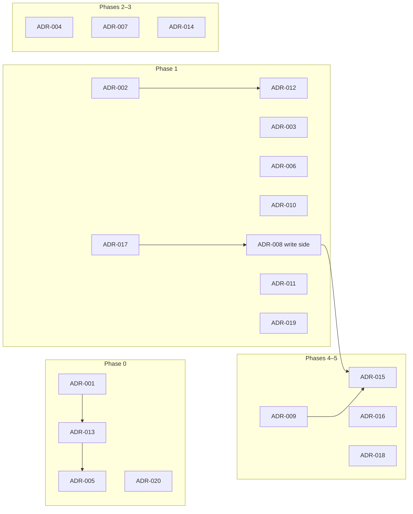

# ADR Inventory — Warden

Version 0.1 · Kaulin Mindiola · 2026-10-20  
Companion to `SDD-Warden.md` (Section 4). Location in repository: `/docs/adr/README.md`.

This inventory plans the Architecture Decision Records of Warden release 1.0. It is **not** a set of ADRs: each entry states the problem, why it deserves a record, what it affects, the design direction already reflected in the SDD, and when it will be developed. Full records are written with `adr-template.md` when the implementation reaches the decision.

## Conventions

- File name: `docs/adr/ADR-NNN-short-title.md`. IDs are immutable; a replaced decision is marked `superseded by ADR-NNN`, never deleted.
- **Inventory status:** PLANNED · READY FOR ANALYSIS · IN PROGRESS · ACCEPTED · DEFERRED · CANCELLED · SUPERSEDED. An entry becomes ACCEPTED only when its full ADR exists; the ADR metadata `status` then becomes `accepted`.
- ADR-001–011 come from SRS Appendix C; most already have an approved SRS decision (DEC-xxx), so they are READY FOR ANALYSIS: the record must capture alternatives and consequences, not reopen the decision without cause.
- ADR-012–020 are introduced by the SDD.
- **Baseline direction** = the option the SDD is currently built on. Developing the ADR may confirm it or replace it; if replaced, the affected views are updated.

## Inventory

### ADR-001 — Modular monolith instead of microservices
- **Description:** How to split Warden into deployable units while keeping boundaries enforceable.
- **Reason:** Shapes the whole structure, deployment and testing strategy; costly to reverse.
- **Affected elements:** V02, V03, V04, V20, V21; CON-005; REQ-MAINT-001, 002; DEC-052.
- **Baseline direction:** One deployable, five modules verified by Spring Modulith + ArchUnit.
- **Status:** ACCEPTED — [ADR-001](ADR-001-modular-monolith.md) · **Phase:** 0

### ADR-002 — Self-issued tokens instead of an external IdP
- **Description:** Whether Warden issues and validates its own tokens or delegates to an identity provider.
- **Reason:** Defines the trust model and the portfolio's core competence; CON-006.
- **Affected elements:** V01, V08, V11, V18; REQ-INT-003, 004; DEC-051.
- **Baseline direction:** Warden is the sole issuer and validator; no JWKS in 1.0.
- **Status:** ACCEPTED — [ADR-002](ADR-002-self-issued-tokens.md) · **Phase:** 1

### ADR-003 — Roles resolved per request, outside the JWT
- **Description:** Where workspace roles are evaluated so that changes apply on the next request.
- **Reason:** Trade-off between per-request DB cost and authorization freshness (BR-004).
- **Affected elements:** V05, V08, V11, V12; REQ-FUNC-022; REQ-PERF-003.
- **Baseline direction:** No roles in the token; uncached membership lookup per workspace request.
- **Status:** ACCEPTED — [ADR-003](ADR-003-roles-outside-the-token.md) · **Phase:** 1

### ADR-004 — 404 for non-members, 403 for insufficient role
- **Description:** Error semantics that avoid revealing workspace existence.
- **Reason:** Public contract and enumeration resistance; affects every workspace endpoint.
- **Affected elements:** V07, V08, V12; REQ-FUNC-023, 024; DEC-015.
- **Baseline direction:** As DEC-015.
- **Status:** ACCEPTED — [ADR-004](ADR-004-not-found-for-non-members.md) · **Phase:** 2

### ADR-005 — Tenant isolation with application filter and Row Level Security
- **Description:** How to guarantee isolation independently of application code correctness.
- **Reason:** G-01 is the top driver; pooled-connection leakage is the main technical risk.
- **Affected elements:** V06, V07, V12; REQ-SEC-012; REQ-POC-002; DEC-016.
- **Baseline direction:** Three layers: route membership, Hibernate filter + explicit `workspaceId`, RLS with transaction-local GUCs and `NULLIF`.
- **Status:** IN PROGRESS — [ADR-005](ADR-005-tenant-isolation-rls.md) proposed; accepted when layers 1 and 2 are verified · **Phase:** 0–2

### ADR-006 — Atomic refresh-token rotation and reuse detection
- **Description:** How to rotate refresh tokens so that concurrent use yields exactly one winner and reuse revokes the session.
- **Reason:** Normative guarantee (REQ-FUNC-013) and a classic correctness trap; RISK-008.
- **Affected elements:** V11, V14-A1, V15, V16.
- **Baseline direction:** Conditional `UPDATE … WHERE used_at IS NULL RETURNING`; conditional session revoke for a single alert.
- **Status:** ACCEPTED — [ADR-006](ADR-006-refresh-token-rotation.md) · **Phase:** 1

### ADR-007 — Revocation denylist in Redis with PostgreSQL fallback and reconciliation
- **Description:** How to reject revoked sessions immediately while tolerating Redis failures.
- **Reason:** G-02 depends on it; the SDD found a gap (revocations during an outage) not covered by REQ-REL-007.
- **Affected elements:** V09, V11, V14-A7, V17; REQ-FUNC-018; REQ-REL-007; DEC-036.
- **Baseline direction:** `sid` denylist with 630 s TTL; instance-local degraded mode on PostgreSQL; reconciliation on recovery and every 30 s.
- **Status:** READY FOR ANALYSIS · **Phase:** 3

### ADR-008 — Transactional outbox with at-least-once dispatch
- **Description:** How to publish events atomically with state changes and process them across instances.
- **Reason:** G-03 depends on it; choosing a custom outbox over Spring Modulith's event publication registry needs justification.
- **Affected elements:** V06, V10, V13, V16; REQ-REL-001, 002; DEC-007, DEC-018.
- **Baseline direction:** Own `outbox_event` table; dispatcher with `FOR UPDATE SKIP LOCKED` running the handler in the same transaction.
- **Status:** IN PROGRESS — [ADR-008](ADR-008-transactional-outbox.md) proposed; accepted when the dispatcher is verified (step 4.5) · **Phase:** 1 (write side) / 4 (dispatch)

### ADR-009 — Provider resilience: failover, circuit breaker, timeouts and backoff
- **Description:** How each delivery attempt combines two providers, breakers, time limits and retry spacing; includes how providers are simulated.
- **Reason:** Defines the observable reliability behaviour and library dependency on Boot 4.1 (RISK-005).
- **Affected elements:** V09, V13, V14-A5, V17, V21; REQ-FUNC-055–057; REQ-REL-004–006; DEC-019, 041–043.
- **Baseline direction:** In-attempt failover; Resilience4j core (no Boot starter); JDK HttpClient time limit; stored `next_attempt_at`; WireMock simulators.
- **Status:** READY FOR ANALYSIS (after POC-001) · **Phase:** 4

### ADR-010 — Virtual threads with explicitly bounded resources
- **Description:** Request and worker threading model on Java 21.
- **Reason:** Affects latency, memory (Argon2) and pinning risks.
- **Affected elements:** V16, V23; REQ-PERF-001–005.
- **Baseline direction:** Virtual threads on; semaphores for Argon2 and provider calls; Hikari as DB limiter.
- **Status:** ACCEPTED — [ADR-010](ADR-010-virtual-threads-bounded-resources.md) · **Phase:** 1

### ADR-011 — Protection of link tokens inside events and deliveries
- **Description:** How one-time tokens travel to the notification module without existing in plaintext at rest.
- **Reason:** RISK-011; security-sensitive data lifecycle.
- **Affected elements:** V06, V10, V18; REQ-SEC-005; DEC-044.
- **Baseline direction:** AES-256-GCM with key ids; stripped from the event at dispatch; nulled on SENT/CANCELLED/expiry.
- **Status:** ACCEPTED — [ADR-011](ADR-011-link-token-protection.md) · **Phase:** 1

### ADR-012 — Access-token signing algorithm and key management
- **Description:** Algorithm, key format, `kid` and rotation for access tokens.
- **Reason:** Resolves SRS TBD-03; hard to change once consumers integrate.
- **Affected elements:** V08, V18; REQ-INT-004; REQ-SEC-002; REQ-INST-002.
- **Baseline direction:** ES256, PEM key from environment, current + previous key for verification, ephemeral in `local`.
- **Status:** ACCEPTED — [ADR-012](ADR-012-access-token-signing-and-keys.md) · **Phase:** 1

### ADR-013 — Persistence access strategy, migrations and database roles
- **Description:** ORM vs SQL for critical paths, migration tool and the role model that makes RLS and append-only audit effective.
- **Reason:** Underpins isolation (non-owner role) and audit integrity (REQ-SEC-016).
- **Affected elements:** V03, V06, V07; REQ-INST-003; REQ-CM-003.
- **Baseline direction:** Spring Data JPA/Hibernate for aggregates, `JdbcClient` for conditional updates and claims; Flyway; `warden_owner` / `warden_app` roles.
- **Status:** ACCEPTED — [ADR-013](ADR-013-persistence-migrations-roles.md) · **Phase:** 0–1

### ADR-014 — Rate-limiting mechanism and local fallback
- **Description:** Algorithm, store and key design for all limits, including degradation without Redis.
- **Reason:** Security control with exact numeric thresholds; window semantics must be justified (ASM-SDD-01).
- **Affected elements:** V09, V14-A2, V17; REQ-SEC-006–009; REQ-FUNC-007, 033; REQ-REL-008; DEC-005, DEC-045.
- **Baseline direction:** Bucket4j (Redis/Lettuce proxy + local buckets), HMAC-hashed keys, `check` before verification for login failures.
- **Status:** PLANNED (after POC-001) · **Phase:** 3

### ADR-015 — Delivery scheduling and claiming with leases
- **Description:** How due deliveries are claimed, sent outside a long transaction and recovered after crashes.
- **Reason:** Distinct from the outbox: affects at-least-once behaviour towards providers and multi-instance safety.
- **Affected elements:** V13, V15, V16; REQ-REL-002; REQ-AVAIL-003.
- **Baseline direction:** `SKIP LOCKED` claim + 30 s lease, result re-checked under lock, provider idempotency key = delivery id; no ShedLock or external queue.
- **Status:** PLANNED · **Phase:** 4

### ADR-016 — Restricted placeholder renderer for templates
- **Description:** Engine used for ADMIN-editable templates.
- **Reason:** Security control (REQ-SEC-013); a general template engine would allow logic.
- **Affected elements:** V09, V14-A6; REQ-FUNC-052–054.
- **Baseline direction:** In-house single-pass `{{var}}` renderer with declared-variable validation.
- **Status:** PLANNED · **Phase:** 4

### ADR-017 — Notification data ownership and event-carried recipient data
- **Description:** Which module owns recipient e-mail, locale and preferences when `notification` may not query other modules.
- **Reason:** Resolves the tension between REQ-MAINT-002 and REQ-FUNC-049/051 (locale changeable in preferences).
- **Affected elements:** V02, V04, V10, V13; RISK-001; DEC-007, DEC-039.
- **Baseline direction:** Events carry `Recipient{userId?, email, fallbackLocale}`; `notification` owns preferences and locale overrides; membership checks via `shared` `MembershipLookup`.
- **Status:** ACCEPTED — [ADR-017](ADR-017-event-carried-recipient-data.md) · **Phase:** 1

### ADR-018 — Observability stack and trace correlation without a trace backend
- **Description:** Metrics, logging format, tracing and alerting components of the reference environment.
- **Reason:** Adds containers and dependencies; must stay proportional (CON-007, CON-009).
- **Affected elements:** V19, V21; REQ-OBS-001–008.
- **Baseline direction:** Micrometer + Prometheus + Grafana, Boot structured JSON logs, Micrometer Tracing with trace id persisted in events; no Tempo/Jaeger or Alertmanager in 1.0.
- **Status:** PLANNED · **Phase:** 5

### ADR-019 — Response-time equalization against account enumeration
- **Description:** How login, registration and password-reset responses become indistinguishable in time.
- **Reason:** REQ-SEC-010 is measured statistically; the mechanism affects latency targets.
- **Affected elements:** V11, V14-A2/A3; REQ-SEC-010; REQ-PERF-001; BR-007.
- **Baseline direction:** Dummy Argon2 hash for unknown e-mails; configurable minimum response time for register and forgot-password.
- **Status:** ACCEPTED — [ADR-019](ADR-019-response-time-equalization.md) · **Phase:** 1 (mechanism) / 3 (calibration)

### ADR-020 — Redis distribution and licence under CON-007
- **Description:** Which Redis-compatible server satisfies "Redis" (CON-004) and "open-source only" (CON-007).
- **Reason:** Redis 7.4 is not OSI-licensed; Redis 8 adds AGPLv3; Valkey is BSD. A licence-compatible choice is needed for REQ-COST-001.
- **Affected elements:** V06, V21; CON-004, CON-007; DEP-002; REQ-COST-001.
- **Baseline direction:** Redis 8.x under AGPLv3, unmodified and self-hosted; Valkey as drop-in fallback.
- **Status:** ACCEPTED — [ADR-020](ADR-020-redis-distribution-licence.md) · **Phase:** 0

## Suggested development order

ADR-005 is finalized after POC-002; ADR-009 and ADR-014 after POC-001. Decisions are developed when the implementation needs them, not strictly in this order.
