# Software Design Description
## For Warden — Workspace Identity, Access & Notification Platform

Version 0.1  
Prepared by Kaulin Mindiola  
Personal professional portfolio project  
2026-10-20

## Table of Contents
<!-- TOC -->
* [1. Introduction](#1-introduction)
  * [1.1 Document Purpose](#11-document-purpose)
  * [1.2 Subject Scope](#12-subject-scope)
  * [1.3 Definitions, Acronyms, and Abbreviations](#13-definitions-acronyms-and-abbreviations)
  * [1.4 References](#14-references)
  * [1.5 Document Overview](#15-document-overview)
* [2. Design Overview](#2-design-overview)
  * [2.1 Stakeholder Concerns](#21-stakeholder-concerns)
  * [2.2 Selected Viewpoints](#22-selected-viewpoints)
* [3. Design Views](#3-design-views)
* [4. Decisions](#4-decisions)
* [5. Appendixes](#5-appendixes)
<!-- TOC -->

## Revision History

| Name            | Date       | Reason For Changes                                                   | Version |
|-----------------|------------|----------------------------------------------------------------------|---------|
| Kaulin Mindiola | 2026-10-20 | Initial design baseline derived from SRS v0.1                        | 0.1     |

## 1. Introduction

### 1.1 Document Purpose

This SDD describes **how** Warden release 1.0 is structured to satisfy the requirements of `SRS-Warden.md` v0.1: its modules, interfaces, data, runtime interactions, failure handling and deployment. It is a **prescriptive** architecture: it contains enough detail to implement every module without re-opening the architecture, while the rationale of each significant decision is recorded progressively in ADRs (Section 4).

Audiences:
- **Developer** — implements modules, schema, contracts and workers from Section 3.
- **QA** — derives architecture fitness functions and integration tests (Appendix B) in addition to the SRS acceptance criteria.
- **Technical reviewers / recruiters** — evaluate the engineering judgement behind the design (Sections 2 and 4).
- **Operator** — runs the local environment and reads its telemetry (views V19, V21).

Per REQ-MAINT-007 this document is written in English; the SRS remains in Spanish. SRS identifiers (REQ-, BR-, DEC-, UC-, MUC-, RISK-, CON-, ASM-) are used unchanged.

### 1.2 Subject Scope

**Subject:** Warden — Workspace Identity, Access & Notification Platform, release 1.0.

Warden is a single deployable Java 21 / Spring Boot 4.1 backend that registers and authenticates users, issues short-lived access tokens and rotating refresh tokens, authorizes access per workspace with RBAC, isolates workspace data in three layers, and delivers e-mail notifications through two simulated providers with retries, failover and a dead-letter queue. The design targets the SRS goals G-01 (isolation), G-02 (containment), G-03 (reliable delivery) and G-04 (verifiable guarantees).

**Included in this SDD:** the five application modules (`iam`, `workspace`, `notes`, `notification`, `shared`), the PostgreSQL schema and Redis keyspace, the public REST contract, internal ports and event contracts, background workers, failure and degradation behaviour, security architecture, observability, the Docker Compose reference environment and the CI pipeline.

**Excluded:** everything excluded by SRS §1.2 (MFA, social login, SSO, SMS/push, admin UI, account deletion, e-mail change, workspace rename/restore, account states, global admin, Sistema-scope DLQ reprocessing API, HTML e-mail, JWKS publication, real e-mail providers), plus: design of API-consumer clients, production infrastructure and multi-region topologies (ASM-005, ASM-008).

### 1.3 Definitions, Acronyms, and Abbreviations

The SRS glossary (§1.3) applies in full. Additional terms used in this SDD:

| Term | Definition |
|------|------------|
| AEAD | Authenticated Encryption with Associated Data (here AES-256-GCM). |
| Adapter | Implementation of a port that talks to an external technology (Redis, HTTP, PostgreSQL). |
| API | Application Programming Interface - A set of definitions and protocols for building and integrating application software |
| Application module | Top-level package of the deployable with an explicit public API, verified by Spring Modulith. |
| C4 | Context–Container–Component–Code diagramming model. |
| Claim (job) | Act of a worker taking exclusive, time-bounded ownership of rows (`FOR UPDATE SKIP LOCKED` + lease). |
| Degraded mode | Instance-local operating mode used while Redis is unavailable (V17). |
| ES256 | ECDSA with P-256 and SHA-256 (RFC 7518). |
| Fitness function | Automated check that a design rule holds (architecture test, build gate). |
| GUC | PostgreSQL configuration parameter (`set_config`), used to carry the tenant context to RLS policies. |
| HMAC | Keyed-hash message authentication code (here HMAC-SHA-256). |
| Lease | Expiry timestamp on a claimed row after which another worker may reclaim it. |
| Port | Interface owned by a module that hides a technology or another module. |
| Problem type | Stable URI identifying an error kind in an RFC 9457 response. |
| SDD | Software Design Document - A document that describes the intended purpose, requirements, and nature of a software |
| Tenant context | Per-request/per-transaction value holding the effective workspace id and the caller's role. |
| View / Viewpoint | A viewpoint is a perspective (e.g. Information); a view is this system's representation from that perspective. |
| Worker | Scheduled in-process component that executes background work (outbox dispatch, deliveries, purges). |

### 1.4 References

| ID | Title | Author / Owner | Version | Date | Location | Type |
|----|-------|----------------|---------|------|----------|------|
| SREF-01 | SRS-Warden.md — Software Requirements Specification | Kaulin Mindiola | 0.1 | 2026-10-20 | Repository, `/docs` | Normative |
| SREF-02 | ADR-Inventory-Warden.md | Kaulin Mindiola | 0.1 | 2026-10-20 | Repository, `/docs/adr` | Informative |
| SREF-03 | RFC 7519 (JWT), RFC 7518 (JWA), RFC 6750 (Bearer), RFC 9457 (Problem Details) | IETF | — | — | rfc-editor.org | Normative |
| SREF-04 | OWASP ASVS 5.0, Password Storage Cheat Sheet | OWASP | TBC | — | owasp.org | Informative |
| SREF-05 | PostgreSQL documentation — Row Security Policies, `SELECT … FOR UPDATE SKIP LOCKED` | PostgreSQL GDG | 17 | — | postgresql.org/docs | Informative |
| SREF-06 | Spring Modulith reference documentation | Spring team | Compatible with Boot 4.1 (TBC, POC-001) | — | spring.io | Informative |
| SREF-07 | The C4 model | S. Brown | — | — | c4model.com | Informative |

### 1.5 Document Overview

Section 2 lists stakeholder concerns, architecture drivers, quality-attribute scenarios and the viewpoints selected to address them. Section 3 contains the design views (V01–V23) in the template format; each view references the SRS requirements it implements and the ADRs that condition it. Section 4 is the inventory of decisions to be documented as ADRs (detailed in SREF-04). Section 5 holds non-normative support: traceability, verification strategy, engineering backlog, proposed SRS updates and a configuration reference.

**Conventions**
- **[SRS]** — fixed by the SRS (requirement, constraint or approved DEC). Changing it requires an SRS change.
- **[BASELINE]** — design baseline set by this SDD and binding for implementation. Its rationale is recorded in the referenced ADR when that ADR is developed.
- **[TBC]** — baseline that depends on a POC or a measurement (POC-001, POC-002, load test).
- **[TBD]** — not yet defined; listed in Appendix C.
- Unmarked statements are direct consequences of the above.
- View IDs (`V01`…) and ADR IDs are immutable. Changes are recorded in Revision History; superseded content is marked, not deleted (aligned with REQ-CM-004).

## 2. Design Overview

### 2.1 Stakeholder Concerns

| Stakeholder | Main concerns | Addressed by |
|-------------|---------------|--------------|
| Developer (author) | Clear module boundaries, implementable contracts, limited complexity, testability with real dependencies | V02–V10, V14, V16, Appendix B |
| QA | Deterministic verification of concurrency, time, isolation and chaos scenarios | V14–V17, Appendix A/B |
| API consumer (ACT-08) | Stable contract, predictable errors, token lifecycle semantics | V08, V11 |
| Security reviewer / attacker model (ACT-11) | Tenant isolation, token theft containment, enumeration resistance, secret hygiene | V07, V11, V14, V18 |
| Operator (ACT-12) | One-command environment, health, metrics, alerts, DLQ visibility | V19, V21, V23 |
| Technical reviewer / recruiter | Engineering judgement, traceability, justified simplicity | Sections 2 and 4, V20, Appendix A |

#### 2.1.1 Architecture Drivers

| ID | Driver | Source | Priority | Design impact |
|----|--------|--------|----------|---------------|
| DRV-01 | Tenant isolation must hold even with a forgotten filter | G-01; REQ-FUNC-022–026; REQ-SEC-011, 012; REQ-MAINT-003 | Critical | Three isolation layers (V07); isolation suite as build gate |
| DRV-02 | Revoked sessions rejected on the very next request | G-02; REQ-FUNC-018; REQ-REL-007 | Critical | Per-request revocation check on Redis with PostgreSQL fallback and reconciliation (V11, V14-A7) |
| DRV-03 | Refresh rotation atomic under concurrency; reuse revokes the session | REQ-FUNC-011–013; BR-005 | Critical | Conditional `UPDATE … RETURNING` on the token row (V14-A1, V16) |
| DRV-04 | Notifications are never lost despite provider failures or crashes | G-03; REQ-REL-001–006; REQ-FUNC-055–062 | Critical | Transactional outbox, idempotent delivery creation, leased delivery worker, circuit breakers (V13) |
| DRV-05 | Responses never reveal account existence | BR-007; REQ-FUNC-002, 009, 019; REQ-SEC-006, 008, 010 | High | Identical bodies, dummy hashing, minimum response time (V14-A2/A3) |
| DRV-06 | Module boundaries verifiable, `notification` independent | CON-005; REQ-MAINT-001, 002 | High | Spring Modulith verification + ArchUnit rules (V04) |
| DRV-07 | Fail closed on authorization and storage failures | REQ-SEC-011; REQ-REL-009 | High | Explicit error mapping to 403/404/503; no cached membership (V12, V17) |
| DRV-08 | Latency and memory targets with deliberately expensive hashing | REQ-PERF-001–005; REQ-SEC-003 | High | Bounded Argon2 concurrency, sized pools (V23) |
| DRV-09 | Correctness with ≥ 2 instances | REQ-REL-002; REQ-DIST-001 | High | No local state except degraded-mode counters; DB-level exclusion (V16) |
| DRV-10 | Zero cost and one-command reproducibility | CON-007, CON-009; REQ-INST-001; REQ-BUILD-001; REQ-COST-001 | High | Compose with OSI-licensed images; Testcontainers; no external services (V21) |
| DRV-11 | Secrets never at rest in plaintext nor in telemetry | REQ-SEC-004, 005, 014; REQ-OBS-003, 005 | High | Hash-only storage, AEAD for in-flight link tokens, log redaction (V18, V19) |

#### 2.1.2 Quality Attribute Scenarios

| ID | Attribute | Stimulus | Environment | Response | Measure | Views |
|----|-----------|----------|-------------|----------|---------|-------|
| QAS-01 | Security (isolation) | User member of W and X requests a note of X through `/workspaces/W/…` | Normal | 404, no data of X read or modified | 0 leaks across 100 % of workspace endpoints | V07, V12 |
| QAS-02 | Security (containment) | Session revoked; next request with its access token | Any instance; Redis up or down | 401 | Zero tolerance (first request after revocation response) | V11, V14-A7, V17 |
| QAS-03 | Integrity | N ≥ 2 concurrent refreshes with the same token | Normal | Exactly one 200; session ends revoked | 50/50 repetitions | V14-A1, V16 |
| QAS-04 | Reliability | Primary provider returns 500 | Normal | Delivered via secondary within the same attempt | Delivery `SENT` with attempts = 1 | V13, V14-A5 |
| QAS-05 | Reliability | Process killed after commit, before event dispatch | Restart | Event dispatched and delivery created | 100 % | V13, V17 |
| QAS-06 | Performance | 50 req/s mix (10/20/70) for 10 min | Reference environment | p95 login ≤ 500 ms, refresh ≤ 100 ms, workspace ≤ 200 ms, outbox lag ≤ 5 s | Load report | V23 |
| QAS-07 | Security (enumeration) | Login / forgot-password with existing vs non-existing e-mail | Normal | Same status and body | Median difference ≤ 10 % (≥ 200 samples) | V14-A2/A3 |
| QAS-08 | Modifiability | Developer adds `/workspaces/{id}/…` endpoint without isolation case | CI | Build fails | Always | V04, Appendix B |
| QAS-09 | Availability | Redis stops | Single instance | Login, refresh and revocation keep working; rate limits enforced locally | 6th failed login → 429 | V17 |
| QAS-10 | Deployability | `docker compose up -d --wait` on a clean machine with images pulled | Local | Readiness UP | < 3 min | V21 |

### 2.2 Selected Viewpoints

| Viewpoint | Applicability | Concerns addressed | Language | Views |
|-----------|---------------|--------------------|----------|-------|
| Context | Applied | Boundaries, actors, external systems | C4 Context (Mermaid flowchart) | V01 |
| Composition | Applied | Responsibility allocation, runtime decomposition | Module table, component diagram | V02 |
| Logical | Applied | Domain abstractions and invariants | UML class diagram | V05 |
| Physical | Applied (minimal) | Host platform | Natural language | V22 |
| Structure | Applied | Internal module layout, ports/adapters, trust boundaries | Package diagram, tables | V03, V18 |
| Dependency | Applied | Coupling, allowed directions, build gates | Dependency graph | V04 |
| Information | Applied | Schema, constraints, isolation scheme, retention, Redis keyspace | ERD, SQL excerpts | V06, V07 |
| Interface | Applied | Public API, internal ports, events, telemetry | Tables, JSON, Java signatures | V08, V09, V10, V19 |
| Interaction | Applied | Request flows, pipelines, failure paths | UML sequence diagrams, tables | V11, V12, V13, V17 |
| Algorithm | Applied | Security- and integrity-critical logic | Pseudocode | V14 |
| State Dynamics | Applied | Lifecycles of deliveries, invitations, sessions, tokens | UML state machines | V15 |
| Concurrency | Applied | Thread model, locking, idempotency | Tables | V16 |
| Patterns | Applied | Applied patterns and where | Table | V20 |
| Deployment | Applied | Containers, profiles, configuration, CI/CD | Deployment diagram, pipeline flowchart | V21 |
| Resources | Applied | Memory, pools, limits | Resource allocation table | V23 |

#### 2.2.1 Context
Treats Warden as a black box: API consumers, e-mail providers, the operator and the stores it depends on. Addresses system boundaries and offered services. View: V01.

#### 2.2.2 Composition
Functional decomposition into five application modules and runtime decomposition into the HTTP pipeline plus in-process workers. View: V02.

#### 2.2.3 Logical
Domain types, aggregates and their invariants (BR-001–BR-012). View: V05.

#### 2.2.4 Physical
Only one physical node exists (developer workstation). The view records platform constraints and the open hardware definition (TBD-02). View: V22.

#### 2.2.5 Structure
Internal package layout of every module, where ports and adapters exist, and the trust boundaries of the security architecture. Views: V03, V18.

#### 2.2.6 Dependency
Allowed module dependencies, their direction and the fitness functions that enforce them. View: V04.

#### 2.2.7 Information
Relational schema, integrity constraints, retention, Redis keyspace and the tenant-isolation data access scheme. Views: V06, V07.

#### 2.2.8 Interface
Public REST contract, internal ports between modules, event contracts and telemetry interfaces. Views: V08, V09, V10, V19.

#### 2.2.9 Interaction
Happy and failure paths for authentication, workspace authorization, the notification pipeline and dependency degradation. Views: V11, V12, V13, V17.

#### 2.2.10 Algorithm
Pseudocode for refresh rotation, login, anti-enumeration timing, last-owner protection, delivery attempts, template rendering and revocation checks. View: V14.

#### 2.2.11 State Dynamics
State machines whose transitions are themselves requirements (REQ-FUNC-058) or invariants. View: V15.

#### 2.2.12 Concurrency
Concurrency is a first-class concern (REQ-FUNC-013, 039, 045; REQ-REL-002); treated separately to keep interaction views readable. View: V16.

#### 2.2.13 Patterns
Catalogue of applied patterns and their placement. View: V20.

#### 2.2.14 Deployment
Mapping of software to Compose services, ports, profiles, configuration and the delivery pipeline. View: V21.

#### 2.2.15 Resources
Memory budget, connection pools, concurrency limits and batch sizes, cross-referenced with V16 and V21. View: V23.

## 3. Design Views

---

- ID: V01-system-context
- Title: System context
- Viewpoint: Context
- Representation:

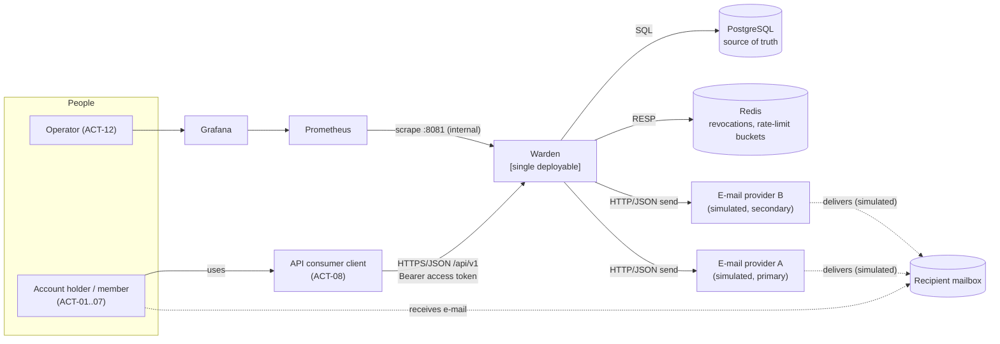

  **Boundary.** Warden owns identity, sessions, workspaces, memberships, notes and notifications. API consumers own all user interfaces; one-time links (verification, reset, invitation) point to a consumer-configured base URL with the token in the fragment (REQ-INT-009), and the consumer's client posts the token back to Warden.

  **External systems.** PostgreSQL and Redis are runtime dependencies inside the deployment boundary but outside the process. The e-mail providers are external and untrusted for availability (ACT-09). Prometheus/Grafana read telemetry only; the operator has no API role in 1.0.

  **Offered services.** UC-01 to UC-27 via the endpoints of V08; background services UC-22 and UC-27 run without an external trigger.

- More Information: SRS §2.1, §2.4. REQ-INT-001, REQ-INT-009, REQ-OBS-001. ADR-001, ADR-002.

---

- ID: V02-module-decomposition
- Title: Functional and runtime decomposition
- Viewpoint: Composition
- Representation:

  **Functional decomposition [SRS: DEC-052, BASELINE for responsibilities]**

| Module | Responsible for | Not responsible for | Provides (public API) | Uses | Owns data | Requirements |
|--------|-----------------|---------------------|-----------------------|------|-----------|--------------|
| `iam` | Accounts, e-mail verification, password policy and hashing, login, sessions, access/refresh tokens, revocation, password reset, new-device detection, authentication filter chain | Workspace authorization, sending e-mail, rendering templates | `UserDirectory` (read-only user facts), domain events | `shared` | `user_account`, `one_time_token`, `auth_session`, `refresh_token`, `known_device` | REQ-FUNC-001–021; REQ-SEC-002–004, 006–010; REQ-REL-007 |
| `workspace` | Workspaces, memberships, roles, invitations, last-OWNER protection, membership resolution for authorization | Authentication, notes, notifications | `MembershipLookup` implementation (SPI of `shared`), domain events | `iam` (`UserDirectory`), `shared` | `workspace`, `workspace_member`, `invitation` | REQ-FUNC-022–042; REQ-SEC-011 |
| `notes` | Reference resource: CRUD of notes with optimistic versioning | Membership checks (delegated to `shared` authorization) | REST endpoints only | `shared` | `note` | REQ-FUNC-043–046 |
| `notification` | Event-to-delivery fan-out, recipient settings and preferences, templates and versions, rendering, provider adapters, failover, retries, DLQ, delivery queries | Knowing users or workspaces beyond event payloads | `OutboxEventHandler` implementation, REST endpoints | `shared` only | `notification_delivery`, `notification_template`, `notification_preference`, `recipient_setting` | REQ-FUNC-047–063; REQ-SEC-005, 013, 014; REQ-REL-003–006; REQ-INT-008, 009 |
| `shared` | Technical kernel: problem details, pagination, current-user and tenant context, workspace authorization interceptor, tenant transactions, outbox (write + dispatch), rate limiting, audit log, crypto helpers, clock, telemetry conventions | Any business rule of the other modules | Ports and helpers listed in V09 | — (no domain module) | `outbox_event`, `audit_log` | REQ-INT-001–007; REQ-SEC-001, 012, 015–019; REQ-REL-001, 002, 008, 009; REQ-OBS-* |

  `shared` is a kernel, not a dumping ground: a class belongs there only if (a) at least two modules need it and (b) it contains no domain rule. This is checked in review; V04 rule R6 prevents `shared` from depending on domain modules.

  **Runtime decomposition [BASELINE]**

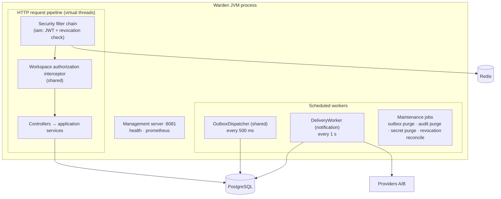

  All workers run in every instance; exclusion is achieved in the database (V16), so no leader election or external scheduler is needed.

- More Information: CON-005, REQ-MAINT-002, REQ-DIST-001. ADR-001, ADR-008, ADR-015, ADR-017.

---

- ID: V03-module-internal-structure
- Title: Internal structure of modules, ports and adapters
- Viewpoint: Structure
- Representation:

  Base package: `io.github.kaulinmindiola.warden` [BASELINE].

```text
io.github.kaulinmindiola.warden
├── WardenApplication
├── iam
│   ├── (root)          public API: UserDirectory, UserSummary, events (exposed to other modules)
│   ├── web             controllers, request/response records
│   ├── application     use-case services; owns @Transactional boundaries
│   ├── domain          entities, value objects, invariants, domain exceptions
│   └── infrastructure  Spring Data repositories, JdbcClient SQL, Redis RevocationStore, JWT adapter, Argon2 adapter
├── workspace           same layout; root exposes events; implements shared.security.MembershipLookup
├── notes               same layout; nothing exposed
├── notification        same layout; implements shared.outbox.OutboxEventHandler
│   └── infrastructure.provider   EmailProvider adapters A/B, ProviderResult classifier
└── shared              named interfaces: web, security, tenancy, outbox, ratelimit, audit, crypto, time, observability
```

  Layer rules (checked by ArchUnit, V04):
  1. `web` → `application` only; controllers never touch repositories.
  2. `application` owns transactions and orchestrates `domain` and `infrastructure`.
  3. `domain` has no dependency on `web`, `infrastructure`, Spring MVC, Redis or HTTP clients. **Pragmatic exception [BASELINE]:** domain entities carry JPA annotations; a separate persistence model would duplicate every aggregate without a requirement that benefits from it.
  4. Cross-module references are by **id** (UUID), never by JPA association.

  **Ports exist only where substitution is required** (provider failover, Redis degradation, deterministic time, testing secrets): `EmailProvider`, `RevocationStore`, `RateLimiter`, `SecretCipher`, `Clock`. Repositories are Spring Data interfaces; no extra repository abstraction is introduced.

- More Information: REQ-MAINT-001, REQ-MAINT-004 (coverage measured on `domain` + `application`). ADR-001, ADR-013.

---

- ID: V04-module-dependencies
- Title: Module dependency rules and fitness functions
- Viewpoint: Dependency
- Representation:

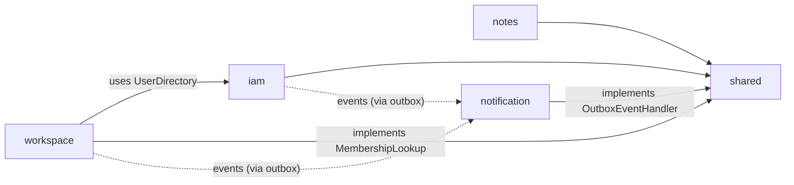

| Rule | Statement | Enforcement |
|------|-----------|-------------|
| R1 | The module graph is acyclic and only the solid edges above exist. | Spring Modulith `ApplicationModules.verify()` with `allowedDependencies` declared per module |
| R2 | Modules access other modules only through their root package or declared named interfaces. | Spring Modulith verification |
| R3 | `notification` depends on `shared` only; it never imports `iam`, `workspace` or `notes`. | ArchUnit rule (REQ-MAINT-002) |
| R4 | Information reaches `notification` only via outbox events; no synchronous call from other modules into it. | R3 + absence of public API in `notification` |
| R5 | Only `notification.application.worker` may open a system-context (cross-tenant) transaction (V07). | ArchUnit rule on `TenantTransactions.system(...)` callers |
| R6 | `shared` depends on no domain module. | Spring Modulith verification |
| R7 | Every handler under `/api/v1/workspaces/{id}/**` is registered in the isolation suite. | Build-time test enumerating `RequestMappingHandlerMapping` (REQ-MAINT-003) |

  All rules run inside `./mvnw verify` (REQ-BUILD-001); any violation fails the build.

- More Information: REQ-MAINT-001–003. ADR-001, ADR-005, ADR-017. Spring Modulith compatibility with Boot 4.1 is [TBC] by POC-001; fallback is equivalent ArchUnit rules.

---

- ID: V05-domain-model
- Title: Domain model and invariants
- Viewpoint: Logical
- Representation:

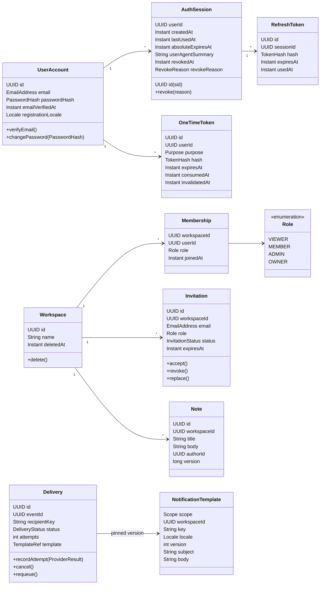

  **Value objects:** `EmailAddress` (normalized: trimmed, lower-cased with `Locale.ROOT`; REQ-FUNC-004), `PasswordHash`, `TokenHash` (SHA-256 of a 256-bit secret), `Locale` restricted to `es|en`, `Role` with total order `VIEWER < MEMBER < ADMIN < OWNER` (lives in `shared.security` because `notes` and `notification` check it).

  **Aggregate invariants**

| Aggregate | Invariant | Source |
|-----------|-----------|--------|
| UserAccount | E-mail unique after normalization; password length 12–128 and not in the common list | REQ-FUNC-003, 004 |
| AuthSession | Once `revokedAt` is set it never clears; a session is usable only if not revoked and `now < absoluteExpiresAt` | REQ-FUNC-014, 018 |
| RefreshToken | Used at most once; `expiresAt = min(issuedAt + 7 d, session.absoluteExpiresAt)` | REQ-FUNC-011, 014 |
| OneTimeToken | At most one active token per (user, purpose); issuing a new one invalidates previous ones | REQ-FUNC-007, 019; BR-006 |
| Workspace | ≥ 1 OWNER at all times; deleted is terminal | BR-001, BR-011, BR-012 |
| Membership | ADMIN cannot act on OWNER; only OWNER grants OWNER | BR-002, BR-008 |
| Invitation | Role ∈ {ADMIN, MEMBER, VIEWER}; at most one PENDING per (workspace, e-mail) | BR-008, REQ-FUNC-031, 032 |
| Note | Update requires current `version` | REQ-FUNC-045 |
| Delivery | Transitions restricted to REQ-FUNC-058; ≤ 5 attempts per cycle | REQ-FUNC-057, 058 |
| NotificationTemplate | Versions are insert-only; placeholders ⊆ declared variables of the key | REQ-FUNC-053, 054; REQ-SEC-013 |

- More Information: SRS §3.2.1. ADR-003, ADR-006.

---

- ID: V06-data-model
- Title: Persistent data model, keyspace and retention
- Viewpoint: Information
- Representation:

  **Relational schema (PostgreSQL 17 [TBC by POC-002; SRS minimum 16])**

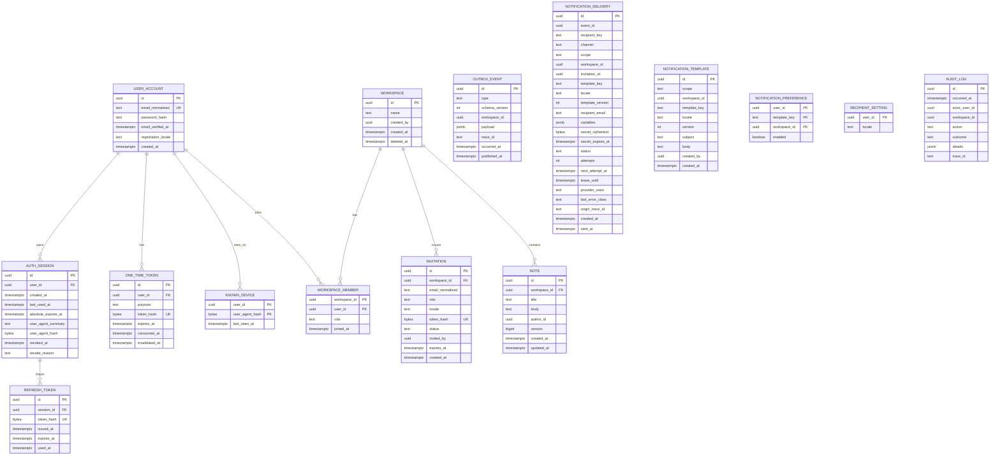

  **Table notes [BASELINE]**

| Table | Key constraints and indexes | RLS | Retention |
|-------|-----------------------------|-----|-----------|
| `user_account` | `UNIQUE(email_normalized)` | No | Indefinite (deletion out of scope) |
| `auth_session` | Index `(user_id) WHERE revoked_at IS NULL`; index `(revoked_at)` for reconciliation | No | Revoked/expired sessions kept ≥ 30 d, then purged (TBC) |
| `refresh_token` | `UNIQUE(token_hash)`; FK `session_id` | No | Purged with session |
| `one_time_token` | `UNIQUE(token_hash)`; `purpose ∈ {EMAIL_VERIFICATION, PASSWORD_RESET}`; index `(user_id, purpose) WHERE consumed_at IS NULL AND invalidated_at IS NULL` | No | Purged 7 d after expiry |
| `known_device` | PK `(user_id, user_agent_hash)` | No | Rows older than 90 d purged |
| `workspace` | `CHECK(char_length(name) BETWEEN 1 AND 100)` | No (membership-gated) | Soft delete, kept |
| `workspace_member` | PK `(workspace_id, user_id)`; `role` CHECK; index `(user_id)` | **Yes** (tenant OR own user) | Row deleted on removal/leave |
| `invitation` | Partial `UNIQUE(workspace_id, email_normalized) WHERE status = 'PENDING'`; `role <> 'OWNER'` CHECK | **Yes** | Kept |
| `note` | `CHECK` lengths (title 1–200, body ≤ 10 000); `version` for optimistic locking | **Yes** | Kept |
| `outbox_event` | Index `(occurred_at) WHERE published_at IS NULL` | No (worker only) | Published + 7 d (REQ-FUNC-063) |
| `notification_delivery` | `UNIQUE(event_id, recipient_key, channel)` (REQ-FUNC-061); index `(next_attempt_at) WHERE status IN ('PENDING','RETRYING')`; index `(workspace_id, status)` | **Yes** (Workspace scope; system context for workers) | Kept; `secret_ciphertext` nulled per REQ-SEC-005 |
| `notification_template` | `UNIQUE(scope, workspace_id, template_key, locale, version)` (NULLS NOT DISTINCT) | **Yes** for `scope='WORKSPACE'` rows | Insert-only |
| `audit_log` | Index `(occurred_at)` | No | 365 d (REQ-SEC-016) |

  **Cross-module references.** Foreign keys across module tables inside the same database are allowed for integrity (e.g. `workspace_member.user_id → user_account.id`), but Java code references other modules' rows only by id (V03 rule 4). `notification` tables carry no FK to other modules, keeping the module independently testable.

  **Database roles [BASELINE]**
  - `warden_owner` — owns the schema; used only by Flyway at startup.
  - `warden_app` — runtime role; DML on application tables; **no** `UPDATE/DELETE` on `audit_log` (purge through a `SECURITY DEFINER` function `purge_audit_log(cutoff)`); not table owner, so RLS applies; RLS tables use `FORCE ROW LEVEL SECURITY`.

  **Migrations.** Flyway, versioned SQL under `db/migration`, applied at startup (REQ-INST-003); checksums validated on every start and in CI (REQ-CM-003). Global templates (all keys, `es` and `en`, version 1) are seeded by migration.

  **Redis keyspace [BASELINE]** (Redis 8.x, AGPLv3 distribution — see ADR-020)

| Key | Value | TTL | Purpose |
|-----|-------|-----|---------|
| `warden:revoked:{sid}` | `1` | 630 s (10 min 30 s) | Revocation denylist (REQ-FUNC-018, REQ-REL-007) |
| `warden:rl:{policy}:{hmac(key)}` | Bucket4j state | Policy window | Rate-limit buckets (REQ-SEC-006–009, REQ-FUNC-007, 033) |

  E-mail addresses and IPs never appear in Redis keys; they are HMAC-SHA-256 hashed with a dedicated key (V18).

- More Information: REQ-FUNC-061, 063; REQ-SEC-004, 005, 016; REQ-INST-003; REQ-CM-003. ADR-005, ADR-008, ADR-011, ADR-013, ADR-020.

---

- ID: V07-tenant-isolation
- Title: Tenant isolation data access scheme (three layers)
- Viewpoint: Information
- Representation:

  The effective tenant is **always the workspace id in the route** (REQ-FUNC-025); workspace ids in request bodies are ignored.

| Layer | Mechanism | Failure it covers | Result on violation |
|-------|-----------|-------------------|---------------------|
| L1 — Access resolution | `WorkspaceAuthorizationInterceptor` (shared) calls `MembershipLookup.find(workspaceId, userId)` on every request to `/workspaces/{id}/**`; no caching (BR-004) | Non-member, deleted workspace, insufficient role | 404 (non-member / deleted / unknown), 403 (role) |
| L2 — Application filter | `TenantTransactions.inWorkspace(id, …)` opens the transaction, enables the Hibernate filter `tenant` on tenant-scoped entities and every repository method takes `workspaceId` explicitly | Query that loads a resource by id from another workspace | Empty result → 404 |
| L3 — Row Level Security | Same transaction executes `set_config('app.workspace_id', :id, true)` and `set_config('app.user_id', :uid, true)`; PostgreSQL policies filter rows | A forgotten application filter or native query | No rows returned / modified |

  **Policy shape (excerpt)**

```sql
ALTER TABLE note ENABLE ROW LEVEL SECURITY;
ALTER TABLE note FORCE ROW LEVEL SECURITY;

CREATE POLICY note_tenant ON note
  USING      (workspace_id = NULLIF(current_setting('app.workspace_id', true), '')::uuid)
  WITH CHECK (workspace_id = NULLIF(current_setting('app.workspace_id', true), '')::uuid);

-- workspace_member: visible for the current tenant OR for the caller's own rows
-- (needed by GET /workspaces and by MembershipLookup before a tenant is set)
CREATE POLICY member_visibility ON workspace_member
  USING (workspace_id = NULLIF(current_setting('app.workspace_id', true), '')::uuid
         OR user_id   = NULLIF(current_setting('app.user_id', true), '')::uuid);
```

  `NULLIF(…, '')` is required: after a transaction-local `set_config` ends, the parameter reverts to an empty string on that pooled connection, and `''::uuid` would raise an error instead of returning no rows. `is_local = true` guarantees the value never leaks to the next transaction on the same pooled connection — this is exactly what POC-002 must demonstrate [TBC].

  **System context.** Background workers need cross-tenant access to `notification_delivery` and `notification_template`. They use `TenantTransactions.system(…)`, which sets `app.system_context = 'on'`; the notification policies add `OR current_setting('app.system_context', true) = 'on'`. Rule R5 (V04) restricts its callers to the worker package.

  **Verification.** (1) Isolation suite: for every workspace endpoint, cases "non-member", "member of other workspace", "random UUID" (REQ-FUNC-023, 025); registry enforced by R7. (2) RLS tests with raw JDBC and no application filter (REQ-SEC-012). (3) POC-002: 1 000 transactions alternating two tenants over a pool of 2 connections.

- More Information: G-01, DRV-01, MUC-01, RISK-009. REQ-FUNC-022–026; REQ-SEC-011, 012; REQ-MAINT-003; REQ-POC-002. ADR-004, ADR-005.

---

- ID: V08-public-api-contract
- Title: Public REST API contract
- Viewpoint: Interface
- Representation:

  **Conventions [SRS + BASELINE]**
  - Base path `/api/v1` (REQ-INT-001, DEC-046); JSON UTF-8; ids are UUIDv7 rendered as strings (REQ-INT-007; v7 for index locality, not exposed semantically); timestamps ISO-8601 UTC with `Z`.
  - Resource fields use `camelCase`. The token response uses the OAuth-style `snake_case` field names mandated by REQ-INT-003.
  - Pagination envelope: `{ "items": [...], "page": 0, "size": 20, "totalElements": 0, "totalPages": 0 }`; `size` ∈ [1, 100] (REQ-INT-006).
  - Access token only in `Authorization: Bearer`; refresh and one-time tokens only in JSON bodies (REQ-INT-002). Request bodies > 64 KiB → 413 (REQ-SEC-018).
  - Clients must not retry a refresh with the same token after a timeout (RISK-008).

  **Problem types** — base `urn:warden:problem:` (stable, documented in the repository; REQ-INT-005). Every problem includes `type, title, status, detail, instance, traceId`; validation problems add `errors: [{field, reason}]`.

| Slug | Status | Used when |
|------|--------|-----------|
| `validation-error` | 400 | Bean validation / domain format errors (password policy, lengths, locale, `size > 100`) |
| `malformed-request` | 400 | Unparseable JSON, refresh token sent in `Authorization` header |
| `invalid-one-time-token` | 400 | Verification / reset / invitation token unknown, used, expired, revoked or replaced (identical body) |
| `preference-not-optional` | 400 | Attempt to disable SEGURIDAD/TRANSACCIONAL notification |
| `unauthenticated` | 401 | Missing, malformed, expired, forged or revoked access token |
| `invalid-credentials` | 401 | Unknown e-mail or wrong password (identical body) |
| `invalid-refresh-token` | 401 | Refresh token unknown, expired, reused or of a revoked session (identical body) |
| `insufficient-role` | 403 | Member with role below the endpoint minimum, or ADMIN acting on OWNER |
| `email-not-verified` | 403 | Create workspace / accept invitation without verified e-mail |
| `invitation-email-mismatch` | 403 | Verified e-mail differs from invited e-mail (token not consumed) |
| `not-found` | 404 | Unknown resource, non-member workspace, deleted workspace, foreign session |
| `already-member` | 409 | Invite/accept for an existing member |
| `email-already-verified` | 409 | Resend verification when already verified |
| `last-owner` | 409 | Operation would leave the workspace without OWNER |
| `version-conflict` | 409 | Stale note version |
| `invitation-not-pending` | 409 | Revoke an accepted invitation; reprocess delivery of a non-pending invitation |
| `delivery-not-retryable` | 409 | Reprocess a delivery not in `DEAD` |
| `payload-too-large` | 413 | Body > 64 KiB |
| `rate-limited` | 429 | Any rate limit; includes `Retry-After` |
| `internal-error` | 500 | Unexpected error; generic `detail` (REQ-SEC-017) |
| `service-unavailable` | 503 | PostgreSQL down, or Redis and PostgreSQL down; includes `Retry-After` |

  **Endpoints** (min. role per REQ-FUNC-023/024; see SRS Appendix E)

| Method & path | Access | Request body | Success |
|---------------|--------|--------------|---------|
| `POST /auth/register` | Public | `{email, password, locale?}` | 202, empty body |
| `POST /auth/email/verify` | Public | `{token}` | 204 |
| `POST /auth/email/verify/resend` | Authenticated | — | 202 |
| `POST /auth/login` | Public | `{email, password}` | 200 `TokenResponse` |
| `POST /auth/refresh` | Public | `{refresh_token}` | 200 `TokenResponse` |
| `POST /auth/logout` | Authenticated | — | 204 |
| `GET /auth/sessions` | Authenticated | — | 200 page of `{id, createdAt, lastUsedAt, userAgent, current}` |
| `DELETE /auth/sessions/{sessionId}` | Authenticated | — | 204 |
| `POST /auth/password/forgot` | Public | `{email}` | 202, empty body |
| `POST /auth/password/reset` | Public | `{token, newPassword}` | 204 |
| `POST /workspaces` | Authenticated + verified | `{name}` | 201 `{id, name, role, createdAt}` + `Location` |
| `GET /workspaces` | Authenticated | — | 200 page of `{id, name, role, createdAt}` |
| `DELETE /workspaces/{id}` | OWNER | — | 204 |
| `POST /workspaces/{id}/leave` | VIEWER | — | 204 |
| `GET /workspaces/{id}/members` | VIEWER | — | 200 page of `{userId, email, role, joinedAt}` |
| `PUT /workspaces/{id}/members/{userId}/role` | ADMIN* | `{role}` | 200 member |
| `DELETE /workspaces/{id}/members/{userId}` | ADMIN* | — | 204 |
| `POST /workspaces/{id}/invitations` | ADMIN | `{email, role, locale?}` | 201 `{id, email, role, expiresAt}` |
| `GET /workspaces/{id}/invitations` | ADMIN | — | 200 page (no token) |
| `DELETE /workspaces/{id}/invitations/{invitationId}` | ADMIN | — | 204 |
| `POST /invitations/accept` | Authenticated + verified | `{token}` | 200 `{workspaceId, role}` |
| `GET /workspaces/{id}/notes` | VIEWER | — | 200 page of `{id, title, authorId, createdAt, updatedAt, version}` |
| `POST /workspaces/{id}/notes` | MEMBER | `{title, body}` | 201 note |
| `GET /workspaces/{id}/notes/{noteId}` | VIEWER | — | 200 `{id, title, body, authorId, createdAt, updatedAt, version}` |
| `PUT /workspaces/{id}/notes/{noteId}` | MEMBER | `{title, body, version}` | 200 note |
| `DELETE /workspaces/{id}/notes/{noteId}` | MEMBER | — | 204 |
| `GET /workspaces/{id}/notification-templates/{key}?locale=` | ADMIN | — | 200 `{key, locale, origin: WORKSPACE\|GLOBAL, version, subject, body, variables[]}` |
| `PUT /workspaces/{id}/notification-templates/{key}` | ADMIN | `{locale, subject, body}` | 200 template (new version) |
| `GET /workspaces/{id}/notifications/deliveries?status=` | ADMIN | — | 200 page of delivery views (no content) |
| `POST /workspaces/{id}/notifications/deliveries/{deliveryId}/retry` | ADMIN | — | 202 `{id, status: "PENDING"}` |
| `GET /me/notification-preferences` | Authenticated | — | 200 `{locale, preferences: [{key, workspaceId?, enabled}]}` |
| `PUT /me/notification-preferences` | Authenticated | `{locale?, preferences?: [{key, workspaceId?, enabled}]}` | 200 same shape |

  *ADMIN with the restrictions of BR-002 and BR-008.

  **TokenResponse (REQ-INT-003)**

```json
{
  "access_token": "eyJhbGciOiJFUzI1NiIsImtpZCI6Ik…",
  "token_type": "Bearer",
  "expires_in": 600,
  "refresh_token": "wrt_4q8m…",
  "refresh_expires_in": 604800
}
```

  `refresh_expires_in` = seconds until `min(now + 7 d, session absolute expiry)`. Refresh tokens carry the prefix `wrt_` and one-time tokens `wot_` so that secret scanners can recognise leaks [BASELINE].

  **Access token claims (REQ-INT-004):** header `{alg: ES256, kid}`; claims `iss` (`warden`, configurable), `sub` (user id), `sid`, `jti`, `iat`, `exp = iat + 600`. No roles, e-mail or workspace data.

  **API documentation.** An OpenAPI 3.1 document generated at build time (springdoc, [TBC] POC-001) plus the problem-type catalogue are published in the repository; the request collection required by REQ-MAINT-008 is a Bruno collection under `/docs/api`.

- More Information: REQ-INT-001–007; REQ-COMP-001, 002; REQ-SEC-001, 014, 017, 018; REQ-CM-001. ADR-002, ADR-004, ADR-012.

---

- ID: V09-internal-interfaces
- Title: Internal ports and module APIs
- Viewpoint: Interface
- Representation:

| Port | Owner (defines) | Implemented by | Contract (Java-style) | Notes |
|------|-----------------|----------------|-----------------------|-------|
| `UserDirectory` | `iam` (public) | `iam` | `Optional<UserSummary> findById(UUID)`; `Map<UUID,UserSummary> findByIds(Set<UUID>)`; `UserSummary(UUID id, String email, String locale, boolean emailVerified)` | Read-only; used by `workspace` for member listing, invitation acceptance, workspace creation, and event recipient data |
| `MembershipLookup` | `shared.security` (SPI) | `workspace` | `Optional<WorkspaceAccess> find(UUID workspaceId, UUID userId)`; `List<UUID> workspaceIdsOf(UUID userId)` | Returns empty for deleted workspaces (BR-012); throws `MembershipUnavailableException` on storage failure → 503 (fail closed) |
| `CurrentUser` | `shared.security` | `iam` (populates) | `record CurrentUser(UUID userId, UUID sessionId)` | Resolved from the validated JWT |
| `@RequiresWorkspaceRole` | `shared.security` | Interceptor | `@RequiresWorkspaceRole(Role.MEMBER)` on handler methods | Missing annotation on a workspace route fails the R7 test |
| `TenantTransactions` | `shared.tenancy` | `shared` | `<T> T inWorkspace(UUID, Supplier<T>)`; `<T> T forUser(UUID, Supplier<T>)`; `<T> T system(Supplier<T>)` | Sets GUCs + Hibernate filter (V07) |
| `OutboxPublisher` | `shared.outbox` | `shared` | `void publish(DomainEvent)` — propagation `MANDATORY` | Same transaction as the state change (REQ-REL-001) |
| `OutboxEventHandler` | `shared.outbox` (SPI) | `notification` | `Set<String> handledTypes()`; `void handle(OutboxRecord)` — invoked inside the dispatcher's transaction | At-least-once; must be idempotent |
| `RateLimiter` | `shared.ratelimit` | Redis adapter + local fallback | `Decision check(Policy, String key)`; `Decision consume(Policy, String key)`; `Decision(boolean allowed, Duration retryAfter)` | `check` does not consume (login failure semantics) |
| `RevocationStore` | `iam` (internal) | Redis adapter | `void markRevoked(UUID sid, Duration ttl)`; `RevocationState state(UUID sid)` → `REVOKED | NOT_REVOKED | UNKNOWN` | `UNKNOWN` triggers PostgreSQL fallback (V14-A7) |
| `AuditLog` | `shared.audit` | `shared` | `void record(AuditEntry)` | Successful actions: caller's transaction; failures (e.g. failed login): `REQUIRES_NEW` |
| `SecretCipher` | `shared.crypto` | AES-256-GCM adapter | `SealedSecret seal(String, Instant expiresAt)`; `String open(SealedSecret)` | Ciphertext prefixed with key id for rotation |
| `TokenHasher`, `KeyedHasher` | `shared.crypto` | JDK | `byte[] sha256(String)`; `String hmac(String)` | SHA-256 for 256-bit tokens; HMAC for low-entropy values (e-mail, IP) |
| `Clock` | `shared.time` | `java.time.Clock` bean | — | Replaced by a controllable clock in time-based tests |
| `EmailProvider` | `notification` (internal) | `HttpEmailProvider` ×2 (A, B) | `ProviderResult send(EmailMessage)`; `ProviderResult ∈ {ACCEPTED, PERMANENT_REJECTION, TRANSIENT_FAILURE}` | Primary/secondary chosen by configuration (REQ-INT-008) |
| `TemplateRenderer` | `notification` (internal) | `PlaceholderRenderer` | `RenderedMessage render(Template, Map<String,String>)`; `void validate(String key, String subject, String body)` | No logic, literal substitution (V14-A6) |

  **Provider wire contract (simulated providers) [BASELINE]**
  `POST {baseUrl}/v1/messages` with `{ "idempotencyKey": "<deliveryId>", "to": "...", "subject": "...", "text": "..." }`.

| Provider response | Classification |
|-------------------|----------------|
| `202` | `ACCEPTED` |
| `422` with `{"code": "invalid_recipient"}` | `PERMANENT_REJECTION` |
| `429`, `5xx`, any other `4xx`, connection error, no response within 5 s | `TRANSIENT_FAILURE` |

  The idempotency key equals the delivery id, so a provider can de-duplicate a resend after an ambiguous timeout or a lease expiry (V16).

- More Information: REQ-INT-008; REQ-MAINT-002; REQ-SEC-005, 015. ADR-007, ADR-009, ADR-014, ADR-016, ADR-017.

---

- ID: V10-event-contracts
- Title: Domain event contracts
- Viewpoint: Interface
- Representation:

  **Envelope (stored in `outbox_event`) — REQ-MAINT-005**

| Field | Type | Description |
|-------|------|-------------|
| `eventId` | UUID | Idempotency key for consumers |
| `type` | string | e.g. `workspace.MemberInvited` |
| `schemaVersion` | int | Starts at 1; incompatible change ⇒ +1 |
| `occurredAt` | timestamp | Business time from `Clock` |
| `workspaceId` | UUID? | Null for Sistema scope |
| `traceId` | string | Trace of the originating request (REQ-OBS-006) |
| `payload` | JSON | Type-specific, below |

  `Recipient = { userId?: UUID, email: string, fallbackLocale: "es"|"en" }`. `Secret = { ciphertext: base64, keyId: string, expiresAt: timestamp }` (AES-256-GCM, REQ-SEC-005).

| Type | Payload fields |
|------|----------------|
| `iam.EmailVerificationRequested` | `recipient`, `secret`, `expiresAt` |
| `iam.PasswordResetRequested` | `recipient`, `secret`, `expiresAt` |
| `iam.RegistrationAttemptedOnExistingAccount` | `recipient`, `occurredAt` |
| `iam.PasswordChanged` | `recipient`, `occurredAt` |
| `iam.RefreshTokenReuseDetected` | `recipient`, `sessionId`, `occurredAt` |
| `iam.NewDeviceLoginDetected` | `recipient`, `userAgentSummary`, `occurredAt` |
| `workspace.MemberInvited` | `invitationId`, `workspaceName`, `role`, `recipient` (no `userId`), `secret`, `expiresAt` |
| `workspace.MemberRoleChanged` | `workspaceName`, `affected: Recipient`, `owners: Recipient[]` (at event time), `previousRole`, `newRole`, `changedBy` |
| `workspace.InvitationRevoked` | `invitationId`, `reason: REVOKED|REPLACED` |
| `workspace.InvitationAccepted` | `invitationId` |
| `workspace.WorkspaceDeleted` | — (uses `workspaceId`) |

  **Rules.** Events carry all data the consumer needs (DEC-007). The dispatcher strips `payload.secret` from `outbox_event` in the same transaction in which deliveries are created, so the encrypted token persists only in `notification_delivery` (REQ-SEC-005). Consumers accept versions N and N−1 through per-type upcasters. Event types without a template (the last three) are consumed for cancellation and reprocessing rules (REQ-FUNC-060, 062).

- More Information: SRS Appendix B; REQ-FUNC-047, 061; REQ-MAINT-005. ADR-008, ADR-011, ADR-017.

---

- ID: V11-authentication-interactions
- Title: Login, authenticated request and refresh rotation
- Viewpoint: Interaction
- Representation:

  **(a) Login (UC-03)**

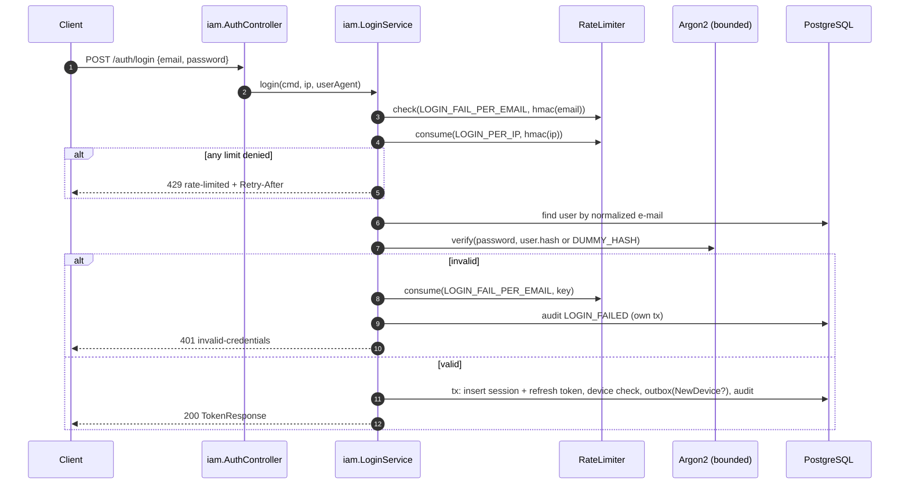

  **(b) Authenticated request** — Spring Security resource server, stateless.

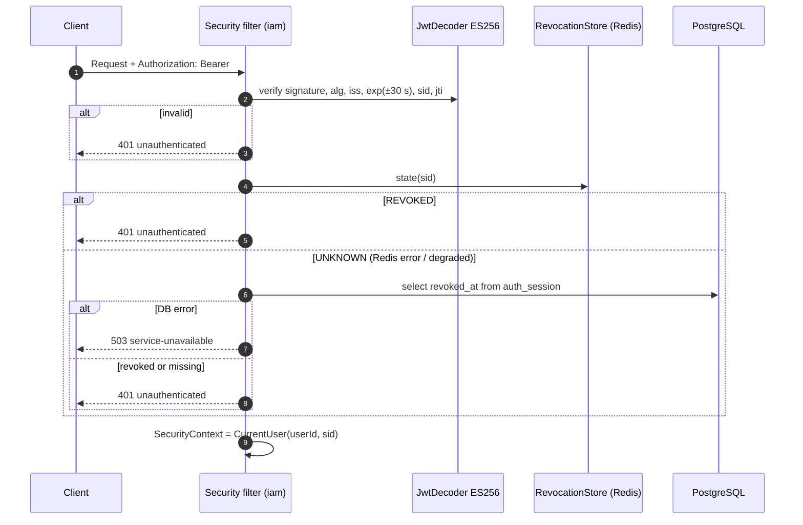

  **(c) Refresh rotation and reuse (UC-04)** — atomic conditional update; detail in V14-A1.

```mermaid
sequenceDiagram
    autonumber
    participant C as Client
    participant S as iam.RefreshService
    participant DB as PostgreSQL
    participant R as RevocationStore
    C->>S: POST /auth/refresh {refresh_token}
    S->>DB: UPDATE refresh_token SET used_at=now WHERE hash=? AND used_at IS NULL AND expires_at>now RETURNING
    alt 1 row (winner)
        S->>DB: check session active; insert new refresh token; update last_used_at
        S-->>C: 200 TokenResponse (same sid)
    else 0 rows and token already used, session active
        S->>DB: UPDATE auth_session SET revoked_at, reason=REUSE WHERE revoked_at IS NULL RETURNING
        S->>DB: outbox RefreshTokenReuseDetected + audit (only if row returned)
        S->>R: after commit: markRevoked(sid, 630 s)
        S-->>C: 401 invalid-refresh-token
    else unknown / expired / session expired or revoked
        S-->>C: 401 invalid-refresh-token (no alert)
    end
```

  **Logout / terminate session / password reset** follow the same revocation path: update `auth_session` in PostgreSQL, commit, then `markRevoked` in Redis before responding. A revocation is "confirmed" (REQ-FUNC-018) when the response is sent; see V14-A7 for the behaviour when the Redis write fails.

  **`lastUsedAt`** is updated on login and refresh only — not on every authenticated request — to keep the request path read-only on PostgreSQL. [BASELINE; interpretation of REQ-FUNC-016 recorded in Appendix D.]

- More Information: REQ-FUNC-008–018, 020; REQ-INT-002–004; REQ-SEC-002, 006, 007, 009; REQ-REL-007. MUC-02, MUC-03. ADR-002, ADR-003, ADR-006, ADR-007, ADR-012.

---

- ID: V12-workspace-request-interaction
- Title: Workspace-scoped request: authorization and tenant transaction
- Viewpoint: Interaction
- Representation:

```mermaid
sequenceDiagram
    autonumber
    participant C as Client
    participant F as Security filter
    participant I as WorkspaceAuthorizationInterceptor (shared)
    participant M as MembershipLookup (workspace)
    participant H as NotesController
    participant A as NoteService
    participant T as TenantTransactions
    participant DB as PostgreSQL (RLS)
    C->>F: PUT /workspaces/{W}/notes/{N}
    F->>I: CurrentUser
    I->>M: find(W, userId)
    alt empty (non-member / deleted / unknown)
        I-->>C: 404 not-found
    else storage error
        I-->>C: 503 service-unavailable
    else role < @RequiresWorkspaceRole
        I-->>C: 403 insufficient-role
    end
    I->>H: WorkspaceAccess(W, role) in request scope
    H->>A: update(W, N, cmd)
    A->>T: inWorkspace(W)
    T->>DB: BEGIN; set_config(app.workspace_id=W, local); enable filter
    A->>DB: UPDATE note … WHERE id=N AND workspace_id=W AND version=v
    alt 0 rows: note absent in W
        A-->>C: 404 not-found
    else 0 rows: version mismatch
        A-->>C: 409 version-conflict
    end
    T->>DB: COMMIT
    A-->>C: 200 note
```

  **Fail-closed rules (REQ-SEC-011).** Unknown role value in the database → mapped to "no access" (404) and logged as error; exception in `MembershipLookup` → 503; interceptor executed for every `/workspaces/{id}/**` route including those owned by `notification`. Membership is never cached, so role changes and removals apply on the next request (BR-004, REQ-FUNC-022).

  **Member-management operations** (role change, removal, leave) additionally lock the workspace row (V14-A4); invitation acceptance runs under `TenantTransactions.forUser` because the caller is not yet a member.

- More Information: REQ-FUNC-022–025, 037–046; REQ-SEC-011, 012; REQ-PERF-003. ADR-004, ADR-005.

---

- ID: V13-notification-pipeline
- Title: Notification pipeline: outbox, fan-out, delivery, failover
- Viewpoint: Interaction
- Representation:

```mermaid
sequenceDiagram
    autonumber
    participant D as Domain service (iam/workspace)
    participant DB as PostgreSQL
    participant OD as OutboxDispatcher (shared)
    participant NH as NotificationEventHandler
    participant DW as DeliveryWorker
    participant PA as Provider A (primary)
    participant PB as Provider B (secondary)
    D->>DB: tx: state change + INSERT outbox_event
    loop every 500 ms
        OD->>DB: tx: SELECT unpublished … FOR UPDATE SKIP LOCKED LIMIT 100
        OD->>NH: handle(record)
        NH->>DB: resolve recipients, preferences, locale, template version
        NH->>DB: INSERT notification_delivery … ON CONFLICT DO NOTHING
        NH->>DB: apply cancellations (InvitationRevoked / WorkspaceDeleted)
        OD->>DB: published_at=now, strip secret; COMMIT
    end
    loop every 1 s
        DW->>DB: claim due deliveries (SKIP LOCKED + lease 30 s); COMMIT
        DW->>DW: render pinned template + decrypt secret
        alt primary breaker closed
            DW->>PA: send (timeout 5 s)
        end
        alt primary TRANSIENT or breaker open
            DW->>PB: send (timeout 5 s)
        end
        DW->>DB: tx: record attempt → SENT | RETRYING(next_attempt_at) | DEAD
    end
```

  **Fan-out rules (NotificationEventHandler)** — per SRS Appendix B:
  1. Recipients from the payload; `MemberRoleChanged` recipients = affected ∪ owners, de-duplicated by `recipientKey` (REQ-FUNC-040). `recipientKey = userId` when present, else `"email:" + hmac(email)`.
  2. Category check: `INFORMATIVA` keys honour `notification_preference` (default enabled, REQ-FUNC-050); `SEGURIDAD` and `TRANSACCIONAL` always created (REQ-FUNC-048).
  3. Locale: `recipient_setting.locale` if the user has one, else `fallbackLocale` from the event, else `es` (REQ-FUNC-051).
  4. Template resolution (REQ-FUNC-052): workspace custom (key, locale) → global (key, locale) → global (key, `es`); the resolved **version is pinned** on the delivery at creation (REQ-FUNC-053), rendering happens at send time.
  5. Idempotency: `UNIQUE(event_id, recipient_key, channel)` with `ON CONFLICT DO NOTHING` (REQ-FUNC-061). Because the dispatcher and the handler share one local transaction, a crash re-dispatches the whole event and the constraint absorbs duplicates.
  6. Cancellation: `InvitationRevoked` (REVOKED/REPLACED) cancels unsent deliveries with that `invitation_id`; `WorkspaceDeleted` cancels all unsent deliveries of the workspace; secrets are nulled (REQ-FUNC-030, 032, 035, 062).

  **Failure paths**

| Situation | Behaviour | Requirement |
|-----------|-----------|-------------|
| Primary 5xx/timeout | Secondary in the same attempt | REQ-FUNC-055 |
| Primary breaker open | Primary not called | REQ-FUNC-055, REQ-REL-004 |
| `PERMANENT_REJECTION` | `DEAD`, no failover, cause stored | REQ-FUNC-056 |
| Both transient | `RETRYING` with backoff; 5th failure → `DEAD` | REQ-FUNC-057, REQ-REL-006 |
| Both providers down for long | Business operations unaffected; deliveries accumulate; DLQ metric grows | REQ-REL-003, REQ-OBS-002 |
| Worker crash during send | Lease expires after 30 s, another worker re-claims; provider receives same idempotency key | REQ-AVAIL-003 |
| Delivery cancelled while in flight | Result recording sees `CANCELLED` and keeps it; the message may still have been sent (accepted race, DRISK-04) | REQ-FUNC-062 |

  **Reprocessing (REQ-FUNC-060).** `retry` endpoint: workspace scope only; requires `DEAD`; for `workspace.invitation`, requires the invitation still `PENDING` and unexpired — checked against a local projection: the handler records `InvitationRevoked/Accepted` effects on deliveries, and expiry is known from `secret_expires_at`; transition `DEAD → PENDING`, `attempts = 0`, `next_attempt_at = now`.

- More Information: G-03; REQ-FUNC-047–062; REQ-REL-001–006; REQ-PERF-004. ADR-008, ADR-009, ADR-015, ADR-016, ADR-017.

---

- ID: V14-critical-algorithms
- Title: Security- and integrity-critical algorithms
- Viewpoint: Algorithm
- Representation:

  **A1 — Refresh rotation with reuse detection** (`iam.application.RefreshService`)

```text
refresh(presented, ip):
  require rateLimiter.consume(REFRESH_PER_IP, hmac(ip))            else 429
  h := sha256(presented)
  tx (READ COMMITTED):
    row := UPDATE refresh_token SET used_at = now
           WHERE token_hash = h AND used_at IS NULL AND expires_at > now
           RETURNING session_id
    -- concurrent callers block on the row lock; after the winner commits,
    -- PostgreSQL re-evaluates the WHERE clause and returns 0 rows for them
    if row is null:
      t := SELECT session_id, used_at FROM refresh_token WHERE token_hash = h
      s := t ? SELECT * FROM auth_session WHERE id = t.session_id : null
      if t != null AND t.used_at != null AND s.isActive(now):
        revoked := UPDATE auth_session SET revoked_at = now, revoke_reason = 'REUSE'
                   WHERE id = s.id AND revoked_at IS NULL RETURNING id
        if revoked: outbox.publish(RefreshTokenReuseDetected); audit(REUSE_DETECTED)
        afterCommit: revocationStore.markRevoked(s.id, 630 s)
      return 401 invalid-refresh-token                              -- identical for all cases
    s := SELECT * FROM auth_session WHERE id = row.session_id
    if not s.isActive(now): rollback; return 401 invalid-refresh-token
    new := random(32 bytes); INSERT refresh_token(session_id, sha256(new),
           expires_at = min(now + 7 d, s.absolute_expires_at))
    UPDATE auth_session SET last_used_at = now WHERE id = s.id
  return TokenResponse(jwt(sub, sid = s.id), "wrt_" + base64url(new))
```

  Guarantees: exactly one winner (REQ-FUNC-013); a single alert per session thanks to the conditional revoke (REQ-FUNC-012); expiry never raises an alert (REQ-FUNC-014).

  **A2 — Login with enumeration resistance** (`iam.application.LoginService`)

```text
login(email, password, ip, ua):
  key := hmac(normalize(email))
  if rateLimiter.check(LOGIN_FAIL_PER_EMAIL, key).denied: return 429   -- even with the right password
  if rateLimiter.consume(LOGIN_PER_IP, hmac(ip)).denied:  return 429
  user := users.findByEmail(normalize(email))
  hash := user?.passwordHash ?: DUMMY_HASH          -- computed at startup with current parameters
  ok   := argon2Limiter.call(() -> encoder.matches(password, hash)) AND user != null
  if not ok:
    rateLimiter.consume(LOGIN_FAIL_PER_EMAIL, key); audit(LOGIN_FAILED, REQUIRES_NEW)
    return 401 invalid-credentials
  tx:
    if encoder.upgradeEncoding(hash): user.passwordHash := argon2Limiter.call(encode(password))
    s := new AuthSession(user, now, absolute = now + 30 d, uaSummary(ua), sha256(ua))
    issue refresh token (as A1)
    first := NOT EXISTS known_device WHERE user_id = user.id
    seen  := EXISTS known_device WHERE user_id = user.id AND ua_hash = sha256(ua) AND last_seen_at > now - 90 d
    UPSERT known_device(user.id, sha256(ua), now)
    if not first AND not seen: outbox.publish(NewDeviceLoginDetected)
    audit(LOGIN_SUCCEEDED)
  return TokenResponse
```

  The per-email window uses a Bucket4j bucket of capacity 5 refilled in full every 15 min (interval refill) [BASELINE; window semantics TBC in ADR-014]. Unknown e-mails consume the same bucket (REQ-SEC-006).

  **A3 — Minimum response time for register and forgot-password**

```text
withResponseFloor(floor = 250 ms [configurable, TBC by REQ-SEC-010 analysis], action):
  start := monotonicNow()
  result := action()                      -- both branches also hash/generate a token
  sleep(max(0, floor - (monotonicNow() - start)))   -- cheap on virtual threads
  return result
```

  Applied to `POST /auth/password/forgot` (REQ-SEC-010) and `POST /auth/register` (BR-007, same rationale; registration always hashes the password, even when the e-mail exists). The floor must exceed the slow path's p99; it is calibrated with the REQ-SEC-010 analysis.

  **A4 — Last-OWNER guard and role authority** (`workspace.application.MembershipService`)

```text
changeRole | removeMember | leave (W, target, actor, newRole?):
  tx inWorkspace(W):
    ws := SELECT * FROM workspace WHERE id = W AND deleted_at IS NULL FOR UPDATE   -- serializes per workspace
    if ws is null: 404
    t := membership(W, target) else 404
    if actor.role = ADMIN AND (t.role = OWNER OR newRole = OWNER): 403   -- BR-002, BR-008
    if t.role = OWNER AND (removal OR leave OR newRole != OWNER):
      if COUNT(role = OWNER) <= 1: 409 last-owner                          -- BR-001, BR-011
    apply; outbox.publish(MemberRoleChanged | …); audit
```

  **A5 — Delivery attempt** (`notification.application.worker.DeliveryWorker`)

```text
claim := UPDATE notification_delivery SET lease_until = now + 30 s
         WHERE id IN (SELECT id FROM notification_delivery
                      WHERE status IN ('PENDING','RETRYING') AND next_attempt_at <= now
                        AND (lease_until IS NULL OR lease_until < now)
                      ORDER BY next_attempt_at LIMIT :batch FOR UPDATE SKIP LOCKED)
         RETURNING *                                          -- committed immediately
for d in claim (virtual threads, bounded by delivery.concurrency):
  msg := render(template(d.key, d.locale, d.version), d.variables ∪ link(open(d.secret)))
  (result, provider) := sendWithFailover(msg, idempotencyKey = d.id)
  tx system():
    cur := SELECT … WHERE id = d.id FOR UPDATE
    if cur.status = CANCELLED: return
    cur.attempts += 1; cur.provider_used := provider; cur.lease_until := null
    match result:
      ACCEPTED            -> SENT, sent_at = now, secret := null
      PERMANENT_REJECTION -> DEAD, last_error_class = 'PERMANENT_REJECTION'
      TRANSIENT_FAILURE   -> if cur.attempts >= 5: DEAD
                             else RETRYING, next_attempt_at = now + backoff(cur.attempts)

sendWithFailover(msg):
  for p in [primary, secondary]:
    if breaker(p).isOpen: continue
    r := timeLimit(5 s, p.send(msg)); breaker(p).record(r == TRANSIENT_FAILURE)
    if r != TRANSIENT_FAILURE: return (r, p)
  return (TRANSIENT_FAILURE, last tried or 'NONE')

backoff(n) := min(60 s, 1 s · 2^(n−1)) · uniform(0.5, 1.5)          -- 1, 2, 4, 8 s without jitter
```

  **A6 — Template validation and rendering** (`notification.infrastructure.PlaceholderRenderer`)

```text
PLACEHOLDER := \{\{\s*([A-Za-z][A-Za-z0-9]*)\s*\}\}
validate(key, subject, body):
  for text in [subject, body]:
    names := all PLACEHOLDER matches
    if any name ∉ declaredVariables(key): 400 validation-error
    if text with PLACEHOLDER matches removed still contains "{{" or "}}": 400   -- no expressions/sections
render(text, values):
  single left-to-right pass replacing each match by values[name] as literal text;
  inserted values are never re-scanned (a workspace named "{{token}}" renders literally)
```

  A dedicated ~50-line renderer is preferred over a template engine because engines such as Mustache include sections and partials that REQ-SEC-013 forbids.

  **A7 — Revocation check with degradation and reconciliation** (`iam.infrastructure.RedisRevocationStore`)

```text
state(sid):
  if degraded: return UNKNOWN                              -- caller falls back to PostgreSQL
  try: return EXISTS warden:revoked:{sid} ? REVOKED : NOT_REVOKED
  catch RedisException: enterDegraded(); return UNKNOWN

markRevoked(sid, ttl):                                     -- called after the PostgreSQL commit
  try: SET warden:revoked:{sid} 1 EX ttl
  catch RedisException: enterDegraded()                    -- PostgreSQL already holds the truth

recovery (every 5 s while degraded):
  if PING ok:
    for s in SELECT id, revoked_at FROM auth_session WHERE revoked_at > now - 630 s:
      SET warden:revoked:{s.id} 1 EX (630 s − age(s))
    degraded := false                                      -- only after reconciliation completes

periodic reconcile (every 30 s while healthy): same loop   -- bounds a partial-write gap to ≤ 30 s
```

  This closes a gap not explicit in REQ-REL-007: sessions revoked while Redis was down would otherwise be accepted once Redis returns.

- More Information: REQ-FUNC-004, 010–014, 018, 039, 052, 054–058; REQ-SEC-003, 006, 010, 013; REQ-REL-004–007. ADR-006, ADR-007, ADR-009, ADR-014, ADR-016, ADR-019.

---

- ID: V15-state-machines
- Title: Lifecycle state machines
- Viewpoint: State Dynamics
- Representation:

  **Delivery (REQ-FUNC-058)**

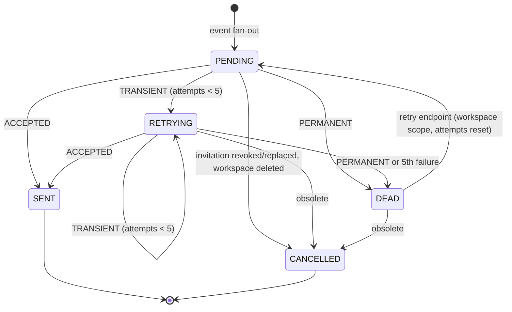

  Transitions are implemented exclusively in `Delivery` methods (`recordAttempt`, `cancel`, `requeue`), each guarded by an allowed-transition table; any other transition throws `IllegalStateTransition` — the table itself is unit-tested.

  **Invitation**

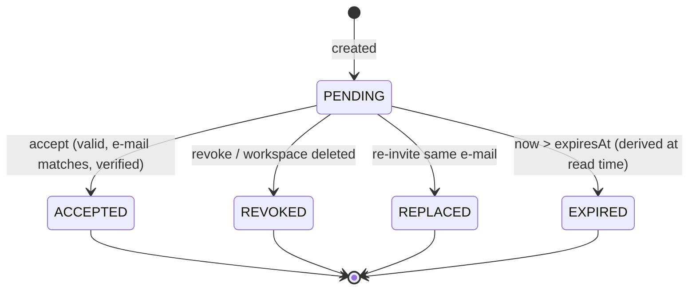

  `EXPIRED` is not persisted: it is derived from `expires_at` to avoid a scheduler.

  **Session and refresh token**

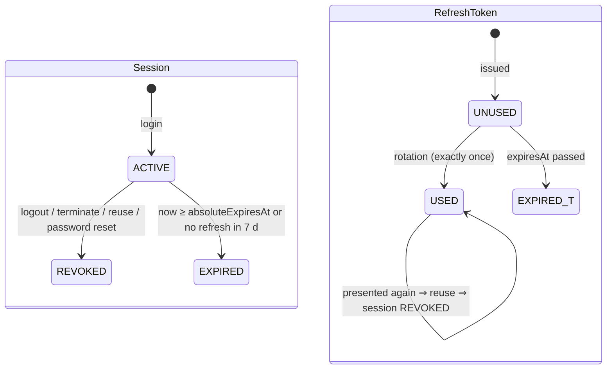

  **One-time token:** `ACTIVE → CONSUMED | INVALIDATED (superseded) | EXPIRED (derived)`; REQ-FUNC-036 403 cases leave it `ACTIVE`.

- More Information: REQ-FUNC-005–007, 011–021, 030–036, 055–062; BR-005, BR-006. ADR-006, ADR-015.

---

- ID: V16-concurrency-model
- Title: Concurrency, locking and idempotency
- Viewpoint: Concurrency
- Representation:

  **Thread model [BASELINE]**
  - HTTP requests run on virtual threads (`spring.threads.virtual.enabled=true`).
  - Blocking-but-bounded resources are guarded explicitly: Argon2 hashing by a semaphore (`warden.security.argon2.max-concurrency`, default 4), JDBC by the Hikari pool, provider calls by `delivery.concurrency` (default 8).
  - Scheduled workers use Spring scheduling; each tick processes a bounded batch; ticks of the same worker never overlap within an instance.
  - Known Java 21 risk: virtual-thread pinning inside `synchronized` blocks of libraries; mitigated by bounded concurrency and checked in the load test (`jdk.tracePinnedThreads`) — DRISK-03.

  **Critical sections**

| Operation | Mechanism | Guarantee | Requirement |
|-----------|-----------|-----------|-------------|
| Refresh rotation | Conditional `UPDATE … WHERE used_at IS NULL RETURNING` (row lock) | Exactly one winner | REQ-FUNC-013 |
| Session revocation | Conditional `UPDATE … WHERE revoked_at IS NULL RETURNING` | One alert, idempotent logout | REQ-FUNC-012, 015 |
| One-time token consumption | Conditional `UPDATE … SET consumed_at WHERE consumed_at IS NULL AND invalidated_at IS NULL AND expires_at > now` | Single use under replay | BR-006, MUC-06 |
| Last-OWNER protection | `SELECT workspace … FOR UPDATE` before counting owners | ≤ 1 success in concurrent double demotion | REQ-FUNC-039 |
| Re-invitation | Workspace row lock + partial unique index on pending invitation | One pending invitation per e-mail | REQ-FUNC-032 |
| Invitation acceptance | Conditional update on invitation + PK on `workspace_member` | No double membership | REQ-FUNC-036 |
| Note edit | JPA `@Version` (optimistic) | Lost-update prevention → 409 | REQ-FUNC-045 |
| Outbox dispatch | `FOR UPDATE SKIP LOCKED` in one transaction with the handler | Each event processed by one instance at a time | REQ-REL-001, 002 |
| Delivery creation | `UNIQUE(event_id, recipient_key, channel)` + `ON CONFLICT DO NOTHING` | At most one delivery per recipient | REQ-FUNC-061 |
| Delivery sending | `SKIP LOCKED` claim + 30 s lease; result update re-reads under lock | One sender at a time; crash-safe re-claim | REQ-REL-002, REQ-AVAIL-003 |
| Rate limiting | Bucket4j compare-and-swap in Redis (Lettuce); local `ConcurrentHashMap` buckets in degraded mode | Atomic consumption | REQ-SEC-006–009, REQ-REL-008 |

  **Isolation level:** PostgreSQL default READ COMMITTED everywhere; all critical sections rely on row locks or unique constraints, not on SERIALIZABLE.

  **Delivery semantics end-to-end:** event → delivery creation is effectively exactly-once (same transaction + unique key); delivery → provider is at-least-once (lease expiry can resend), mitigated by the provider idempotency key.

- More Information: REQ-FUNC-013, 039, 045, 061; REQ-REL-002; REQ-DIST-001. ADR-006, ADR-008, ADR-010, ADR-015.

---

- ID: V17-failure-and-degradation
- Title: Dependency failures and degraded behaviour
- Viewpoint: Interaction
- Representation:

| Failure | Detection | Behaviour | Readiness | Requirement |
|---------|-----------|-----------|-----------|-------------|
| Redis unavailable (revocations) | Lettuce exception / command timeout 200 ms | Instance enters degraded mode; revocation checks on PostgreSQL (`auth_session`); reconciliation before leaving (V14-A7) | UP | REQ-REL-007 |
| Redis unavailable (rate limits) | Same | Local per-instance buckets with the same policies; effective limit × instances (RISK-012) | UP | REQ-REL-008 |
| Redis and PostgreSQL unavailable | Both fail | Authenticated requests → 503 `service-unavailable` + `Retry-After: 5` | DOWN | REQ-REL-007, 009 |
| PostgreSQL unavailable | Hikari connection timeout (2 s) | Every operation requiring it → 503; no workspace request authorized; workers back off | DOWN | REQ-REL-009, REQ-AVAIL-001 |
| One provider down | Transient results; breaker opens | Failover to the other provider | UP | REQ-FUNC-055, REQ-REL-004 |
| Both providers down | Transient results | Deliveries in `RETRYING` then `DEAD`; business endpoints unaffected | UP | REQ-REL-003 |
| Provider slow | 5 s time limit | Classified transient, failover | UP | REQ-REL-005 |
| Crash after commit, before dispatch | Unpublished outbox row | Dispatched by any instance after restart | — | REQ-REL-001, REQ-AVAIL-003 |
| Crash during send | Lease expiry | Re-claimed after 30 s | — | REQ-AVAIL-003 |
| SIGTERM | Spring graceful shutdown | Stop accepting, finish in-flight requests ≤ 30 s; workers stop claiming and finish the current batch | — | REQ-AVAIL-002 |
| Unexpected exception | `@RestControllerAdvice` | 500 `internal-error`, generic detail, `traceId`; stack trace only in logs | — | REQ-SEC-017 |

- More Information: REQ-REL-003–009; REQ-AVAIL-001–003. ADR-007, ADR-009, ADR-014.

---

- ID: V18-security-architecture
- Title: Trust boundaries, key material and security controls
- Viewpoint: Structure
- Representation:

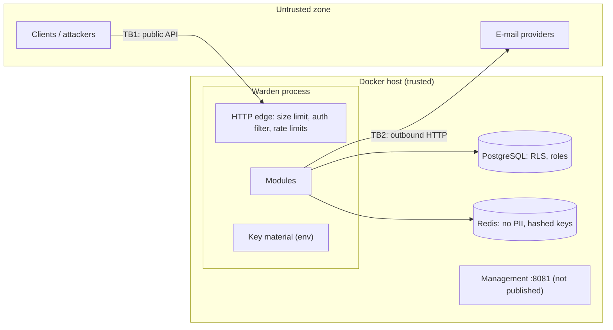

  **Key material [BASELINE]**

| Secret | Algorithm | Source | Rotation | Local profile |
|--------|-----------|--------|----------|---------------|
| Access-token signing key | ES256 (P-256) | `WARDEN_JWT_SIGNING_KEY` (PKCS#8 PEM) + `WARDEN_JWT_KEY_ID` | Verification accepts current + previous public key (`kid`) | Ephemeral key generated at startup |
| Secret cipher key | AES-256-GCM, 96-bit random nonce | `WARDEN_SECRET_KEYS` (`id:base64key[,id:base64key]`) | New key id for sealing, old ids for opening | Ephemeral |
| Hashing pepper | HMAC-SHA-256 | `WARDEN_HMAC_KEY` | Rotation resets rate-limit buckets only | Ephemeral |
| DB credentials | — | `WARDEN_DB_*` | — | Compose defaults |

  Outside the `local` profile the application refuses to start if any key is missing (REQ-INST-002). No private key is stored in the repository; a secret-scanning step runs in CI.

  **Controls**

| Concern | Control | Requirement |
|---------|---------|-------------|
| Token forgery | Nimbus decoder with fixed `alg=ES256`, `iss`, `exp` (30 s skew), required `sid`/`jti` | REQ-SEC-002 |
| Password storage | Spring Security `Argon2PasswordEncoder` (m = 19 MiB, t = 2, p = 1, configurable), `upgradeEncoding` rehash | REQ-SEC-003 |
| Token storage | 256-bit `SecureRandom` secrets, SHA-256 hash only | REQ-SEC-004 |
| Link tokens in flight | AES-GCM in event/delivery; removed on dispatch (event) and on SENT/CANCELLED/expiry (delivery) | REQ-SEC-005 |
| Common passwords | In-memory set loaded from a bundled list (SecLists, MIT, ~100 k entries [TBC]) | REQ-FUNC-003, TBD-01 |
| CSRF | Disabled: no cookies or ambient credentials; tokens only in header/body | — |
| CORS | Disabled by default; optional allow-list `WARDEN_CORS_ALLOWED_ORIGINS` | — |
| Headers | `Cache-Control: no-store` on auth responses; HSTS outside `local` | REQ-SEC-019 |
| Transport | HTTP only in `local`; other profiles require TLS (`server.ssl.*`) | REQ-SEC-019 |
| Request size | 64 KiB servlet limit → 413 | REQ-SEC-018 |
| Audit | Append-only table, DB-role enforced; 365-day purge function | REQ-SEC-015, 016 |
| Template injection | Restricted renderer (V14-A6) | REQ-SEC-013 |

  The full STRIDE threat model is maintained separately (REF-11); this view provides its structural input.

- More Information: REQ-SEC-001–019; REQ-INST-002; REQ-COMP-002, 003. ADR-002, ADR-011, ADR-012, ADR-019.

---

- ID: V19-observability
- Title: Telemetry interfaces: metrics, logs, traces, health, alerts
- Viewpoint: Interface
- Representation:

  **Metrics** (Micrometer → Prometheus, management port 8081, path `/actuator/prometheus`)

| Metric | Type | Tags (low cardinality only) | Requirement |
|--------|------|-----------------------------|-------------|
| `warden_auth_logins_total` | counter | `outcome=success|failure|rate_limited` | REQ-OBS-001 |
| `warden_auth_refresh_total` | counter | `outcome=success|invalid|reuse` | REQ-OBS-001 |
| `warden_auth_sessions_revoked_total` | counter | `reason=logout|terminate|reuse|password_reset` | REQ-OBS-001 |
| `warden_ratelimit_rejections_total` | counter | `policy` | REQ-OBS-001 |
| `warden_authz_denials_total` | counter | `status=403|404|503` | REQ-OBS-001 |
| `warden_revocation_degraded` | gauge | — | REQ-REL-007 |
| `warden_notification_deliveries` | gauge | `status`, `scope` | REQ-OBS-002 |
| `warden_notification_attempts_total` | counter | `provider`, `result` | REQ-OBS-002 |
| `warden_provider_request_seconds` | timer | `provider`, `result` | REQ-OBS-002 |
| `warden_provider_circuit_state` | gauge | `provider`, `state` | REQ-OBS-002 |
| `warden_outbox_pending` | gauge | — | REQ-OBS-002 |
| `warden_outbox_lag_seconds` | timer (histogram) | — | REQ-OBS-002, REQ-PERF-004 |
| HTTP server/JVM/Hikari metrics | built-in | `uri` template, not raw path | REQ-OBS-003 |

  Tag values never contain user, workspace, session ids, e-mails or IPs (REQ-OBS-003); verified by scanning the `/actuator/prometheus` output after the full suite.

  **Logs.** Spring Boot structured logging (`logstash` JSON format) to stdout: `@timestamp, level, logger, message, traceId, spanId, userId?, workspaceId?, originTraceId?`. `userId`/`workspaceId` are put in MDC by the security filter and interceptor. Redaction: tokens are never passed to loggers; `Authorization` header, request bodies of `/auth/**` and provider payloads are not logged; a defensive log converter masks values matching `wrt_`, `wot_`, `eyJ…` (JWT) and e-mail patterns (REQ-OBS-005).

  **Traces.** Micrometer Tracing with the OpenTelemetry bridge generates and propagates `traceId`; no trace backend is deployed in 1.0. The originating `traceId` is stored in `outbox_event.trace_id` and `notification_delivery.origin_trace_id` and emitted as `originTraceId` in worker logs, which satisfies REQ-OBS-006 by log correlation (demonstrated with `docker compose logs | grep <traceId>`). An OTLP exporter can be enabled later by configuration only.

  **Health.** `/actuator/health/liveness` (process) and `/actuator/health/readiness` (includes `db` only; Redis and providers excluded) — REQ-AVAIL-001.

  **Dashboard and alerts.** Grafana provisioning (`/ops/grafana`) loads one dashboard "Warden — Access & Delivery". Prometheus rule file (`/ops/prometheus/alerts.yml`) with: `ProviderCircuitOpen` (> 5 min), `DlqGrowing` (`increase(...[15m]) > 0`), `OutboxLagHigh` (p95 > 5 s for 5 min), `RefreshReuseSpike` (> 10 in 5 min), `WardenNotReady`. Alerts are observed as *firing* in the Prometheus UI; no Alertmanager is deployed (no on-call in scope).

- More Information: REQ-OBS-001–008; REQ-AVAIL-001; REQ-SEC-001. ADR-018.

---

- ID: V20-applied-patterns
- Title: Applied patterns
- Viewpoint: Patterns
- Representation:

| Pattern | Where | Why | Requirement |
|---------|-------|-----|-------------|
| Modular monolith | Whole deployable | One deployable with verifiable boundaries | CON-005 |
| Ports and adapters (selective) | Providers, Redis, crypto, clock | Substitution and deterministic tests only where needed | REQ-INT-008, REQ-REL-007 |
| Transactional outbox | `shared.outbox` | Atomic state change + event | REQ-REL-001 |
| Idempotent consumer | Delivery creation | At-least-once dispatch without duplicates | REQ-FUNC-061 |
| Competing consumers with leases | Delivery worker | Multi-instance, crash-safe processing | REQ-REL-002 |
| Circuit breaker + timeout + failover | Provider calls (Resilience4j core) | Isolate slow/failing providers | REQ-REL-004, 005 |
| Exponential backoff with jitter | Retry scheduling (stored `next_attempt_at`) | Retries survive restarts | REQ-REL-006 |
| Dead letter queue (status-based) | `DEAD` deliveries | No loss, inspectable, reprocessable | REQ-FUNC-057, 060 |
| Refresh token rotation with reuse detection | `iam` | Containment of stolen tokens | REQ-FUNC-011–013 |
| Denylist with authoritative fallback | Revocations | Immediate revocation without stateful tokens | REQ-FUNC-018 |
| Defense in depth (multi-layer tenancy) | V07 | Isolation independent of a single check | REQ-SEC-012 |
| Optimistic concurrency | Notes | Lost-update prevention | REQ-FUNC-045 |
| Token bucket | Rate limiting | Burst-tolerant limits | REQ-SEC-006–009 |
| Problem Details | Error handling | Stable error contract | REQ-INT-005 |

  **Deliberately not used:** microservices, message brokers (Kafka/RabbitMQ), event sourcing, CQRS read stores, distributed tracing backend, Kubernetes, service mesh, external schedulers or distributed locks (ShedLock). None is required by a requirement and each adds operational cost (CON-007, CON-009).

- More Information: ADR-001, ADR-008, ADR-009, ADR-015.

---

- ID: V21-deployment
- Title: Reference environment, configuration and delivery pipeline
- Viewpoint: Deployment
- Representation:

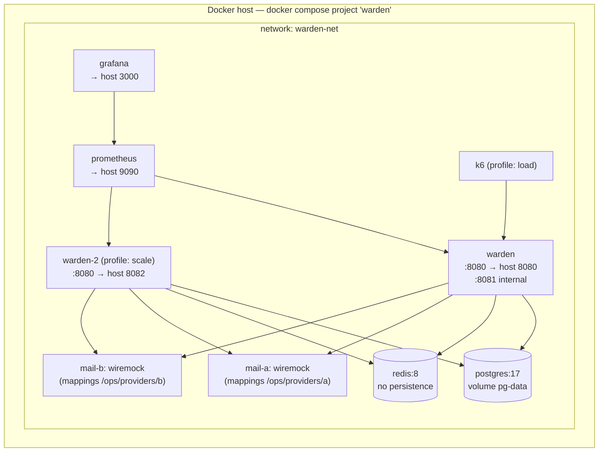

| Service | Image (pinned by digest in compose) | Host ports | Health check |
|---------|--------------------------------------|------------|--------------|
| `warden` | `ghcr.io/kaulinmindiola/warden:<sha>` or local build (Temurin 21 JRE, layered jar, non-root) | 8080 | readiness on 8081 |
| `postgres` | `postgres:17` | none (5432 optional via override) | `pg_isready` |
| `redis` | `redis:8` | none | `redis-cli ping` |
| `mail-a`, `mail-b` | `wiremock/wiremock` | 8091, 8092 (admin API for chaos) | `/__admin/health` |
| `prometheus` | `prom/prometheus` | 9090 | built-in |
| `grafana` | `grafana/grafana-oss` | 3000 | built-in |
| `k6` | `grafana/k6` (profile `load`) | — | — |

  **Commands.** `docker compose up -d --wait` (REQ-INST-001; `depends_on: condition: service_healthy`); `docker compose down -v --remove-orphans` (REQ-INST-004); `docker compose --profile scale up -d` (REQ-DIST-001 demonstration); `docker compose --profile load run k6` (load test).

  **Startup sequence.** PostgreSQL healthy → Warden starts → Flyway migrates with `warden_owner` (concurrent instances serialized by Flyway's lock) → application pool connects as `warden_app` → readiness UP.

  **Profiles.** `local` (default in compose): HTTP, ephemeral keys, WireMock providers, link base URL `http://localhost:3001/#token=` placeholders per link type [resolves TBD-09]. `test`: Testcontainers, controllable clock. `prod-like`: TLS required, keys required, HSTS.

  **Chaos.** Provider failures, latency and timeouts are injected through the WireMock admin API (scenario mappings committed under `/ops/providers`), both in Testcontainers tests and in the Compose environment.

  **CI/CD (GitHub Actions)**

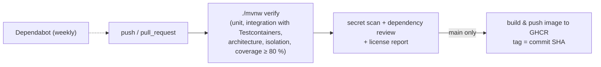

  Branch protection on `main` requires the `verify` job (REQ-BUILD-002). Dependabot security alerts and the dependency-review action cover REQ-BUILD-004; JaCoCo enforces REQ-MAINT-004; `license-maven-plugin` produces the REQ-COST-001 report.

- More Information: CON-009; REQ-INST-001–004; REQ-BUILD-001–005; REQ-DIST-001; REQ-PORT-001. ADR-001, ADR-018, ADR-020.

---

- ID: V22-physical-platform
- Title: Physical platform
- Viewpoint: Physical
- Representation:

  One physical node: a developer workstation running Docker Engine (Linux) or Docker Desktop (macOS/Windows). All selected images are published for `linux/amd64` and `linux/arm64`; `amd64` is the verified platform, `arm64` is best effort and its result is documented (REQ-PORT-001). Single region and a single host (ASM-008). Reference hardware for performance measurement is **[TBD-02]**; the load-test report must record CPU model, cores, RAM and Docker resource limits alongside the results. Clock drift between containers is negligible on one host (ASM-007).

- More Information: REQ-PORT-001; REQ-PERF-*; SRS §3.3.1.

---

- ID: V23-resource-allocation
- Title: Resource budget and limits
- Viewpoint: Resources
- Representation:

| Resource | Allocation [BASELINE, TBC by load test] | Rationale | Requirement |
|----------|------------------------------------------|-----------|-------------|
| Container memory | 1 GiB limit per instance | SRS limit | REQ-PERF-005 |
| JVM heap | `-XX:MaxRAMPercentage=60` (≈ 614 MiB) | Headroom for metaspace, code cache, thread stacks, direct buffers | REQ-PERF-005 |
| Argon2 concurrency | 4 concurrent hashes (≈ 76 MiB peak) | Bounds memory; login is 10 % of 50 req/s ≈ 5 logins/s | REQ-PERF-001, 005 |
| Hikari pool | 20 connections, connection timeout 2 s | Virtual threads make the pool the effective concurrency limit | REQ-PERF-003 |
| PostgreSQL | `max_connections` ≥ 50 (2 instances × 20 + Flyway + admin) | DIST-001 profile | REQ-DIST-001 |
| Redis client | Lettuce, single shared connection, command timeout 200 ms | Fast detection of degradation | REQ-REL-007 |
| Provider HTTP client | JDK `HttpClient`, connect 2 s, overall 5 s | Time limit per call | REQ-REL-005 |
| Outbox dispatcher | Every 500 ms, batch 100 | p95 lag ≤ 5 s with margin | REQ-PERF-004 |
| Delivery worker | Every 1 s, batch 20, 8 concurrent sends, lease 30 s | Lease > 2 × 5 s timeouts + render | REQ-REL-002, 005 |
| Request body | 64 KiB | Resource exhaustion | REQ-SEC-018 |
| Page size | ≤ 100 | Bounded queries | REQ-INT-006 |
| Graceful shutdown | 30 s | Drain | REQ-AVAIL-002 |

  These values are configuration properties (Appendix E), not constants.

- More Information: REQ-PERF-001–005; REQ-SEC-003. ADR-010.

## 4. Decisions

The decisions below have significant long-term impact. The design consequences of each are already reflected in Section 3; the ADR captures context, alternatives, consequences and confirmation when it is developed in the indicated phase. IDs ADR-001–ADR-011 come from the SRS (Appendix C); ADR-012 onward are introduced by this SDD. Descriptions, reasons and affected elements are detailed in `../../../../Users/User/Downloads/WardenDefinitivo/ADR-Inventory-Warden.md` (SREF-04).

| ID | Title | Status | Planned phase | Affected views |
|----|-------|--------|---------------|----------------|
| ADR-001 | Modular monolith instead of microservices | READY FOR ANALYSIS | 0 | V02, V03, V04, V20, V21 |
| ADR-002 | Self-issued tokens instead of an external IdP | READY FOR ANALYSIS | 1 | V01, V08, V11, V18 |
| ADR-003 | Roles resolved per request, outside the JWT | READY FOR ANALYSIS | 1 | V05, V08, V11, V12 |
| ADR-004 | 404 for non-members, 403 for insufficient role | READY FOR ANALYSIS | 2 | V07, V08, V12 |
| ADR-005 | Tenant isolation with application filter and RLS | READY FOR ANALYSIS (after POC-002) | 0–2 | V06, V07, V12 |
| ADR-006 | Atomic refresh-token rotation and reuse detection | READY FOR ANALYSIS | 1 | V11, V14, V15, V16 |
| ADR-007 | Revocation denylist in Redis with PostgreSQL fallback and reconciliation | READY FOR ANALYSIS | 3 | V09, V11, V14, V17 |
| ADR-008 | Transactional outbox with at-least-once dispatch | READY FOR ANALYSIS | 1 (write) / 4 (dispatch) | V06, V10, V13, V16 |
| ADR-009 | Provider resilience: failover, circuit breaker, timeouts, backoff | READY FOR ANALYSIS (after POC-001) | 4 | V09, V13, V14, V17 |
| ADR-010 | Virtual threads with explicitly bounded resources | READY FOR ANALYSIS | 1 | V16, V23 |
| ADR-011 | Protection of link tokens inside events and deliveries | READY FOR ANALYSIS | 1 | V06, V10, V18 |
| ADR-012 | Access-token signing algorithm and key management | PLANNED | 1 | V08, V18 |
| ADR-013 | Persistence access strategy, migrations and database roles | PLANNED | 0–1 | V03, V06, V07 |
| ADR-014 | Rate-limiting mechanism and local fallback | PLANNED (after POC-001) | 3 | V09, V14, V17 |
| ADR-015 | Delivery scheduling and claiming with leases | PLANNED | 4 | V13, V15, V16 |
| ADR-016 | Restricted placeholder renderer for templates | PLANNED | 4 | V09, V14 |
| ADR-017 | Notification data ownership and event-carried recipient data | PLANNED | 1 | V02, V04, V10, V13 |
| ADR-018 | Observability stack and trace correlation without a trace backend | PLANNED | 5 | V19, V21 |
| ADR-019 | Response-time equalization against account enumeration | PLANNED | 1 / 3 | V11, V14 |
| ADR-020 | Redis distribution and licence under CON-007 | PLANNED | 0 | V06, V21 |

## 5. Appendixes

### Appendix A — Requirements-to-design traceability

| Requirements | Design elements | Views | Verification approach |
|--------------|-----------------|-------|-----------------------|
| REQ-INT-001–007 | Controllers, `ProblemDetailsAdvice`, pagination envelope | V08 | Contract tests (MockMvc), JSON-schema validation of problems |
| REQ-INT-008 | `EmailProvider`, classifier | V09 | WireMock per result class |
| REQ-INT-009 | `LinkBuilder` (fragment token) | V13, V21 | Unit + integration |
| REQ-FUNC-001–010 | `RegistrationService`, `VerificationService`, `LoginService`, `PasswordPolicy` | V05, V11, V14-A2/A3 | Integration tests, controllable clock |
| REQ-FUNC-011–018 | `RefreshService`, `SessionService`, `RevocationStore` | V11, V14-A1/A7, V15, V16 | Concurrency test ×50; multi-instance test |
| REQ-FUNC-019–021 | `PasswordResetService` | V11, V14-A3 | Integration tests |
| REQ-FUNC-022–026 | `WorkspaceAuthorizationInterceptor`, `MembershipLookup`, `TenantTransactions`, RLS | V07, V12 | Isolation suite, endpoint × role matrix |
| REQ-FUNC-027–042 | `WorkspaceService`, `InvitationService`, `MembershipService` | V05, V12, V14-A4, V15 | Integration + concurrency ×50 |
| REQ-FUNC-043–046 | `NoteService` | V12 | Integration, optimistic-lock race |
| REQ-FUNC-047–063 | `NotificationEventHandler`, `DeliveryWorker`, `PlaceholderRenderer`, purge jobs | V10, V13, V14-A5/A6, V15 | Outbox tests, chaos tests, clock tests |
| REQ-PERF-001–005 | Resource budget | V23 | k6 load test (TBD-07 resolved: k6) |
| REQ-SEC-001–010 | Security filter chain, Argon2, hashing, rate limiting, response floor | V11, V14, V18 | Integration; timing analysis for SEC-010 |
| REQ-SEC-011–014 | Fail-closed interceptor, RLS, renderer, response DTOs | V07, V12, V14-A6 | Fault injection, raw-JDBC RLS tests, secret scan of responses |
| REQ-SEC-015–019 | `AuditLog`, DB roles, advice, size limit, TLS profile | V06, V17, V18 | Integration, inspection |
| REQ-REL-001–009 | Outbox, workers, breakers, degraded modes | V13, V14, V16, V17 | Kill-and-restart test, Testcontainers stop/start of Redis/PG |
| REQ-AVAIL-001–003 | Actuator groups, graceful shutdown, leases | V17, V19 | Integration |
| REQ-OBS-001–008 | Micrometer meters, structured logs, provisioning | V19 | Metric assertions, telemetry scan, demonstrations |
| REQ-COMP-001–003 | Problem Details, JWT, ASVS mapping doc | V08, V18 | Tests + inspection |
| REQ-INST/BUILD/DIST/PORT/COST | Compose, Dockerfile, CI | V21, V22 | Demonstration, inspection |
| REQ-MAINT-001–008 | Module layout, ArchUnit/Modulith rules, R7 registry | V03, V04, V10 | Architecture tests in `verify` |
| REQ-POC-001–002 | POC projects in `/poc` | V04, V07 | Demonstration |

### Appendix B — Verification strategy and fitness functions

**Test layers**
1. Unit — domain invariants, state-transition tables, renderer, backoff, password policy.
2. Slice/contract — MockMvc for the HTTP contract and problem types.
3. Integration — `@SpringBootTest` with Testcontainers (PostgreSQL 17, Redis 8, WireMock ×2), controllable `Clock`.
4. Concurrency — `CountDownLatch`-started parallel requests, ≥ 50 repetitions (REQ-FUNC-013, 039, 045; REQ-REL-002).
5. Chaos — WireMock fault scenarios; Testcontainers `stop()/start()` for Redis and PostgreSQL.
6. Multi-instance — two application contexts in the same test JVM on different ports sharing the containers (REQ-DIST-001, REQ-REL-002).
7. Load — k6 scripts in `/load` against the Compose environment (outside `verify`).

**Fitness functions (run in `./mvnw verify`)**

| ID | Check | Protects |
|----|-------|----------|
| FF-01 | Spring Modulith `verify()` | R1, R2, R6 |
| FF-02 | ArchUnit: `notification` imports only `shared` | R3, REQ-MAINT-002 |
| FF-03 | ArchUnit: callers of `TenantTransactions.system` | R5 |
| FF-04 | Isolation registry covers 100 % of workspace handlers | R7, REQ-MAINT-003 |
| FF-05 | Every workspace handler declares `@RequiresWorkspaceRole` | REQ-SEC-011 |
| FF-06 | JaCoCo ≥ 80 % lines on `domain` + `application` | REQ-MAINT-004 |
| FF-07 | Flyway validate (checksums) | REQ-CM-003 |
| FF-08 | Maven Enforcer: no version ranges or SNAPSHOT | REQ-BUILD-003 |
| FF-09 | Telemetry scan for secrets and e-mails | REQ-OBS-003, 005 |
| FF-10 | Response scan for secrets | REQ-SEC-014 |

All verifications are planned; none has been executed yet.

### Appendix C — Engineering backlog

**Open questions**

| ID | Question | Priority | Affected | Status |
|----|----------|----------|----------|--------|
| Q-001 | Does Spring Modulith (and springdoc) support Boot 4.1 at the pinned versions? | P1 | V04, V08 | Open → POC-001 |
| Q-002 | Is `set_config(..., true)` leak-free with Hikari for all code paths (including `JdbcClient`)? | P1 | V07 | Open → POC-002 |
| Q-003 | Response-floor value that satisfies REQ-SEC-010 on the reference hardware | P2 | V14-A3 | Open → phase 3 analysis |
| Q-004 | Exact common-password list file and size | P3 | V18 | Open → phase 1 |

**Assumptions**

| ID | Assumption | Impact if false | Confirmation | Status |
|----|------------|-----------------|--------------|--------|
| ASM-SDD-01 | Bucket4j interval refill is an acceptable implementation of "5 failures in 15 min" | Need a sliding-window counter | ADR-014 | Open |
| ASM-SDD-02 | Updating `lastUsedAt` only on login/refresh satisfies REQ-FUNC-016 | Extra write per request | SRS clarification (Appendix D) | Open |
| ASM-SDD-03 | WireMock is sufficient to simulate both providers including chaos | Need a custom simulator | Phase 4 | Open |
| ASM-SDD-04 | Redis 8 under AGPLv3 satisfies CON-007/REQ-COST-001 for an unmodified, self-hosted server | Switch to Valkey (BSD) | ADR-020 | Open |

**Design risks**

| ID | Risk | P / I | Mitigation | Affected |
|----|------|-------|------------|----------|
| DRISK-01 | Redis write fails after PostgreSQL revocation while reads still succeed on other instances | Low / High | Instance degrades; periodic reconciliation every 30 s bounds the gap | V14-A7 |
| DRISK-02 | RLS GUC leaks across pooled connections | Low / Critical | `is_local=true`, `NULLIF`, POC-002, raw-JDBC tests | V07 |
| DRISK-03 | Virtual-thread pinning in libraries degrades latency | Medium / Medium | Bounded concurrency, pinning trace in load test | V16, V23 |
| DRISK-04 | Delivery cancelled while in flight is still sent | Low / Low | Accepted; re-check under lock before recording | V13 |
| DRISK-05 | `shared` grows into a catch-all | Medium / Medium | Admission rule in V02; review | V02 |
| DRISK-06 | Argon2 limiter queues logins under burst and breaks p95 | Low / Medium | Tune limit with load test; memory headroom | V23 |

**Design gaps**

| ID | Missing information | Consequence | Priority | Action |
|----|---------------------|-------------|----------|--------|
| GAP-001 | Reference hardware (TBD-02) | Performance results not comparable | P2 | Define before first load test |
| GAP-002 | Milestone dates (TBD-05) | REQ-DEAD-001 planning only | P3 | Author planning |
| GAP-003 | ASVS version/URLs (TBD-06) | REQ-COMP-003 mapping | P3 | Consult official sources |

**Constraints.** CON-001–CON-010 of the SRS apply unchanged; no additional constraints are introduced.

### Appendix E — Configuration reference (selected)

| Property / env var | Default (local) | Notes |
|--------------------|-----------------|-------|
| `WARDEN_JWT_SIGNING_KEY`, `WARDEN_JWT_KEY_ID` | ephemeral | Required outside `local` |
| `WARDEN_SECRET_KEYS`, `WARDEN_HMAC_KEY` | ephemeral | Required outside `local` |
| `warden.jwt.issuer` | `warden` | |
| `warden.jwt.access-ttl` / `clock-skew` | `10m` / `30s` | REQ-INT-004, REQ-SEC-002 |
| `warden.session.refresh-idle-ttl` / `absolute-ttl` | `7d` / `30d` | DEC-009 |
| `warden.security.argon2.memory-kib` / `iterations` / `parallelism` / `max-concurrency` | `19456` / `2` / `1` / `4` | REQ-SEC-003 |
| `warden.security.response-floor` | `250ms` | V14-A3 |
| `warden.ratelimit.*` | SRS DEC-005, DEC-028, DEC-031 values | |
| `warden.revocation.ttl` / `reconcile-interval` | `630s` / `30s` | V14-A7 |
| `warden.links.verify-email-base-url` etc. | see Appendix D | REQ-INT-009 |
| `warden.notification.primary-provider` | `a` | REQ-INT-008 |
| `warden.notification.providers.{a,b}.base-url` | `http://mail-a:8080`, `http://mail-b:8080` | |
| `warden.notification.breaker.*` | 50 %, window 20, min 10, open 30 s, 3 probes | DEC-042 |
| `warden.notification.timeout` / `max-attempts` / `backoff.*` | `5s` / `5` / base 1 s, ×2, ±50 %, max 60 s | DEC-043, DEC-012 |
| `warden.notification.worker.*` | interval 1 s, batch 20, concurrency 8, lease 30 s | V23 |
| `warden.outbox.dispatch-interval` / `batch` / `retention` | `500ms` / `100` / `7d` | REQ-FUNC-063 |
| `warden.audit.retention` | `365d` | REQ-SEC-016 |
| `server.shutdown` / `spring.lifecycle.timeout-per-shutdown-phase` | `graceful` / `30s` | REQ-AVAIL-002 |
| `management.server.port` | `8081` | Not published |
