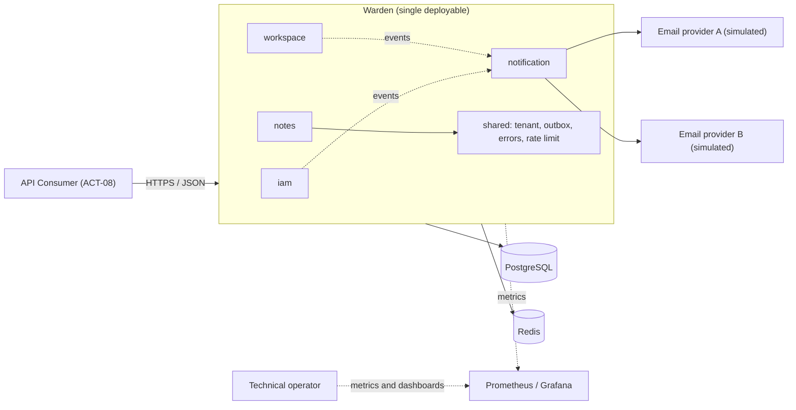

# Software Requirements Specification
## For Warden — Workspace Identity, Access & Notification Platform

Version 0.1
Prepared by Kaulin Mindiola  
Personal professional portfolio project  
2026-10-22

## Table of Contents
<!-- TOC -->
* [1. Introduction](#1-introduction)
    * [1.1 Document Purpose](#11-document-purpose)
    * [1.2 Product Scope](#12-product-scope)
    * [1.3 Definitions, Acronyms, and Abbreviations](#13-definitions-acronyms-and-abbreviations)
    * [1.4 References](#14-references)
    * [1.5 Document Overview](#15-document-overview)
* [2. Product Overview](#2-product-overview)
    * [2.1 Product Perspective](#21-product-perspective)
    * [2.2 Product Functions](#22-product-functions)
    * [2.3 Product Constraints](#23-product-constraints)
    * [2.4 User Characteristics](#24-user-characteristics)
    * [2.5 Assumptions and Dependencies](#25-assumptions-and-dependencies)
    * [2.6 Apportioning of Requirements](#26-apportioning-of-requirements)
* [3. Requirements](#3-requirements)
    * [3.1 External Interfaces](#31-external-interfaces)
    * [3.2 Functional](#32-functional)
    * [3.3 Quality of Service](#33-quality-of-service)
    * [3.4 Compliance](#34-compliance)
    * [3.5 Design and Implementation](#35-design-and-implementation)
    * [3.6 AI/ML](#36-aiml)
* [4. Verification](#4-verification)
* [5. Appendixes](#5-appendixes)
<!-- TOC -->

## Revision History

| Name            | Date       | Reason For Changes                                                                                                                                                                                              | Version |
|-----------------|------------|-----------------------------------------------------------------------------------------------------------------------------------------------------------------------------------------------------------------|---------|
| Kaulin Mindiola | 2026-10-20 | Initial version: requirements baseline derived from the discovery process.                                                                                                                 | 0.1     |

## 1. Introduction

This document specifies the requirements for Warden, an identity, authorization and notification backend for multi-workspace APIs. Section 1 orients the reader; Section 2 provides the product context; Section 3 contains the verifiable requirements; Section 4 defines how each requirement is verified; Section 5 collects supporting material (use cases, event catalog, decision log and open items).

### 1.1 Document Purpose

This SRS defines **what** Warden shall do and **which properties** it shall exhibit, without prescribing how it is implemented; implementation decisions are documented in the ADRs and in the Software Design Document (SDD). Its audiences are: the developer, to design and implement the system; the QA owner, to derive tests from the acceptance criteria; and technical reviewers or recruiters, to assess the engineering judgment behind the project.

### 1.2 Product Scope

**Product:** Warden — Workspace Identity, Access & Notification Platform, release 1.0.

Warden is a backend service that enables a multi-tenant API to register users, authenticate them, authorize their access per workspace, and notify them of security and business events. Its capabilities serve the following verifiable goals:

| ID   | Goal                                                                                                                      |
|------|---------------------------------------------------------------------------------------------------------------------------|
| G-01 | **Isolation:** a valid token never grants access to data of a workspace its holder does not belong to.                    |
| G-02 | **Containment:** a compromised session can be terminated immediately, without waiting for the token to expire.           |
| G-03 | **Reliable delivery:** events that trigger notifications are notified without loss, even when providers fail.            |
| G-04 | **Verifiable engineering:** every guarantee is backed by automated tests (portfolio purpose).                             |

**In scope:** registration and email verification; login, logout and session management; short-lived access tokens and refresh tokens with rotation and reuse detection; password recovery; workspaces, memberships, invitations and per-workspace RBAC; a reference resource (`notes`) to demonstrate authorization and isolation; rate limiting; immediate session revocation; email notifications with versioned templates, preferences, retries, failover between two simulated providers, and a DLQ; observability.

**Out of scope for release 1.0:** MFA; OAuth2/OIDC social login; enterprise SSO; SMS and push; administration UI; password change while authenticated; account deletion; email change; workspace renaming; restoring deleted workspaces; account states (lockout, suspension); a global platform administrator role; manual reprocessing via the API of System-scope notifications; HTML emails; validation of Warden tokens by third-party services (JWKS publication); integration with real email providers.

### 1.3 Definitions, Acronyms, and Abbreviations

| Term | Definition |
|------|------------|
| Access token | Short-lived JWT that authenticates a user's requests within a session. |
| ADR | Architecture Decision Record — a record of an architectural decision and its rationale. |
| API | Application Programming Interface - A set of definitions and protocols for building and integrating application software |
| ASVS | OWASP Application Security Verification Standard. |
| BR | Business Rule (Section 3.2.1). |
| Circuit breaker | Mechanism that stops calling a provider after a failure-rate threshold is reached and probes it again after a wait period. |
| Delivery | An attempt to get a notification to a recipient through a channel; it has a state lifecycle (REQ-FUNC-058). |
| Denylist | Record of revoked sessions checked on every authenticated request. |
| DLQ | Dead Letter Queue — the set of deliveries that exhausted their attempts (state `DEAD`). |
| Failover | Use of the secondary provider when the primary fails or its circuit breaker is open. |
| Idempotency | Property whereby processing the same event twice produces the same result as processing it once. |
| JWT | JSON Web Token (RFC 7519). |
| MUC | Misuse Case — a case of misuse originated by an attacker (Appendix A). |
| Outbox | Persistent record of domain events stored in the same transaction as the state change that produces them. |
| p95 | 95th percentile of a response-time distribution. |
| RBAC | Role-Based Access Control. |
| Refresh token | Opaque random value used to obtain new tokens within the same session. |
| RLS | PostgreSQL Row Level Security. |
| Session | Session family: the chain of refresh tokens linked by rotation from a single login. Identified by the `sid` claim. |
| SRS | Software Requirements Specification - A document that describes the intended purpose, requirements, and nature of a software |
| TBC | To Be Confirmed — proposed value pending confirmation. |
| TBD | To Be Defined — value not yet defined. |
| Tenant / Workspace | Unit of data isolation. Every workspace-scoped resource belongs to exactly one workspace. |
| UC | Use Case (Appendix A). |
| UI | User Interface - The visual part of computer application through which a user interacts with a software |
| UUID | Universally Unique Identifier, used for every identifier exposed by the API. |

### 1.4 References

| ID | Title | Author / Owner | Version | Date | Location | Type |
|----|-------|----------------|---------|------|----------|------|
| REF-01 | PROJECT_CONTEXT.md — project context | Kaulin Mindiola | Unversioned | 2026-10 | Repository, `/docs` | Informative |
| REF-02 | srs-template.md | Kaulin Mindiola | Unversioned | 2026-10 | Repository, `/docs` | Normative (structure) |
| REF-03 | RFC 7519 — JSON Web Token (JWT) | IETF | — | 2015-05 | https://www.rfc-editor.org/rfc/rfc7519 | Normative |
| REF-04 | RFC 6750 — OAuth 2.0 Bearer Token Usage | IETF | — | 2012-10 | https://www.rfc-editor.org/rfc/rfc6750 | Normative (Bearer header usage) |
| REF-05 | RFC 9457 — Problem Details for HTTP APIs | IETF | — | 2023-07 | https://www.rfc-editor.org/rfc/rfc9457 | Normative |
| REF-06 | OWASP ASVS | OWASP | 5.0 (TBC) | TBC | https://owasp.org/www-project-application-security-verification-standard/ | Informative |
| REF-07 | OWASP Password Storage Cheat Sheet | OWASP | Current | — | https://cheatsheetseries.owasp.org/cheatsheets/Password_Storage_Cheat_Sheet.html | Informative |
| REF-08 | NIST SP 800-63B — Digital Identity Guidelines: Authentication | NIST | Current (TBC) | TBC | TBD | Informative |
| REF-09 | Statutory Law 1581 of 2012 (personal data protection, Colombia) | Congress of the Republic of Colombia | — | 2012-10-17 | TBD | Informative (no compliance claim) |
| REF-10 | ADR-001 to ADR-011 | Kaulin Mindiola | Planned | — | Repository, `/docs/adr` | Informative |
| REF-11 | Threat model (lightweight STRIDE) | Kaulin Mindiola | Planned | — | Repository, `/docs` | Informative |

### 1.5 Document Overview

Section 2 describes the product, its constraints, users, assumptions, and the allocation of requirements to modules and phases. Section 3 contains the requirements in the template format; business rules are in 3.2.1. Section 4 contains the verification matrix, and Section 5 the supporting appendixes, which are informative.

**Conventions:**
- **shall** = mandatory · **should** = recommended · **may** = optional.
- IDs follow the template schema `REQ-[AREA]-[NNN]-[VER]`, where `-[VER]` is present only once a requirement has been revised. IDs are immutable; a revision increments `-[VER]` and is recorded in the Revision History.
- The HTTP status codes cited are part of the API's observable contract. All errors are returned as specified in REQ-INT-005.
- Acceptance criteria use the *Given / When / Then* form or a list of verifiable conditions.
- Numeric values were set during discovery (Appendix C). Anything not yet defined is marked **TBD** or **TBC** and listed in Appendix D.
- Enumeration values that are part of the observable contract (notification categories, provider result classes, notification scopes) are given in English; in version 0.1 they appeared in Spanish (`SEGURIDAD` → `SECURITY`, `TRANSACCIONAL` → `TRANSACTIONAL`, `INFORMATIVA` → `INFORMATIONAL`, `ACEPTADO` → `ACCEPTED`, `RECHAZO_PERMANENTE` → `PERMANENT_REJECTION`, `FALLO_TRANSITORIO` → `TRANSIENT_FAILURE`, Sistema → System).

## 2. Product Overview

### 2.1 Product Perspective

Warden is a **new, standalone product**; it does not replace an existing system. It is built as a **single deployable unit** with internal modules whose boundaries are verifiable (`iam`, `workspace`, `notes`, `notification`, `shared`). It persists its state in PostgreSQL, uses Redis for ephemeral state (revocations and rate-limiting counters), and delivers emails through two external providers, which are simulated in release 1.0.

**Ownership and support:** personal portfolio project maintained by its author. There are no contractual SLAs and no support model; the quality targets in Section 3.3 are design objectives verified in the local environment (ASM-005).



### 2.2 Product Functions

- **Account:** registration, email verification and password recovery without revealing which accounts exist.
- **Sessions:** login with token issuance, refresh with rotation, reuse detection, logout, session listing and termination.
- **Immediate revocation:** a revoked session is rejected from the next request onward.
- **Workspaces:** creation, listing, soft deletion, leaving.
- **Members and invitations:** invite, revoke and accept invitations; list members; change roles; remove members, with protection of the last OWNER.
- **Authorization and isolation:** per-workspace RBAC resolved on every request, and data isolation between workspaces.
- **Reference resource `notes`:** minimal CRUD that exercises read and write permissions.
- **Notifications:** event-driven generation, preferences, versioned and localized templates, retries, failover, DLQ and delivery inspection.
- **Protection:** rate limiting of sensitive endpoints and of outbound sends; auditing of security events.
- **Operability:** metrics, structured logs, traces, dashboard and alerts.

### 2.3 Product Constraints

| ID | Constraint | Origin | Type |
|----|------------|--------|------|
| CON-001 | Warden must be implemented in Java 21. | Internal | Mandatory |
| CON-002 | Warden must use Spring Boot 4.1.x and Spring Security 7. | Internal | Mandatory |
| CON-003 | Persistent storage must be PostgreSQL. | Internal | Mandatory |
| CON-004 | Ephemeral state (revocations, counters) must reside in Redis. | Internal | Mandatory |
| CON-005 | Warden must be delivered as a single deployable unit (modular monolith), not as microservices. | Internal (ADR-001) | Mandatory |
| CON-006 | Warden must issue and validate its own tokens, without delegating to an external identity provider. | Internal (ADR-002) | Mandatory |
| CON-007 | All dependencies must be open source, and the system must not require paid services. | Internal | Mandatory |
| CON-008 | Email must be the only notification channel in release 1.0. | Scope | Mandatory |
| CON-009 | The reference runtime environment must be Docker Compose on a local machine. | Internal | Mandatory |
| CON-010 | HTTP errors must conform to RFC 9457 and tokens to RFC 7519. | External (REF-03, REF-05) | Mandatory |

### 2.4 User Characteristics

| ID | User class | Behavior and goals | Access | Frequency | Considerations |
|----|------------|--------------------|--------|-----------|----------------|
| ACT-01 | Anonymous visitor | Creates an account, logs in or recovers their password. | Public endpoints (REQ-SEC-001) | Occasional | May be an attacker; responses must not reveal whether an account exists. |
| ACT-02 | Authenticated user | Manages their sessions and preferences, creates workspaces and accepts invitations. | Own data | Daily | Receives notifications in `es` or `en`. |
| ACT-03 | VIEWER | Reads notes and members of a workspace. | Read-only in their workspace | Daily | — |
| ACT-04 | MEMBER | Creates, edits and deletes notes. | Read and write in their workspace | Daily | — |
| ACT-05 | ADMIN | Manages workspace members, invitations, templates and deliveries. | Management, except over OWNERs | Weekly | May attempt privilege escalation (MUC-05). |
| ACT-06 | OWNER | Has full control of the workspace: assigns OWNER and deletes the workspace. | Full in their workspace | Occasional | Every workspace always has at least one. |
| ACT-07 | Invitee | Receives an invitation by email; may not have an account yet. | Invitation link only | Occasional | Must register and verify their email to accept. |
| ACT-08 | API Consumer | Developer or system integrating Warden over HTTP/JSON. | Public API | Continuous | Needs a stable, documented error contract. |
| ACT-09 | Email provider | External system that accepts, rejects or fails to answer send requests. | Send interface | Continuous | May fail, be slow or reject. |
| ACT-10 | System scheduler | Dispatches the outbox, runs retries and purges. | Internal | Continuous | — |
| ACT-11 | Attacker | Originates the misuse cases in Appendix A. | — | — | Basis for the threat model and the REQ-SEC requirements. |
| ACT-12 | Technical operator | Runs the environment; inspects metrics, dashboards, logs and the System-scope DLQ. | Infrastructure; no role in the API | Occasional | Has no dedicated endpoints in release 1.0. |

**Localization:** notifications are issued in `es` (default) or `en`. API error messages are issued in English with stable `type` identifiers (REQ-INT-005). There is no UI, so visual accessibility requirements do not apply.

### 2.5 Assumptions and Dependencies

**Assumptions**

| ID | Assumption | Impact if false |
|----|------------|-----------------|
| ASM-001 | The SRS is written in English, following the template's structure, headings and ID conventions. | Low: format only. |
| ASM-002 | Warden does not incorporate AI/ML components. | Low: Section 3.6 would need to be completed. |
| ASM-003 | Both email providers are simulated. | Medium: 3.1.3, 3.5.7 and the chaos tests would change. |
| ASM-004 | Warden only exposes a REST API; it has no frontend of its own. | Medium: 3.1.1 would need to be specified. |
| ASM-005 | There is no production environment and no SLA; quality targets are design objectives measured locally. | High: 3.3.4 would require contractual availability targets. |
| ASM-006 | The stack in 2.3 is a firm internal decision. | Medium: CON-001 to CON-004 would become preferences. |
| ASM-007 | Instance clocks are synchronized with a drift below 30 seconds. | Medium: would affect `exp` validation and revocation TTLs. |
| ASM-008 | All instances and data stores run in a single region. | Low for release 1.0. |

**Dependencies**

| ID | Dependency | Impact if unavailable or incompatible |
|----|------------|---------------------------------------|
| DEP-001 | PostgreSQL 16 or later (TBC by POC-002) | No source of truth: the system responds 503 (REQ-REL-009). |
| DEP-002 | Redis 7 or later (TBC) | Degradation defined in REQ-REL-007 and REQ-REL-008. |
| DEP-003 | Compatibility of Spring Modulith, Bucket4j, Resilience4j and Testcontainers with Spring Boot 4.1 | Libraries replaced behind ports; validated in POC-001. |
| DEP-004 | Docker and Docker Compose on the host machine | No reference environment and no integration tests (CON-009). |

### 2.6 Apportioning of Requirements

**Allocation by module**

| Module | Requirements |
|--------|--------------|
| `iam` | REQ-FUNC-001 to 021; REQ-SEC-002 to 004, 006 to 010; REQ-REL-007; REQ-PERF-001, 002 |
| `workspace` | REQ-FUNC-022 to 042; REQ-SEC-011 |
| `notes` | REQ-FUNC-043 to 046 |
| `notification` | REQ-FUNC-047 to 063; REQ-SEC-005, 013, 014; REQ-REL-003 to 006; REQ-INT-008, 009 |
| `shared` | REQ-INT-001 to 007; REQ-SEC-001, 012, 015 to 019; REQ-REL-001, 002, 008, 009; REQ-OBS-*; REQ-PERF-003, 004 |
| Cross-cutting / process | REQ-COMP-*; REQ-INST-*; REQ-BUILD-*; REQ-DIST-*; REQ-MAINT-*; REQ-PORT-*; REQ-COST-*; REQ-DEAD-*; REQ-POC-*; REQ-CM-*; REQ-AVAIL-*; REQ-PERF-005 |

**Allocation by phase**

| Phase | Objective | Requirements | Exit criterion |
|-------|-----------|--------------|----------------|
| 0. Preparation | Validate dependencies and RLS | REQ-POC-001, 002; REQ-BUILD-001, 003 | POCs with documented results |
| 1. IAM core | Accounts, sessions and tokens | REQ-FUNC-001 to 021; REQ-INT-001 to 005, 007; REQ-SEC-001 to 005 | Verification of the phase's requirements passing |
| 2. Multi-tenancy and RBAC | Workspaces, roles, isolation, notes | REQ-FUNC-022 to 046; REQ-INT-006; REQ-SEC-011, 012; REQ-MAINT-003 | Isolation suite passing |
| 3. Protection | Rate limiting, auditing, Redis degradation | REQ-SEC-006 to 010, 015 to 019; REQ-REL-007 to 009 | Rate-limit and revocation tests passing |
| 4. Notifications | Outbox, delivery, failover, DLQ | REQ-FUNC-047 to 063; REQ-INT-008, 009; REQ-SEC-013, 014; REQ-REL-001 to 006 | Chaos and outbox tests passing |
| 5. Operability | Observability, CI, documentation | REQ-OBS-*; REQ-PERF-*; REQ-AVAIL-*; REQ-BUILD-002, 004, 005; remaining requirements in 3.5 | Full definition of done met |

📝 In phase 1, flows that send emails (verification, reset) record their events in the outbox; actual delivery is verified in phase 4.

## 3. Requirements

All requirements follow the template format:

```markdown
- ID: REQ-FUNC-001
- Title: ...
- Statement: The system shall...
- Rationale: ...
- Acceptance Criteria: ...
- Verification Method: Test | Analysis | Inspection | Demonstration | Other
- More Information: ...
```

The *More Information* field traces each requirement to its use cases (UC), misuse cases (MUC), business rules (BR) and decisions (DEC) in the appendixes.

### 3.1 External Interfaces

#### 3.1.1 User Interfaces

N/A — Warden has no user interface in release 1.0 (ASM-004). Human interaction happens through HTTP clients and through emails, whose content is governed by the templates in 3.2.10.

#### 3.1.2 Hardware Interfaces

N/A — Warden does not interact with physical devices.

#### 3.1.3 Software Interfaces

- ID: REQ-INT-001
- Title: Versioned REST API
- Statement: The system shall expose its API as HTTP resources with JSON bodies under the `/api/v1` prefix.
- Rationale: A version prefix allows the contract to evolve without breaking API consumers (REQ-CM-001).
- Acceptance Criteria: Every endpoint in Appendix E responds under `/api/v1`; a path without the prefix responds 404.
- Verification Method: Test
- More Information: Appendix E. ACT-08.

- ID: REQ-INT-002
- Title: Token transport
- Statement: The system shall accept the access token only in the `Authorization: Bearer` header and the refresh token only in the request body, and shall not accept tokens in the URL.
- Rationale: Tokens in URLs end up in logs and proxies (REF-04).
- Acceptance Criteria: An access token sent as a query parameter is ignored and the request responds 401; a refresh token sent in the `Authorization` header of the refresh endpoint responds 400.
- Verification Method: Test
- More Information: UC-03, UC-04.

- ID: REQ-INT-003
- Title: Token issuance response
- Statement: The system shall respond to a successful login or refresh with `access_token`, `token_type` (`Bearer`), `expires_in` (seconds), `refresh_token` and `refresh_expires_in` (seconds).
- Rationale: Stable contract so the client can manage token renewal.
- Acceptance Criteria: The responses of REQ-FUNC-008 and REQ-FUNC-011 contain exactly those fields with the stated types; `expires_in` is 600.
- Verification Method: Test
- More Information: DEC-009.

- ID: REQ-INT-004
- Title: Access token content
- Statement: The access token shall be a JWT signed with an asymmetric algorithm, containing the claims `iss`, `sub`, `sid`, `jti`, `iat` and `exp`, and shall not contain roles, email addresses or workspace data.
- Rationale: Roles are resolved on every request (BR-004); personal data in the token is minimized.
- Acceptance Criteria: Decoding an issued token shows exactly those claims; `exp − iat` = 600 seconds.
- Verification Method: Test
- More Information: REF-03. The specific algorithm (e.g., ES256 or RS256) is decided in an ADR (Appendix D).

- ID: REQ-INT-005
- Title: Error format
- Statement: The system shall respond to every 4xx and 5xx error with `Content-Type: application/problem+json` conforming to RFC 9457, including `type`, `title`, `status`, `detail` and `instance`, a `traceId` member and, for validation errors, an `errors` list with the field and the reason.
- Rationale: Stable error contract for ACT-08 (CON-010).
- Acceptance Criteria: For each error code used in this SRS (400, 401, 403, 404, 409, 413, 429, 503), the response conforms to the schema; each error type has a stable, documented `type` URI.
- Verification Method: Test
- More Information: REF-05, REQ-COMP-001.

- ID: REQ-INT-006
- Title: List pagination
- Statement: Every list endpoint shall accept the parameters `page` (zero-based) and `size` (default 20, maximum 100) and shall return the items together with `page`, `size`, `totalElements` and `totalPages`.
- Rationale: Uniform, bounded contract for all lists (DEC-026).
- Acceptance Criteria: Without parameters, at most 20 items are returned; `size=101` responds 400; the metadata matches the actual number of items.
- Verification Method: Test
- More Information: REQ-FUNC-016, 028, 034, 037, 043, 059.

- ID: REQ-INT-007
- Title: Identifiers and timestamps
- Statement: All identifiers exposed by the API shall be UUIDs, and all timestamps shall be expressed in ISO 8601 in UTC.
- Rationale: Non-sequential identifiers make resource enumeration harder (MUC-01).
- Acceptance Criteria: No response contains sequential numeric identifiers; all timestamps end in `Z`.
- Verification Method: Test
- More Information: —

- ID: REQ-INT-008
- Title: Email provider contract
- Statement: The system shall classify the result of each send to a provider as `ACCEPTED`, `PERMANENT_REJECTION` (invalid recipient) or `TRANSIENT_FAILURE` (error, temporary rejection or timeout), and shall allow a provider to be replaced by another without changes to the rest of the system.
- Rationale: The classification determines retry, failover or direct transfer to the DLQ (REQ-FUNC-055 to 057); replaceability enables failover (ASM-003).
- Acceptance Criteria: With a simulated provider returning each result type, the system records the corresponding classification; changing the primary provider through configuration does not require recompilation.
- Verification Method: Test
- More Information: ACT-09, UC-22.

- ID: REQ-INT-009
- Title: Single-use links
- Statement: The system shall build verification, password-reset and invitation links from a base URL configurable per link type, with the token in the URL fragment (`#token=…`) and never in the path or the query parameters.
- Rationale: Warden has no frontend: the link points to the API consumer's client, which sends the token in the request body (REQ-INT-002). The fragment is not sent to the server and does not end up in its logs (DEC-053).
- Acceptance Criteria: The link in a password-reset email starts with the configured base URL and contains the token only after `#`; changing the base URL through configuration changes the links without recompilation.
- Verification Method: Test
- More Information: UC-02, UC-08, UC-12. Default base URL: TBD (Appendix D).

### 3.2 Functional

#### 3.2.1 Business Rules

| ID | Rule | Requirements that apply it |
|----|------|----------------------------|
| BR-001 | Every workspace has at least one OWNER at all times. | REQ-FUNC-027, 039 |
| BR-002 | An ADMIN cannot modify, demote or remove an OWNER. | REQ-FUNC-038, 041 |
| BR-003 | Security and transactional notifications cannot be disabled; informational ones can. | REQ-FUNC-048, 049 |
| BR-004 | A role change or a removal takes effect on the affected user's next request. | REQ-FUNC-022 |
| BR-005 | Reusing a refresh token revokes its entire session. | REQ-FUNC-012, 013 |
| BR-006 | Verification, password-reset and invitation links are single-use and expire. | REQ-FUNC-005, 006, 019, 021, 031, 036 |
| BR-007 | Registration, login and recovery responses do not reveal whether an account exists. | REQ-FUNC-002, 009, 019; REQ-SEC-010 |
| BR-008 | Only an OWNER can assign the OWNER role, and only to an existing member. | REQ-FUNC-031, 038 |
| BR-009 | Accepting an invitation requires a verified email that matches the invited email. | REQ-FUNC-036 |
| BR-010 | Creating a workspace requires a verified email. | REQ-FUNC-027 |
| BR-011 | The last OWNER cannot be demoted, leave the workspace or be removed. | REQ-FUNC-039 |
| BR-012 | A deleted workspace behaves as non-existent for everyone. | REQ-FUNC-026, 030 |

#### 3.2.2 Account Registration and Verification

- ID: REQ-FUNC-001
- Title: Account registration
- Statement: The system shall register an account when it receives a well-formed email address and a password that satisfies REQ-FUNC-003.
- Rationale: Entry point for every user.
- Acceptance Criteria: Given an unregistered email and a valid password, when the registration is submitted, then the account is created with an unverified email and the response is 202 with no tokens.
- Verification Method: Test
- More Information: UC-01.

- ID: REQ-FUNC-002
- Title: Registration with an existing email
- Statement: If the email already belongs to an account, the system shall respond identically to a successful registration and shall notify the holder of the existing account of the attempt.
- Rationale: Prevents account enumeration through registration (BR-007).
- Acceptance Criteria: Given a registered email, when the registration is submitted, then the response matches REQ-FUNC-001 in status code and structure, no second account is created, and an `account.registration-attempt` notification is recorded for the account holder.
- Verification Method: Test
- More Information: UC-01, MUC-04, DEC-020.

- ID: REQ-FUNC-003
- Title: Password policy
- Statement: The system shall reject passwords shorter than 12 or longer than 128 characters, or present in the common-password list, and shall not impose composition rules.
- Rationale: DEC-008, aligned with REF-08.
- Acceptance Criteria: An 11-character password or one included in the list responds 400 identifying the field; a 12-character password without uppercase letters or symbols is accepted.
- Verification Method: Test
- More Information: UC-01, UC-09. Source and size of the list: TBD (Appendix D).

- ID: REQ-FUNC-004
- Title: Email normalization
- Statement: The system shall treat as the same email two values that differ only in letter case or in leading or trailing whitespace.
- Rationale: Prevents duplicate accounts and evasion of per-account limits (REQ-SEC-006, 008).
- Acceptance Criteria: Registering `Ana@Mail.com ` when `ana@mail.com` exists follows REQ-FUNC-002; logging in with either form authenticates the same account.
- Verification Method: Test
- More Information: UC-01, UC-03, UC-08.

- ID: REQ-FUNC-005
- Title: Email verification request
- Statement: When an account is created, the system shall send to the registered email a single-use verification link that expires after 24 hours.
- Rationale: Proves ownership of the email, as required by BR-009 and BR-010.
- Acceptance Criteria: After REQ-FUNC-001, exactly one `account.email-verification` delivery is recorded for the account; the token becomes invalid at 24 h + 1 s.
- Verification Method: Test
- More Information: UC-02, DEC-021.

- ID: REQ-FUNC-006
- Title: Verification confirmation
- Statement: On receiving a valid, unused and unexpired verification token, the system shall mark the email as verified and invalidate that token.
- Rationale: BR-006.
- Acceptance Criteria: A valid token leaves the email verified; presenting the same token again responds 400; an expired or unknown token responds 400 with an identical response.
- Verification Method: Test
- More Information: UC-02, MUC-06.

- ID: REQ-FUNC-007
- Title: Verification resend
- Statement: The system shall allow an authenticated user with an unverified email to request a new verification link, invalidating previous links, up to a maximum of 3 requests per account per hour.
- Rationale: Recovery from failed System-scope deliveries (DEC-004); limit against send abuse (MUC-07).
- Acceptance Criteria: After the resend, the previous token responds 400 and the new one is valid; if the email is already verified, the response is 409; the 4th request within one hour responds 429 with `Retry-After`.
- Verification Method: Test
- More Information: UC-02, DEC-031.

#### 3.2.3 Login and Sessions

- ID: REQ-FUNC-008
- Title: Credential authentication
- Statement: Given valid credentials, the system shall create a new session and return an access token and a refresh token bound to it.
- Rationale: Each login is an independent session that can be revoked separately (G-02).
- Acceptance Criteria: With valid credentials the response is 200 as specified in REQ-INT-003; the session appears in REQ-FUNC-016; two consecutive logins produce two distinct sessions. An unverified email does not prevent login.
- Verification Method: Test
- More Information: UC-03, DEC-003.

- ID: REQ-FUNC-009
- Title: Invalid credentials
- Statement: Given a non-existent email or an incorrect password, the system shall respond 401 with an identical body in both cases.
- Rationale: BR-007, MUC-04.
- Acceptance Criteria: The responses for "non-existent email" and "incorrect password" are equal in status code and body, except for `traceId` and `instance`.
- Verification Method: Test
- More Information: UC-03. Timing indistinguishability is required by REQ-SEC-010.

- ID: REQ-FUNC-010
- Title: New-device login notice
- Statement: After a successful login from a User-Agent whose hash does not appear among the user's successful logins in the last 90 days, the system shall notify the user, unless it is the user's first login or the user has disabled that notice.
- Rationale: Early signal of an unauthorized session (G-02, DEC-006).
- Acceptance Criteria: An account's first login generates no notice; a second login with a different User-Agent generates exactly one `security.new-device` notice; repeating the same User-Agent generates no notice; with the notice disabled, no delivery is recorded.
- Verification Method: Test
- More Information: UC-03. The User-Agent can be spoofed: this is a notice, not an access control.

- ID: REQ-FUNC-011
- Title: Refresh token rotation
- Statement: On receiving a valid refresh token, the system shall issue a new access token and a new refresh token within the same session and mark the presented token as used.
- Rationale: Limits the usable window of a stolen token (G-02).
- Acceptance Criteria: The response contains a refresh token different from the one presented; the `sid` claim of the new access token equals that of the original session.
- Verification Method: Test
- More Information: UC-04.

- ID: REQ-FUNC-012
- Title: Refresh token reuse detection
- Statement: If an already-used refresh token is presented, the system shall revoke the session it belongs to, respond 401 and notify the user.
- Rationale: BR-005, MUC-02.
- Acceptance Criteria: After the reuse, the session's current refresh token, its access tokens and the reused token are all rejected with 401; exactly one `security.refresh-reuse` delivery is recorded.
- Verification Method: Test
- More Information: UC-04. Definition of done in REF-01.

- ID: REQ-FUNC-013
- Title: Concurrent refresh
- Statement: Given two or more simultaneous requests with the same refresh token, the system shall successfully serve exactly one and handle the others as specified in REQ-FUNC-012.
- Rationale: Normative guarantee in REF-01; prevents a stolen token and the legitimate one from coexisting.
- Acceptance Criteria: With N ≥ 2 concurrent requests, repeated at least 50 times, in every repetition exactly one responds 200 and the session ends up revoked.
- Verification Method: Test
- More Information: UC-04, RISK-008. API consumers must not retry a refresh with the same token (Appendix E).

- ID: REQ-FUNC-014
- Title: Session expiration
- Statement: The system shall reject with 401, without issuing tokens, a refresh token unused for more than 7 days or whose session is older than 30 days.
- Rationale: DEC-009.
- Acceptance Criteria: With a controlled clock: after 7 days + 1 s of inactivity the response is 401; with daily refreshes, at 30 days + 1 s the response is 401; an expiration does not trigger a reuse alert.
- Verification Method: Test
- More Information: UC-04.

- ID: REQ-FUNC-015
- Title: Logout
- Statement: On logout, the system shall revoke the session of the presented access token, and the operation shall be idempotent.
- Rationale: G-02.
- Acceptance Criteria: After logout, that session's access token and refresh token respond 401; the user's other sessions remain active; the response is 204.
- Verification Method: Test
- More Information: UC-05.

- ID: REQ-FUNC-016
- Title: Active session listing
- Statement: The system shall return to the authenticated user only their active sessions, with identifier, creation time, last use, User-Agent summary and a current-session flag.
- Rationale: Lets the user detect sessions that are not theirs (DEC-011).
- Acceptance Criteria: With two users holding three sessions each, each user sees only their own; exactly one is flagged as current; revoked or expired sessions are not listed.
- Verification Method: Test
- More Information: UC-06.

- ID: REQ-FUNC-017
- Title: Terminate a session
- Statement: The system shall allow the user to revoke any of their sessions by its identifier, and shall respond 404 if the session does not exist or does not belong to them.
- Rationale: G-02; does not reveal other users' resources (DEC-015).
- Acceptance Criteria: Revoking an own session responds 204 and its tokens respond 401; attempting to revoke another user's session responds 404 and that session remains active.
- Verification Method: Test
- More Information: UC-07.

- ID: REQ-FUNC-018
- Title: Immediate rejection of revoked sessions
- Statement: Once the revocation of a session has been confirmed, the system shall reject with 401 every subsequent request carrying an access token of that session, even if the token has not expired.
- Rationale: G-02; definition of done in REF-01.
- Acceptance Criteria: The first request sent after the revocation response responds 401, with zero tolerance; this applies to the revocations of REQ-FUNC-012, 015, 017 and 020.
- Verification Method: Test
- More Information: Behavior when Redis is unavailable is defined in REQ-REL-007.

#### 3.2.4 Password Recovery

- ID: REQ-FUNC-019
- Title: Password reset request
- Statement: The system shall respond 202 with an identical body to every password reset request, whether or not the account exists, and, if the account exists, shall send a single-use link that expires after 30 minutes and invalidates previous links.
- Rationale: BR-006, BR-007.
- Acceptance Criteria: The responses for an existing and a non-existent email are identical; only in the first case is an `account.password-reset` delivery recorded; after a second request, the first link responds 400.
- Verification Method: Test
- More Information: UC-08, DEC-021.

- ID: REQ-FUNC-020
- Title: Password reset
- Statement: Given a valid token and a password that satisfies REQ-FUNC-003, the system shall replace the password, invalidate the token, revoke all of the user's sessions, mark the user's email as verified and notify the user of the change.
- Rationale: A reset usually signals a suspected compromise (G-02); the token proves ownership of the email.
- Acceptance Criteria: After the reset, the previous password no longer authenticates and the new one does; all previous sessions respond 401; an `account.password-changed` delivery is recorded; the email is verified.
- Verification Method: Test
- More Information: UC-09, DEC-022, DEC-023.

- ID: REQ-FUNC-021
- Title: Invalid reset token
- Statement: The system shall reject with 400 and an identical response an unknown, used or expired reset token, without modifying the account.
- Rationale: BR-006, MUC-06.
- Acceptance Criteria: All three cases produce the same response and the password does not change.
- Verification Method: Test
- More Information: UC-09.

#### 3.2.5 Authorization and Isolation

- ID: REQ-FUNC-022
- Title: Authorization against the current membership
- Statement: The system shall authorize every workspace-scoped request against the membership and role in effect at the time of the request.
- Rationale: BR-004.
- Acceptance Criteria: An ADMIN demoted to MEMBER, using the same access token, receives 403 on their next attempt to create an invitation; a removed member receives 404 on their next request to the workspace.
- Verification Method: Test
- More Information: UC-16, UC-17. Applies to every `/workspaces/{id}/…` endpoint.

- ID: REQ-FUNC-023
- Title: Foreign or non-existent workspace
- Statement: The system shall respond 404 to every request on a workspace the user is not a member of, with a response identical to that for a non-existent workspace.
- Rationale: Does not reveal which workspaces exist (DEC-015, MUC-01).
- Acceptance Criteria: For a non-member, the responses for an existing workspace and for a random UUID match in status code and body, on every workspace-scoped endpoint.
- Verification Method: Test
- More Information: Isolation suite (REQ-MAINT-003).

- ID: REQ-FUNC-024
- Title: Insufficient role
- Statement: The system shall respond 403 when a member requests an operation that requires a role higher than theirs.
- Rationale: DEC-015; hierarchy OWNER ⊃ ADMIN ⊃ MEMBER ⊃ VIEWER.
- Acceptance Criteria: For each endpoint with minimum role R (Appendix E), every role below R gets 403, and R and every higher role succeed.
- Verification Method: Test
- More Information: Endpoint × role matrix.

- ID: REQ-FUNC-025
- Title: Resource isolation between workspaces
- Statement: The system shall restrict every operation requested in workspace W to W's data, and shall respond 404 when the referenced resource belongs to another workspace, even if the user is also a member of that other workspace.
- Rationale: G-01. The effective tenant is the one in the request path.
- Acceptance Criteria: A user who is a member of both W and X receives 404 when reading, editing or deleting a note of X, retrying a delivery of X or modifying a member of X through W's path.
- Verification Method: Test
- More Information: MUC-01, RISK-009.

- ID: REQ-FUNC-026
- Title: Deleted workspace
- Statement: The system shall treat a deleted workspace as non-existent for all users, including its former OWNERs.
- Rationale: BR-012.
- Acceptance Criteria: After deletion, every request on the workspace responds 404 and the workspace does not appear in REQ-FUNC-028.
- Verification Method: Test
- More Information: UC-19.

#### 3.2.6 Workspaces

- ID: REQ-FUNC-027
- Title: Create workspace
- Statement: The system shall create a workspace with a name of 1 to 100 characters at the request of an authenticated user with a verified email, and shall assign the OWNER role to that user.
- Rationale: BR-010; BR-001 holds from creation onward. The name is not unique because the workspace is identified by its UUID.
- Acceptance Criteria: A verified user gets 201 and is the only OWNER; an unverified user gets 403 and nothing is created; an empty or 101-character name gets 400.
- Verification Method: Test
- More Information: UC-10, DEC-024.

- ID: REQ-FUNC-028
- Title: List my workspaces
- Statement: The system shall return to the authenticated user only the non-deleted workspaces they are a member of, with their role in each.
- Rationale: Lets the client discover its workspaces (DEC-025).
- Acceptance Criteria: A user who is ADMIN in W and VIEWER in X sees exactly W and X with those roles; results are paginated as specified in REQ-INT-006.
- Verification Method: Test
- More Information: UC-11.

- ID: REQ-FUNC-029
- Title: Delete workspace
- Statement: The system shall allow only an OWNER to delete the workspace, as an irreversible soft delete.
- Rationale: DEC-003.
- Acceptance Criteria: An OWNER gets 204; an ADMIN gets 403; no restore operation exists.
- Verification Method: Test
- More Information: UC-19.

- ID: REQ-FUNC-030
- Title: Effects of workspace deletion
- Statement: On deleting a workspace, the system shall invalidate its pending invitations and cancel its notification deliveries not yet sent.
- Rationale: Prevents sending invitations to a non-existent workspace (BR-012).
- Acceptance Criteria: After deletion, accepting a previously valid invitation fails as specified in REQ-FUNC-036; no pending delivery of that workspace is sent and all of them end in `CANCELLED`.
- Verification Method: Test
- More Information: UC-19, REQ-FUNC-062.

#### 3.2.7 Invitations

- ID: REQ-FUNC-031
- Title: Create invitation
- Statement: The system shall allow an ADMIN or OWNER to invite an email address with the role ADMIN, MEMBER or VIEWER, and shall send it a single-use link that expires after 7 days.
- Rationale: DEC-003. OWNER cannot be assigned by invitation (BR-008), so there is a single path to OWNER.
- Acceptance Criteria: An ADMIN inviting with role MEMBER gets 201 and a `workspace.invitation` delivery is recorded; inviting with role OWNER gets 400; inviting an email that is already a member gets 409; a MEMBER gets 403.
- Verification Method: Test
- More Information: UC-12, MUC-05, DEC-027.

- ID: REQ-FUNC-032
- Title: Re-invitation
- Statement: When creating an invitation for an email that has another pending invitation in the same workspace, the system shall invalidate the previous one.
- Rationale: A single valid link per email and workspace.
- Acceptance Criteria: After re-inviting, the previous link fails as specified in REQ-FUNC-036, the new one is valid, and the pending delivery of the previous invitation ends in `CANCELLED`.
- Verification Method: Test
- More Information: UC-12.

- ID: REQ-FUNC-033
- Title: Invitation limit
- Statement: The system shall reject with 429 and `Retry-After` the creation of invitations beyond 50 per workspace per day or 100 per inviting user per day.
- Rationale: Prevents using Warden to send spam, including by spreading invitations across several workspaces (MUC-07).
- Acceptance Criteria: The 51st invitation of the day in one workspace gets 429; a user who spreads 101 invitations across several workspaces gets 429 on the 101st.
- Verification Method: Test
- More Information: UC-12, DEC-028, DEC-031.

- ID: REQ-FUNC-034
- Title: List pending invitations
- Statement: The system shall return to an ADMIN or OWNER the pending, unexpired invitations of their workspace, with identifier, email, role and expiration time, without including the token.
- Rationale: Required to obtain the identifier that revocation needs.
- Acceptance Criteria: Only pending, unexpired invitations of the workspace are listed; no response contains the token or its hash.
- Verification Method: Test
- More Information: UC-13, DEC-029.

- ID: REQ-FUNC-035
- Title: Revoke invitation
- Statement: The system shall allow an ADMIN or OWNER to revoke a pending invitation, after which its link shall no longer be valid.
- Rationale: DEC-003.
- Acceptance Criteria: Revoking a pending invitation responds 204; its token then responds the same as an unknown token (REQ-FUNC-036); its pending delivery, if any, ends in `CANCELLED`; revoking an already-accepted invitation responds 409.
- Verification Method: Test
- More Information: UC-13.

- ID: REQ-FUNC-036
- Title: Accept invitation
- Statement: Given a valid invitation token presented by an authenticated user whose email is verified and matches the invited email, the system shall create the membership with the invitation's role and invalidate the token.
- Rationale: BR-009.
- Acceptance Criteria: With a valid token and a matching, verified email the response is 200 and the user holds the invited role; if the email does not match or is not verified, the response is 403 and the token is not consumed; an unknown, used, expired or revoked token responds 400 with an identical response; if the user is already a member, the response is 409 with no role change.
- Verification Method: Test
- More Information: UC-14, MUC-06. On 403 the token is not consumed, so the invitee can accept it from the correct account.

#### 3.2.8 Memberships and Roles

- ID: REQ-FUNC-037
- Title: List members
- Statement: The system shall return to any workspace member the list of members with identifier, email, role and join date.
- Rationale: UC-15; minimum role VIEWER.
- Acceptance Criteria: A VIEWER gets 200 with all members of the workspace and none from other workspaces.
- Verification Method: Test
- More Information: RISK-010.

- ID: REQ-FUNC-038
- Title: Change a member's role
- Statement: The system shall allow an OWNER to assign any role to any member, and an ADMIN to assign ADMIN, MEMBER or VIEWER only to members who are not OWNERs.
- Rationale: BR-002, BR-008. This is also the ownership-transfer mechanism (DEC-003).
- Acceptance Criteria: An OWNER promotes a MEMBER to OWNER: 200; an ADMIN attempting to assign OWNER or to change an OWNER's role: 403; an ADMIN demoting another ADMIN to VIEWER: 200.
- Verification Method: Test
- More Information: UC-16, MUC-05.

- ID: REQ-FUNC-039
- Title: Last-OWNER protection
- Statement: The system shall reject with 409 any operation that would leave a workspace without an OWNER, including under concurrent requests.
- Rationale: BR-001, BR-011.
- Acceptance Criteria: With a single OWNER, demoting, removing or having that OWNER leave responds 409 with no changes; with two OWNERs those operations on one of them succeed; given two concurrent requests demoting each of the two OWNERs, at most one succeeds, over at least 50 repetitions.
- Verification Method: Test
- More Information: UC-16, UC-17, UC-18.

- ID: REQ-FUNC-040
- Title: Role change notice
- Statement: After a role change, the system shall notify the affected member and every OWNER of the workspace, once per recipient.
- Rationale: Transparency on privilege changes (REF-01, Section 4.4).
- Acceptance Criteria: With two OWNERs, a role change on a MEMBER records three `workspace.role-changed` deliveries; if the affected member is an OWNER, they do not receive the notice twice.
- Verification Method: Test
- More Information: UC-16, UC-22.

- ID: REQ-FUNC-041
- Title: Remove member
- Statement: The system shall allow an OWNER to remove any member and an ADMIN to remove only members who are not OWNERs, subject to REQ-FUNC-039.
- Rationale: BR-002.
- Acceptance Criteria: An ADMIN removes a MEMBER: 204, and the MEMBER receives 404 on their next request; an ADMIN attempting to remove an OWNER receives 403. The removed member's notes are preserved.
- Verification Method: Test
- More Information: UC-17.

- ID: REQ-FUNC-042
- Title: Leave workspace
- Statement: The system shall allow any member to leave the workspace, subject to REQ-FUNC-039.
- Rationale: DEC-003.
- Acceptance Criteria: A VIEWER who leaves gets 204 and the workspace no longer appears in REQ-FUNC-028.
- Verification Method: Test
- More Information: UC-18.

#### 3.2.9 Notes (Reference Resource)

- ID: REQ-FUNC-043
- Title: Read notes
- Statement: The system shall allow any member to list the workspace's notes and retrieve a note by its identifier.
- Rationale: Reference resource for RBAC and isolation (DEC-002).
- Acceptance Criteria: A VIEWER gets 200 on the list and on the detail; a non-existent note responds 404.
- Verification Method: Test
- More Information: UC-20.

- ID: REQ-FUNC-044
- Title: Create note
- Statement: The system shall allow a MEMBER or higher to create a note with a title of 1 to 200 characters and a body of up to 10,000 characters, recording its author and creation time.
- Rationale: DEC-002, DEC-024.
- Acceptance Criteria: A MEMBER gets 201 and the note records its authorship; a VIEWER gets 403; a 201-character title or a 10,001-character body gets 400.
- Verification Method: Test
- More Information: UC-21.

- ID: REQ-FUNC-045
- Title: Edit note
- Statement: The system shall allow a MEMBER or higher to edit any note of the workspace by stating the version being edited, and shall reject with 409 an edit based on a stale version.
- Rationale: Prevents silently lost updates (DEC-030).
- Acceptance Criteria: Two concurrent edits on the same version: one gets 200 and the other 409; a VIEWER gets 403.
- Verification Method: Test
- More Information: UC-21.

- ID: REQ-FUNC-046
- Title: Delete note
- Statement: The system shall allow a MEMBER or higher to delete any note of the workspace.
- Rationale: DEC-002.
- Acceptance Criteria: After deletion, the note responds 404 and does not appear in the list; a VIEWER gets 403.
- Verification Method: Test
- More Information: UC-21.

#### 3.2.10 Notifications

- ID: REQ-FUNC-047
- Title: Event-driven notification generation
- Statement: For every event in Appendix B that has an associated template, the system shall record one delivery per recipient defined for that event.
- Rationale: G-03. The Appendix B catalog is the single source of what is notified and to whom.
- Acceptance Criteria: For each event in Appendix B, producing it records exactly the deliveries to the stated recipients, using the stated template.
- Verification Method: Test
- More Information: UC-22, DEC-007.

- ID: REQ-FUNC-048
- Title: Notification categories
- Statement: The system shall classify every notification as `SECURITY`, `TRANSACTIONAL` or `INFORMATIONAL`, and shall always send the first two regardless of the recipient's preferences.
- Rationale: BR-003. Transactional notifications (invitations) may target people without an account.
- Acceptance Criteria: With all preferences disabled, an event of category `SECURITY` or `TRANSACTIONAL` still records its delivery.
- Verification Method: Test
- More Information: Appendix B, DEC-038.

- ID: REQ-FUNC-049
- Title: Notification preferences
- Statement: The system shall allow the authenticated user to view and enable or disable `INFORMATIONAL` notifications — `security.new-device` globally and `workspace.role-changed` per workspace they are a member of — and shall reject with 400 any attempt to disable a `SECURITY` or `TRANSACTIONAL` notification.
- Rationale: BR-003.
- Acceptance Criteria: Disabling `workspace.role-changed` in W prevents its deliveries in W but not in X; attempting to disable `security.refresh-reuse` responds 400; configuring a workspace the user is not a member of responds 404.
- Verification Method: Test
- More Information: UC-26.

- ID: REQ-FUNC-050
- Title: Default preferences
- Statement: The system shall treat every `INFORMATIONAL` notification as enabled until the user disables it.
- Rationale: Secure default: the user receives notices until deciding otherwise.
- Acceptance Criteria: A newly registered user receives `security.new-device` and `workspace.role-changed` without configuring anything.
- Verification Method: Test
- More Information: UC-26.

- ID: REQ-FUNC-051
- Title: Recipient language
- Statement: The system shall issue each notification in the recipient's language (`es` or `en`), which the user may set at registration and change in their preferences and which defaults to `es`; for an invitee, it shall use the language specified when the invitation was created or, failing that, `es`.
- Rationale: DEC-010, DEC-039.
- Acceptance Criteria: A user with language `en` receives the templates in English; a language other than `es` or `en` responds 400; with no language specified, notifications are issued in `es`.
- Verification Method: Test
- More Information: UC-01, UC-12, UC-26.

- ID: REQ-FUNC-052
- Title: Template resolution
- Statement: The system shall render each notification with the workspace's custom template for its key and language if one exists; otherwise with the global template for that key and language; and, as a last resort, with the global template in `es`.
- Rationale: DEC-004, DEC-040.
- Acceptance Criteria: With a customization of `workspace.invitation` in W, W's invitations use it and X's use the global template; a delivery in `en` with no `en` template available uses the global template in `es`.
- Verification Method: Test
- More Information: UC-22, UC-24.

- ID: REQ-FUNC-053
- Title: Template versioning
- Statement: The system shall record every modification of a template as a new version, retain previous versions, and record in each delivery the key, language and template version used.
- Rationale: Traceability of what content each recipient received.
- Acceptance Criteria: Two successive modifications produce versions 1 and 2; a delivery made before the second modification keeps its reference to version 1.
- Verification Method: Test
- More Information: UC-24.

- ID: REQ-FUNC-054
- Title: Customize workspace template
- Statement: The system shall allow an ADMIN or OWNER to view the effective template and define a customization for the Workspace-scope keys (`workspace.invitation`, `workspace.role-changed`), with a subject of up to 200 characters and a plain-text body of up to 20,000 characters that uses only the variables declared for the key.
- Rationale: DEC-004, DEC-040. System-scope templates cannot be edited through the API.
- Acceptance Criteria: An ADMIN customizes `workspace.invitation`: 200; using an undeclared variable responds 400; a System-scope key responds 404; a MEMBER gets 403.
- Verification Method: Test
- More Information: UC-24, Appendix B, REQ-SEC-013.

- ID: REQ-FUNC-055
- Title: Delivery attempt with failover
- Statement: On each delivery attempt, the system shall send the message to the primary provider unless its circuit breaker is open and, if the primary returns `TRANSIENT_FAILURE` or is open, shall send it to the secondary provider within the same attempt.
- Rationale: G-03; definition of done in REF-01.
- Acceptance Criteria: With the primary responding with 500 errors, the delivery ends in `SENT` through the secondary on the first attempt and records the provider used; with the primary's circuit breaker open, the primary receives no calls.
- Verification Method: Test
- More Information: UC-22, DEC-041, REQ-REL-004.

- ID: REQ-FUNC-056
- Title: Permanent rejection
- Statement: If a provider returns `PERMANENT_REJECTION`, the system shall move the delivery to `DEAD` with no further attempts and no failover, recording the cause.
- Rationale: Retrying an invalid recipient does not change the outcome and consumes resources.
- Acceptance Criteria: A delivery to a recipient rejected as invalid ends in `DEAD` with 1 attempt and the cause recorded.
- Verification Method: Test
- More Information: UC-22, REQ-INT-008.

- ID: REQ-FUNC-057
- Title: Retries and transfer to the DLQ
- Statement: After a failed attempt, the system shall schedule a new attempt as specified in REQ-REL-006, up to a maximum of 5 attempts, and, if the 5th attempt fails, shall move the delivery to `DEAD`, retaining the last cause and the number of attempts.
- Rationale: DEC-012; definition of done in REF-01 ("no loss").
- Acceptance Criteria: With both providers failing, the delivery records 5 attempts and ends in `DEAD`; the message is not lost and can be inspected (REQ-FUNC-059 or REQ-OBS-002, depending on its scope).
- Verification Method: Test
- More Information: UC-22.

- ID: REQ-FUNC-058
- Title: Delivery state lifecycle
- Statement: The system shall keep every delivery in one of the states `PENDING`, `RETRYING`, `SENT`, `DEAD` or `CANCELLED`, and shall only allow the transitions `PENDING→SENT|RETRYING|DEAD|CANCELLED`, `RETRYING→SENT|RETRYING|DEAD|CANCELLED`, `DEAD→PENDING` (only through REQ-FUNC-060) and `DEAD→CANCELLED`.
- Rationale: Explicit states make the other delivery requirements verifiable.
- Acceptance Criteria: No test sequence produces a transition outside the list; `SENT` and `CANCELLED` are terminal.
- Verification Method: Test
- More Information: UC-22, UC-25.

- ID: REQ-FUNC-059
- Title: View workspace deliveries
- Statement: The system shall return to an ADMIN or OWNER the Workspace-scope deliveries of their workspace, filterable by state, with identifier, template key, recipient, state, number of attempts, provider used, class of the last error and timestamps, without including the message content.
- Rationale: UC-23; the content may contain links with tokens (REQ-SEC-014).
- Acceptance Criteria: The `DEAD` filter returns only the workspace's `DEAD` deliveries; no response includes the rendered subject, body or links; System-scope deliveries are not listed.
- Verification Method: Test
- More Information: UC-23.

- ID: REQ-FUNC-060
- Title: Retry a DLQ delivery
- Statement: The system shall allow an ADMIN or OWNER to return to `PENDING`, with its attempt counter reset, a `DEAD` Workspace-scope delivery of their workspace, and shall reject the operation with 409 if the delivery is not in `DEAD` or if it belongs to an invitation that is no longer pending.
- Rationale: Recovery after prolonged provider outages without resending invalid invitations.
- Acceptance Criteria: Retrying a `DEAD` delivery once the providers are restored leaves it `SENT`; retrying it twice responds 409 the second time; retrying the delivery of a revoked, accepted or expired invitation responds 409.
- Verification Method: Test
- More Information: UC-25, DEC-004.

- ID: REQ-FUNC-061
- Title: Idempotent event processing
- Statement: The system shall record at most one delivery per combination of event, recipient and channel, even if the same event is processed more than once.
- Rationale: Event publication is at-least-once (REQ-REL-001).
- Acceptance Criteria: Processing the same event 3 times produces exactly one delivery per recipient.
- Verification Method: Test
- More Information: UC-22.

- ID: REQ-FUNC-062
- Title: Cancellation of obsolete deliveries
- Statement: The system shall move to `CANCELLED` the unsent deliveries of a revoked or superseded invitation and all unsent deliveries of a deleted workspace.
- Rationale: Prevents sending links that are no longer valid (REQ-FUNC-030, 032, 035).
- Acceptance Criteria: With the provider down, revoking an invitation leaves its delivery `CANCELLED` and, once the provider is restored, it is not sent.
- Verification Method: Test
- More Information: UC-13, UC-19, UC-22.

- ID: REQ-FUNC-063
- Title: Purge of published events
- Statement: The system shall delete, at least once a day, the outbox events published more than 7 days earlier, and shall not delete unpublished events.
- Rationale: Events contain recipients' personal data (DEC-007, RISK-006).
- Acceptance Criteria: With a controlled clock, an event published 7 days + 1 s earlier is deleted on the next run; an unpublished event of any age is retained.
- Verification Method: Test
- More Information: UC-27.

### 3.3 Quality of Service

#### 3.3.1 Performance

**Measurement conditions (apply to REQ-PERF-001 to 005):** reference environment of CON-009 with the hardware defined in Appendix D (TBD); preloaded data of 1,000 users, 100 workspaces and 10,000 notes; sustained load of 50 requests per second for 10 minutes after a 2-minute warm-up, with the mix 10% login, 20% refresh and 70% workspace operations (reading and writing notes, listing members); measured at the load-generating client.

- ID: REQ-PERF-001
- Title: Login latency
- Statement: Successful login shall complete with a p95 of at most 500 ms under the measurement conditions.
- Rationale: The deliberately expensive hash of REQ-SEC-003 dominates this time (DEC-013).
- Acceptance Criteria: The load-test report shows p95 ≤ 500 ms for login.
- Verification Method: Test
- More Information: UC-03.

- ID: REQ-PERF-002
- Title: Refresh latency
- Statement: Token refresh shall complete with a p95 of at most 100 ms under the measurement conditions.
- Rationale: It is the most frequent operation of an active client (DEC-013).
- Acceptance Criteria: The load-test report shows p95 ≤ 100 ms for refresh.
- Verification Method: Test
- More Information: UC-04.

- ID: REQ-PERF-003
- Title: Workspace operation latency
- Statement: The workspace operations in the load mix shall complete with a p95 of at most 200 ms under the measurement conditions.
- Rationale: Bounds the cost of per-request authorization and three-layer isolation.
- Acceptance Criteria: The load-test report shows p95 ≤ 200 ms for each workspace operation measured.
- Verification Method: Test
- More Information: REQ-FUNC-022, 025.

- ID: REQ-PERF-004
- Title: Outbox lag
- Statement: The time between the commit of a state change and the publication of its event shall have a p95 of at most 5 s under the measurement conditions.
- Rationale: Security notifications lose value if they arrive late (DEC-013).
- Acceptance Criteria: The outbox-lag metric (REQ-OBS-002) shows p95 ≤ 5 s during the load test.
- Verification Method: Test
- More Information: UC-22.

- ID: REQ-PERF-005
- Title: Application memory
- Statement: Each instance shall operate under the measurement conditions within a container memory limit of 1 GiB, without out-of-memory errors or restarts.
- Rationale: Argon2id consumes memory per concurrent login; the limit makes that cost explicit.
- Acceptance Criteria: During the load test the container does not exceed 1 GiB and does not restart.
- Verification Method: Test
- More Information: REQ-SEC-003.

#### 3.3.2 Security

**Authentication and sessions**

- ID: REQ-SEC-001
- Title: Authentication by default
- Statement: The system shall require a valid access token on every endpoint except registration, login, refresh, verification confirmation, password reset request and confirmation, and health checks.
- Rationale: Secure by default (REF-01, Section 3).
- Acceptance Criteria: A test that calls every endpoint without a token gets 401 on all of them except those in the exception list.
- Verification Method: Test
- More Information: Appendix E. Metrics are exposed only on an unpublished management port (REQ-OBS-001).

- ID: REQ-SEC-002
- Title: Strict access token validation
- Statement: The system shall reject with 401 any access token that is unsigned, has an `alg` other than the configured one, has an invalid signature, has a different issuer, lacks `sid` or `jti`, or is expired beyond a clock skew tolerance of 30 s.
- Rationale: Prevents token forgery (REF-03).
- Acceptance Criteria: A token for each listed condition responds 401; a valid token that expired 29 s earlier is accepted and one that expired 31 s earlier is rejected.
- Verification Method: Test
- More Information: ASM-007.

- ID: REQ-SEC-003
- Title: Password storage
- Statement: The system shall store passwords only as Argon2id hashes with at least 19 MiB of memory, 2 iterations and parallelism 1, with configurable parameters, and should rehash on the next successful login when the configured parameters change.
- Rationale: Minimums from REF-07 (DEC-017).
- Acceptance Criteria: The stored hash identifies Argon2id with those parameters; after increasing the parameters, the next successful login updates the hash.
- Verification Method: Inspection
- More Information: REQ-PERF-001, 005.

- ID: REQ-SEC-004
- Title: Single-use secrets and refresh tokens
- Statement: The system shall generate refresh tokens and verification, password-reset and invitation tokens with a cryptographically secure generator of at least 256 bits of entropy, and shall store them only as hashes.
- Rationale: A database leak must not allow the tokens to be used.
- Acceptance Criteria: After running every flow that issues tokens, none of the issued values appears in plain text in any database table (except as permitted by REQ-SEC-005, in encrypted form).
- Verification Method: Test
- More Information: MUC-02, MUC-06.

- ID: REQ-SEC-005
- Title: Secrets in events and deliveries
- Statement: The system shall store, encrypted with authenticated encryption, the tokens carried in events and deliveries to build links, and shall delete them when the delivery reaches `SENT` or `CANCELLED` or when the token expires, whichever comes first.
- Rationale: The notification module needs the token value to build the link, but it must not exist in plain text at rest (DEC-044).
- Acceptance Criteria: Inspecting the outbox and the deliveries during a pending delivery shows the token only in encrypted form; once the delivery is `SENT`, the encrypted value no longer exists.
- Verification Method: Test
- More Information: RISK-011, ADR-011.

**Abuse protection**

- ID: REQ-SEC-006
- Title: Per-account login limit
- Statement: After 5 failed login attempts for the same normalized email within a 15-minute window, the system shall respond 429 with `Retry-After` to every login attempt for that email until the window allows it, whether or not the account exists.
- Rationale: MUC-03; applying it to non-existent emails prevents enumeration (MUC-04).
- Acceptance Criteria: The 6th attempt within the window responds 429 with `Retry-After`, even if the password is correct; the behavior is identical for a non-existent email.
- Verification Method: Test
- More Information: DEC-005. Definition of done in REF-01.

- ID: REQ-SEC-007
- Title: Per-IP login limit
- Statement: The system shall respond 429 with `Retry-After` from the 21st login request per minute from the same IP address onward, regardless of the result.
- Rationale: Credential stuffing against many accounts from one source (MUC-03).
- Acceptance Criteria: 21 requests within one minute from the same IP: the 21st responds 429.
- Verification Method: Test
- More Information: DEC-005.

- ID: REQ-SEC-008
- Title: Password recovery limits
- Statement: The system shall respond 429 with `Retry-After` from the 4th password reset request per hour for the same normalized email onward, and from the 11th per hour from the same IP onward.
- Rationale: MUC-07; the per-email limit applies whether or not the account exists (BR-007).
- Acceptance Criteria: The 4th request within one hour for an email responds 429; the 11th from one IP with different emails responds 429.
- Verification Method: Test
- More Information: DEC-005.

- ID: REQ-SEC-009
- Title: Per-IP refresh limit
- Statement: The system shall respond 429 with `Retry-After` from the 61st refresh request per minute from the same IP onward.
- Rationale: Limits attempts to guess refresh tokens.
- Acceptance Criteria: The 61st request within one minute responds 429.
- Verification Method: Test
- More Information: DEC-005.

- ID: REQ-SEC-010
- Title: Indistinguishable response time
- Statement: The response time of a login with a non-existent email shall not differ by more than 10% in the median from that of a login with an incorrect password, and the same shall hold for the password reset request with an existing or non-existent email.
- Rationale: BR-007 against timing side-channel attacks.
- Acceptance Criteria: With at least 200 samples of each case, the difference between medians is ≤ 10%.
- Verification Method: Analysis
- More Information: MUC-04.

**Authorization**

- ID: REQ-SEC-011
- Title: Fail closed
- Statement: The system shall deny the request when it cannot resolve the workspace, when the stored role is unknown, or when the membership lookup fails.
- Rationale: Fail closed (REF-01, Section 3).
- Acceptance Criteria: With each listed fault injected, no request succeeds; responses are 403, 404 or 503.
- Verification Method: Test
- More Information: G-01.

- ID: REQ-SEC-012
- Title: Second isolation barrier
- Statement: The storage layer shall prevent, independently of the application logic, a query on workspace-scoped data from returning or modifying rows of a workspace other than the one set for the transaction.
- Rationale: Defense in depth against a forgotten query filter (DEC-016).
- Acceptance Criteria: A test that runs direct queries without the application filter, with W's context, neither reads nor modifies rows of X; with no context set, it reads no rows.
- Verification Method: Test
- More Information: MUC-01, POC-002.

**Notifications**

- ID: REQ-SEC-013
- Title: Templates without execution
- Statement: The system shall insert variable values into templates as literal text without interpreting them, and templates shall not be able to contain logic or reference undeclared variables.
- Rationale: A template editable by an ADMIN must not be able to access other data or have the message altered through malicious values.
- Acceptance Criteria: A workspace named `{{token}}` appears literally in the email; a template containing an expression or an undeclared variable responds 400 when saved.
- Verification Method: Test
- More Information: REQ-FUNC-054, DEC-040.

- ID: REQ-SEC-014
- Title: No secret exposure through the API
- Statement: No API response shall contain passwords, hashes, refresh tokens other than the one issued in that response, single-use tokens, or rendered notification content.
- Rationale: Minimizes the impact of a compromised ADMIN account.
- Acceptance Criteria: A test that calls every read endpoint finds none of the secret values generated during the test in any response.
- Verification Method: Test
- More Information: REQ-FUNC-034, 059.

**Auditing**

- ID: REQ-SEC-015
- Title: Audit log
- Statement: The system shall record in the audit log, with timestamp, actor, workspace (if applicable), action, outcome and `traceId`, the following events: successful and failed login, reuse detected, logout and session termination, password reset, workspace creation, role change, member removal and leaving, invitation creation, revocation and acceptance, workspace deletion, template change and DLQ retry.
- Rationale: Traceability of security-relevant actions (REF-01, Section 11).
- Acceptance Criteria: Performing each listed action produces exactly one record with all fields; no record contains secrets.
- Verification Method: Test
- More Information: ACT-12.

- ID: REQ-SEC-016
- Title: Audit integrity and retention
- Statement: The system shall not offer any operation to modify or delete audit records, except the automatic purge of records older than 365 days.
- Rationale: An audit log loses its value if it can be altered (DEC-049).
- Acceptance Criteria: No endpoint modifies the audit log; with a controlled clock, a 365-day + 1 s record is purged and a 364-day record is retained.
- Verification Method: Inspection
- More Information: —

**Hardening**

- ID: REQ-SEC-017
- Title: Errors without internal details
- Statement: Error responses shall not contain stack traces, SQL statements, class names or internal exception messages.
- Rationale: Avoids leaking information useful to an attacker.
- Acceptance Criteria: A forced internal error responds 500 with a generic `detail` and the `traceId` for correlation.
- Verification Method: Test
- More Information: REQ-INT-005.

- ID: REQ-SEC-018
- Title: Maximum request size
- Statement: The system shall reject with 413 any request whose body exceeds 64 KiB.
- Rationale: Protects against resource exhaustion.
- Acceptance Criteria: A body of 64 KiB + 1 byte responds 413.
- Verification Method: Test
- More Information: The maximum template body (20,000 characters) fits within the limit.

- ID: REQ-SEC-019
- Title: Encrypted transport outside the local environment
- Statement: Outside the local profile, the system shall accept connections only over HTTPS and shall send the `Strict-Transport-Security` header.
- Rationale: Tokens travel in headers and bodies.
- Acceptance Criteria: The non-local profile configuration rejects HTTP and the response includes HSTS.
- Verification Method: Inspection
- More Information: CON-009: the reference environment is local and uses HTTP.

#### 3.3.3 Reliability

- ID: REQ-REL-001
- Title: Guaranteed event publication
- Statement: Every event associated with a committed state change shall be published at least once, even if the process stops immediately after the commit.
- Rationale: G-03; at-least-once semantics (ADR-008).
- Acceptance Criteria: Stopping the instance after the commit and before publication, then restarting it, results in the event being published and its delivery recorded.
- Verification Method: Test
- More Information: REQ-FUNC-061 guarantees the absence of duplicates.

- ID: REQ-REL-002
- Title: Processing with multiple instances
- Statement: With two or more instances running simultaneously, each event shall produce its deliveries exactly once per recipient, with no losses.
- Rationale: Definition of done in REF-01; enables REQ-DIST-001.
- Acceptance Criteria: With 2 instances and 1,000 generated events, exactly the expected deliveries are recorded, with no duplicates or omissions.
- Verification Method: Test
- More Information: DEC-018.

- ID: REQ-REL-003
- Title: Notification fault isolation
- Statement: Unavailability of both email providers shall not affect any operation in groups 3.2.2 to 3.2.9, which shall respond with their usual status codes.
- Rationale: Fault isolation (REF-01, Section 3).
- Acceptance Criteria: With both providers returning errors or timing out, login, refresh, invitation and note operations respond with their usual status codes and the deliveries remain pending.
- Verification Method: Test
- More Information: G-02, G-03.

- ID: REQ-REL-004
- Title: Per-provider circuit breaker
- Statement: The system shall open a provider's circuit breaker when at least 50% of its last 20 calls, with a minimum of 10, were `TRANSIENT_FAILURE`; it shall keep it open for 30 s and then allow 3 probe calls to decide whether to close it.
- Rationale: Avoids hammering a failing provider and speeds up failover (DEC-042).
- Acceptance Criteria: With the primary always failing, the circuit opens after 10 failed calls; after 30 s exactly 3 calls are allowed; if they succeed, the circuit closes.
- Verification Method: Test
- More Information: REQ-FUNC-055. `PERMANENT_REJECTION` results do not count as failures.

- ID: REQ-REL-005
- Title: Provider timeout
- Statement: The system shall abandon any call to a provider that does not respond within 5 s and classify it as `TRANSIENT_FAILURE`.
- Rationale: A slow provider must not block processing.
- Acceptance Criteria: With a provider that responds after 6 s, the call is classified as a failure at 5 s ± 0.5 s.
- Verification Method: Test
- More Information: DEC-043.

- ID: REQ-REL-006
- Title: Backoff between attempts
- Statement: The system shall space a delivery's attempts with exponential backoff of base 1 s and factor 2, with ±50% random jitter and a maximum of 60 s, with configurable values.
- Rationale: Avoids overwhelming a recovering provider (DEC-043).
- Acceptance Criteria: With jitter disabled in the test, the waits are 1, 2, 4 and 8 s; with jitter enabled, each wait falls within ±50% of its base value.
- Verification Method: Test
- More Information: REQ-FUNC-057.

- ID: REQ-REL-007
- Title: Revocation without Redis
- Statement: If the revocation store is unavailable, the system shall check the session state in persistent storage and, if that is also unavailable, shall deny with 503; revocations shall be kept in the ephemeral store for at least 10 min 30 s.
- Rationale: Preserves REQ-FUNC-018 without a Redis outage locking out every user (DEC-036). The TTL covers the access token lifetime plus the clock skew tolerance.
- Acceptance Criteria: With Redis stopped, a revoked session is rejected with 401 and a valid one is accepted; with Redis and PostgreSQL stopped, the request responds 503.
- Verification Method: Test
- More Information: G-02, ADR-007.

- ID: REQ-REL-008
- Title: Rate limiting without Redis
- Statement: If the counter store is unavailable, the system shall keep enforcing the limits of REQ-SEC-006 to 009 and REQ-FUNC-007 and 033 using per-instance local counters.
- Rationale: Neither open sensitive endpoints to brute force nor block them entirely (DEC-045).
- Acceptance Criteria: With Redis stopped and a single instance, the 6th failed login within the window responds 429.
- Verification Method: Test
- More Information: With several instances, the effective limit is multiplied by the number of instances; accepted for release 1.0.

- ID: REQ-REL-009
- Title: Persistent storage unavailability
- Statement: If PostgreSQL is unavailable, the system shall respond 503 with `Retry-After` to every operation that requires it and shall not authorize any workspace-scoped request.
- Rationale: Fail closed; membership is only resolved against the source of truth.
- Acceptance Criteria: With PostgreSQL stopped, workspace and authentication operations respond 503 and none returns 2xx.
- Verification Method: Test
- More Information: DEP-001.

#### 3.3.4 Availability

No percentage availability target is defined: there is no production environment and no SLA (ASM-005). The mechanisms that enable availability are specified instead.

- ID: REQ-AVAIL-001
- Title: Health checks
- Statement: The system shall expose a liveness check and a readiness check; the readiness check shall report not ready if PostgreSQL does not respond, but not because Redis or the providers are unavailable.
- Rationale: Redis and the providers have defined degradation (REQ-REL-003, 007, 008).
- Acceptance Criteria: With PostgreSQL stopped, readiness reports not ready; with Redis or the providers stopped, it reports ready; liveness responds as long as the process is running.
- Verification Method: Test
- More Information: REQ-SEC-001.

- ID: REQ-AVAIL-002
- Title: Graceful shutdown
- Statement: On receiving a termination signal, the system shall stop accepting new requests and complete in-flight requests for up to 30 s before stopping.
- Rationale: Allows restarts and deployments without client errors.
- Acceptance Criteria: A request in flight when the signal is sent completes successfully; a new request sent after the signal is rejected.
- Verification Method: Test
- More Information: REQ-REL-001 covers in-flight events.

- ID: REQ-AVAIL-003
- Title: Resumption after restart
- Statement: After a restart, the system shall resume, without manual intervention, the publication of pending events and the scheduled delivery attempts.
- Rationale: G-03.
- Acceptance Criteria: With deliveries in `RETRYING` when the instance is stopped, after restarting it their attempts continue until a terminal state is reached.
- Verification Method: Test
- More Information: —

#### 3.3.5 Observability

- ID: REQ-OBS-001
- Title: Identity and access metrics
- Statement: The system shall expose, on an unpublished management port, Prometheus-format metrics for successful and failed logins, refreshes, detected reuses, revoked sessions by cause, rate-limiting rejections by endpoint, and authorization denials by status code.
- Rationale: Attack detection and verification of G-01 and G-02 in operation.
- Acceptance Criteria: After performing each operation, the corresponding metric increases by the expected amount.
- Verification Method: Test
- More Information: ACT-12.

- ID: REQ-OBS-002
- Title: Notification metrics
- Statement: The system shall expose metrics for deliveries by state and scope, attempts, latency and error rate per provider, circuit breaker state per provider, DLQ size per scope, pending events and outbox lag.
- Rationale: G-03; it is the only means of observing the System-scope DLQ (DEC-004).
- Acceptance Criteria: With a provider down, the circuit breaker metric reflects the open state and the DLQ size increases once the attempts are exhausted.
- Verification Method: Test
- More Information: REQ-PERF-004.

- ID: REQ-OBS-003
- Title: Metric cardinality
- Statement: Metric labels shall not contain user, workspace or session identifiers, email addresses or IP addresses.
- Rationale: Prevents series explosion and exposure of personal data.
- Acceptance Criteria: No series exposed after running the full suite contains those values in its labels.
- Verification Method: Test
- More Information: —

- ID: REQ-OBS-004
- Title: Structured logs
- Statement: The system shall emit JSON-formatted logs with timestamp, level, `traceId` and, where applicable, `userId` and `workspaceId`.
- Rationale: Event correlation across components.
- Acceptance Criteria: Every log line emitted during an authenticated request to a workspace is valid JSON and contains those fields.
- Verification Method: Test
- More Information: —

- ID: REQ-OBS-005
- Title: Redaction of secrets and personal data in telemetry
- Statement: Logs, metrics and traces shall not contain passwords, tokens, hashes, links with tokens, the `Authorization` header or email addresses.
- Rationale: Telemetry usually has laxer access controls than the database.
- Acceptance Criteria: After running the full suite, a search of the captured telemetry for every secret and email generated during the test returns zero matches.
- Verification Method: Test
- More Information: RISK-006.

- ID: REQ-OBS-006
- Title: End-to-end traceability
- Statement: The system shall allow each delivery to be correlated with the trace of the request that produced its event.
- Rationale: Diagnosis of late or failed deliveries.
- Acceptance Criteria: For an invitation, the `traceId` of the creation request locates the event publication and the delivery attempts.
- Verification Method: Demonstration
- More Information: UC-12, UC-22.

- ID: REQ-OBS-007
- Title: Versioned dashboard
- Statement: The repository shall include a Grafana dashboard with the metrics of REQ-OBS-001 and 002, provisioned automatically in the reference environment.
- Rationale: REF-01, Section 11.
- Acceptance Criteria: After starting the environment (REQ-INST-001), the dashboard is available without manual steps and shows data after running a load test.
- Verification Method: Demonstration
- More Information: ACT-12.

- ID: REQ-OBS-008
- Title: Versioned alert rules
- Statement: The repository shall include alert rules for: circuit breaker open for more than 5 min, DLQ growth, outbox lag p95 above 5 s for 5 min, more than 10 detected reuses in 5 min, and readiness not satisfied.
- Rationale: Aligned with REQ-PERF-004 and G-02/G-03. There is no on-call rotation: alerts are inspected in the local environment.
- Acceptance Criteria: When each condition is triggered in the reference environment, the corresponding alert becomes active.
- Verification Method: Demonstration
- More Information: ACT-12.

### 3.4 Compliance

Warden is not subject to external regulation or contracts in release 1.0. The following requirements derive from adopted technical standards (CON-010, DEC-014). Law 1581 of 2012 (REF-09) is cited only as an informative reference for the processing of personal data; this SRS does not claim compliance with it.

- ID: REQ-COMP-001
- Title: Problem Details
- Statement: Error responses shall conform to RFC 9457.
- Rationale: CON-010.
- Acceptance Criteria: Error responses validate against the RFC 9457 schema as extended by REQ-INT-005.
- Verification Method: Test
- More Information: REF-05. RFC 9457 obsoletes RFC 7807, which is cited in REF-01.

- ID: REQ-COMP-002
- Title: JWT and Bearer usage
- Statement: Access tokens shall conform to RFC 7519 and their transport to RFC 6750.
- Rationale: CON-010; interoperability with standard libraries.
- Acceptance Criteria: A standard JWT library, independent of the implementation, decodes and validates the issued tokens using the public key.
- Verification Method: Test
- More Information: REF-03, REF-04, REQ-INT-002, 004.

- ID: REQ-COMP-003
- Title: Mapping to OWASP ASVS Level 2
- Statement: The project shall maintain a table mapping the ASVS Level 2 requirements for authentication, session management and access control to the requirements of this SRS that cover them, identifying those not covered and the justification.
- Rationale: Recognized framework for assessing security coverage (REF-06).
- Acceptance Criteria: The table exists in the repository and each row references a requirement of this SRS or a justification for exclusion.
- Verification Method: Inspection
- More Information: ASVS version TBC (Appendix D).

### 3.5 Design and Implementation

#### 3.5.1 Installation

- ID: REQ-INST-001
- Title: Full environment with one command
- Statement: A single Docker Compose command shall start the application, PostgreSQL, Redis, both simulated providers, Prometheus and Grafana, with Docker as the only prerequisite, and the application shall report ready in less than 3 minutes.
- Rationale: Makes third-party evaluation of the project easy (CON-009).
- Acceptance Criteria: On a clean machine with Docker, after running the command, the readiness check (REQ-AVAIL-001) succeeds in less than 3 minutes, with no manual steps.
- Verification Method: Demonstration
- More Information: Time measured with images already pulled.

- ID: REQ-INST-002
- Title: Externalized configuration and secrets
- Statement: All configuration shall be settable through environment variables; signing and encryption keys shall not be stored in the repository; in the local profile the application may generate ephemeral keys if none are provided, and outside it the application shall not start without them.
- Rationale: Prevents versioned secrets.
- Acceptance Criteria: A search for private keys in the repository finds none; the non-local profile without keys fails at startup with an explicit message.
- Verification Method: Inspection
- More Information: —

- ID: REQ-INST-003
- Title: Automatic migrations
- Statement: The database schema shall be created and updated automatically at startup through versioned migrations.
- Rationale: Reproducible installation.
- Acceptance Criteria: With an empty database, startup brings the schema to the latest version; a second startup applies no changes.
- Verification Method: Test
- More Information: REQ-CM-003.

- ID: REQ-INST-004
- Title: Clean uninstallation
- Statement: A single Docker Compose command shall stop the environment and remove its containers and volumes.
- Rationale: Allows the evaluation to be repeated from scratch.
- Acceptance Criteria: After the command, no containers or volumes of the project remain.
- Verification Method: Demonstration
- More Information: —

#### 3.5.2 Build and Delivery

- ID: REQ-BUILD-001
- Title: Verification with one command
- Statement: `./mvnw verify` shall compile the project and run all tests, including integration tests against real PostgreSQL and Redis in containers, with JDK 21 and Docker as the only prerequisites.
- Rationale: Definition of done in REF-01.
- Acceptance Criteria: On a clean machine with JDK 21 and Docker, the command succeeds without additional configuration.
- Verification Method: Demonstration
- More Information: —

- ID: REQ-BUILD-002
- Title: Continuous integration
- Statement: A GitHub Actions pipeline shall run REQ-BUILD-001 on every push and pull request, and the main branch shall require a passing pipeline before changes can be merged.
- Rationale: The G-04 guarantees must hold on every change.
- Acceptance Criteria: A pull request with a failing test cannot be merged.
- Verification Method: Inspection
- More Information: —

- ID: REQ-BUILD-003
- Title: Pinned versions
- Statement: All dependencies and plugins shall be declared with exact versions, without ranges or SNAPSHOT versions.
- Rationale: Reproducible builds.
- Acceptance Criteria: The build descriptor contains no ranges or SNAPSHOT versions.
- Verification Method: Inspection
- More Information: Versions are pinned after POC-001.

- ID: REQ-BUILD-004
- Title: Dependency vulnerability scanning
- Statement: The repository shall have automated dependency vulnerability scanning enabled, and no release shall be published with known critical vulnerabilities that are neither resolved nor justified.
- Rationale: Reduces supply-chain risk.
- Acceptance Criteria: Scanning is enabled; the release notes list the open critical vulnerabilities with their justification, or none.
- Verification Method: Inspection
- More Information: REQ-CM-002.

- ID: REQ-BUILD-005
- Title: Container image
- Statement: The pipeline should build a container image of the application on every merge to the main branch.
- Rationale: Enables REQ-INST-001 with the verified artifact.
- Acceptance Criteria: Every merge to the main branch produces an image tagged with the commit.
- Verification Method: Inspection
- More Information: —

#### 3.5.3 Distribution

- ID: REQ-DIST-001
- Title: Interchangeable instances
- Statement: The application shall be able to run as two or more instances sharing PostgreSQL and Redis, such that any instance can serve any request.
- Rationale: Validates that the design does not depend on local state (REQ-REL-002).
- Acceptance Criteria: With 2 instances, a login → refresh → logout flow that alternates instances at each step completes correctly, and the revocation of REQ-FUNC-018 is enforced on both.
- Verification Method: Test
- More Information: ASM-008: single region.

#### 3.5.4 Maintainability

- ID: REQ-MAINT-001
- Title: Verified module boundaries
- Statement: The build shall fail if any module accesses internal elements of another module.
- Rationale: CON-005; boundaries must be verifiable, not merely declared.
- Acceptance Criteria: Introducing an access to an internal element of another module makes REQ-BUILD-001 fail.
- Verification Method: Test
- More Information: ADR-001.

- ID: REQ-MAINT-002
- Title: Independence of the notification module
- Statement: The `notification` module shall not depend on any other domain module and shall only receive information from them through events.
- Rationale: Fault isolation and DEC-007.
- Acceptance Criteria: The architecture test fails if `notification` references `iam`, `workspace` or `notes`.
- Verification Method: Test
- More Information: —

- ID: REQ-MAINT-003
- Title: Mandatory coverage of the isolation suite
- Statement: The isolation suite shall cover 100% of the workspace-scoped endpoints, and the build shall fail if a workspace-scoped endpoint is not covered.
- Rationale: G-01 must not degrade as endpoints are added.
- Acceptance Criteria: Adding a `/workspaces/{id}/…` endpoint without including it in the suite makes the build fail.
- Verification Method: Test
- More Information: REQ-FUNC-023 to 025, RISK-009.

- ID: REQ-MAINT-004
- Title: Code coverage
- Statement: Line coverage of the domain and application layers shall be at least 80%, and the build shall fail below that threshold.
- Rationale: DEC-047.
- Acceptance Criteria: The build's coverage report shows ≥ 80%; reducing it below that makes the build fail.
- Verification Method: Test
- More Information: —

- ID: REQ-MAINT-005
- Title: Event versioning
- Statement: Every event shall include an identifier, type, schema version and occurrence time; a breaking change shall be published as a new version, and consumers shall process both the current and the previous version.
- Rationale: Allows events to evolve without losing those waiting in the outbox during a deployment.
- Acceptance Criteria: An event of the previous version present in the outbox is processed correctly after the new version is deployed.
- Verification Method: Test
- More Information: Appendix B.

- ID: REQ-MAINT-006
- Title: Documented decisions
- Statement: Before release 1.0, the repository shall contain ADR-001 to ADR-011 from Appendix C, each with context, decision, alternatives and consequences.
- Rationale: Traceable decisions (REF-01, Section 3).
- Acceptance Criteria: The 11 ADRs exist and contain the four sections.
- Verification Method: Inspection
- More Information: REF-10.

- ID: REQ-MAINT-007-2
- Title: Artifact language
- Statement: The code, the ADRs, the design document and this SRS shall be written in English.
- Rationale: Project convention; a single technical language across all artifacts.
- Acceptance Criteria: Review of the repository artifacts.
- Verification Method: Inspection
- More Information: ASM-001. Supersedes REQ-MAINT-007 (v0.1), which required this SRS to be written in Spanish.

- ID: REQ-MAINT-008
- Title: Operation and usage documentation
- Statement: The repository shall include a local run guide, a request collection covering every endpoint in Appendix E, and the threat model.
- Rationale: Allows third parties to run and evaluate the system.
- Acceptance Criteria: Following only the guide, a third party starts the environment and runs the full collection without unexpected errors.
- Verification Method: Demonstration
- More Information: REF-11.

#### 3.5.5 Reusability

N/A — No component is designed for reuse outside Warden in release 1.0. Replaceability of email providers is covered by REQ-INT-008.

#### 3.5.6 Portability

- ID: REQ-PORT-001
- Title: Supported platforms
- Statement: The reference environment shall run on any Docker host on `linux/amd64` and should also run on `linux/arm64`.
- Rationale: Evaluation on reviewers' typical machines.
- Acceptance Criteria: REQ-INST-001 is satisfied on an `amd64` host; the result on `arm64` is documented.
- Verification Method: Demonstration
- More Information: —

#### 3.5.7 Cost

- ID: REQ-COST-001
- Title: No license or service costs
- Statement: The system shall not require paid licenses or paid external services, and all of its dependencies shall have licenses compatible with publishing the code in a public repository.
- Rationale: CON-007.
- Acceptance Criteria: A license report of the dependencies contains no commercial or incompatible licenses.
- Verification Method: Inspection
- More Information: —

#### 3.5.8 Deadline

- ID: REQ-DEAD-001
- Title: Phased progress
- Statement: The phases in 2.6 shall be completed in order, and a phase shall be considered complete only when all of its requirements have verification status `Passed`.
- Rationale: Contains scope with explicit exit criteria (RISK-007).
- Acceptance Criteria: The Section 4 matrix shows `Passed` for every requirement of a phase before the next phase starts.
- Verification Method: Inspection
- More Information: Milestone dates: TBD (Appendix D).

#### 3.5.9 Proof of Concept

- ID: REQ-POC-001
- Title: Library compatibility with Spring Boot 4.1
- Statement: Before dependencies are pinned, a proof of concept shall demonstrate that Spring Modulith, Bucket4j with Redis, Resilience4j and Testcontainers work with Spring Boot 4.1, within a timebox of 2 days.
- Rationale: RISK-005, DEP-003.
- Acceptance Criteria: A minimal application starts and passes one test per library; the result and, if applicable, the chosen alternative are documented.
- Verification Method: Demonstration
- More Information: Phase 0.

- ID: REQ-POC-002
- Title: Database isolation with connection pooling
- Statement: A proof of concept shall demonstrate that the tenant set for one transaction does not leak into later transactions that reuse the same pooled connection, within a timebox of 2 days.
- Rationale: Main risk of the second isolation barrier (REQ-SEC-012, DEC-016).
- Acceptance Criteria: 1,000 transactions alternating between two workspaces over a pool of 2 connections produce no cross-tenant reads.
- Verification Method: Demonstration
- More Information: Phase 0.

#### 3.5.10 Change Management

- ID: REQ-CM-001
- Title: API versioning
- Statement: Breaking API changes (removing or renaming fields or endpoints, changing types or semantics, adding mandatory parameters) shall only be published under a new major version prefix; backward-compatible changes may be published in the current version.
- Rationale: Contract stability for ACT-08.
- Acceptance Criteria: Each release is reviewed against the definition of a breaking change.
- Verification Method: Inspection
- More Information: REQ-INT-001.

- ID: REQ-CM-002
- Title: Changelog
- Statement: Each release shall document its changes in a changelog classified into added, changed, deprecated, removed, fixed and security.
- Rationale: Communicates changes to API consumers.
- Acceptance Criteria: The changelog contains one entry per release with that classification.
- Verification Method: Inspection
- More Information: —

- ID: REQ-CM-003
- Title: Immutable migrations
- Statement: A database migration merged into the main branch shall not be modified; changes shall be introduced through new migrations.
- Rationale: Reproducibility of REQ-INST-003.
- Acceptance Criteria: Migration checksum validation is part of the build and fails on a modified migration.
- Verification Method: Test
- More Information: —

- ID: REQ-CM-004
- Title: Requirements change control
- Statement: Requirement IDs shall not be reused or modified; a modification shall increment the `-[VER]` suffix and be recorded in the Revision History, and a retired requirement shall be marked as obsolete instead of deleted.
- Rationale: Stable traceability between requirements and tests.
- Acceptance Criteria: Each SRS version is reviewed against the previous one.
- Verification Method: Inspection
- More Information: Conventions in 1.5.

### 3.6 AI/ML

N/A — Warden does not incorporate machine learning models or data-driven components (ASM-002). Subsections 3.6.1 Model Specification, 3.6.2 Data Management, 3.6.3 Guardrails, 3.6.4 Ethics, 3.6.5 Human-in-the-Loop and 3.6.6 Model Lifecycle and Operations do not apply.

## 4. Verification

**Methods**
- **Test:** automated test run by REQ-BUILD-001, except for the load tests (REQ-PERF-*), which are run separately against the reference environment.
- **Analysis:** statistical or results-based evaluation (e.g., REQ-SEC-010).
- **Inspection:** review of configuration, code, documents or repository artifacts.
- **Demonstration:** guided, observable execution in the reference environment, with its outcome documented.

**Environment**
- Integration tests: real PostgreSQL and Redis in ephemeral containers; simulated email providers with configurable latency, errors and timeouts.
- Concurrency tests (REQ-FUNC-013, 039, 045; REQ-REL-002): at least 50 repetitions per case.
- Time-dependent tests (REQ-FUNC-014, 063; REQ-SEC-016): injectable, controllable clock.
- Performance tests: conditions in 3.3.1; load tool TBD.

**Tools:** JUnit 5, Testcontainers, WireMock, Spring Modulith architecture tests, load-testing tool (TBD), build coverage report.

**Test data:** generated by the tests themselves; the preloaded dataset of 3.3.1 is generated by a versioned script. No real personal data is used.

**Verification matrix** — the initial status of every requirement is `Pending`; artifact links are filled in as each test is implemented. `Partial` means that the evidence covers part of the requirement and names the phase that completes it.

| Requirement ID | Verification Method | Test/Artifact Link | Status  | Evidence |
|----------------|---------------------|--------------------|---------|----------|
| REQ-INT-001 | Test | [ApiConventionsIT](../../src/test/java/io/github/kaulinmindiola/warden/shared/web/ApiConventionsIT.java) | Passed | Endpoints are served only under `/api/v1` with JSON bodies |
| REQ-INT-002 | Test | [AccessTokenAuthenticationIT](../../src/test/java/io/github/kaulinmindiola/warden/iam/web/AccessTokenAuthenticationIT.java) | Passed | Access token accepted only in the `Authorization: Bearer` header, a token in the query string is ignored; a refresh token in the header gets 400 (RefreshIT) |
| REQ-INT-003 | Test | [LoginIT](../../src/test/java/io/github/kaulinmindiola/warden/iam/web/LoginIT.java) | Passed | Login and refresh return `access_token`, `token_type` `Bearer`, `expires_in`, `refresh_token` and `refresh_expires_in` (LoginIT, RefreshIT) |
| REQ-INT-004 | Test | [LoginIT](../../src/test/java/io/github/kaulinmindiola/warden/iam/web/LoginIT.java) | Passed | ES256 JWT with exactly `iss`, `sub`, `sid`, `jti`, `iat` and `exp`; no roles, e-mail or workspace data |
| REQ-INT-005 | Test | [ProblemDetailsContractIT](../../src/test/java/io/github/kaulinmindiola/warden/shared/web/ProblemDetailsContractIT.java) | Passed | Every 4xx and 5xx is `application/problem+json` per RFC 9457 with `traceId`; validation errors list each field and reason |
| REQ-INT-006 | Test | TBD | Pending | — |
| REQ-INT-007 | Test | [ApiConventionsIT](../../src/test/java/io/github/kaulinmindiola/warden/shared/web/ApiConventionsIT.java) | Passed | UUID identifiers and ISO 8601 UTC timestamps (also RuntimeDefaultsIT, UuidV7GeneratorTest, TimeConfigurationTest) |
| REQ-INT-008 | Test | TBD | Pending | — |
| REQ-INT-009 | Test | TBD | Pending | — |
| REQ-FUNC-001 | Test | [RegistrationIT](../../src/test/java/io/github/kaulinmindiola/warden/iam/web/RegistrationIT.java) | Passed | 202; the account is created unverified with a verification event |
| REQ-FUNC-002 | Test | [RegistrationIT](../../src/test/java/io/github/kaulinmindiola/warden/iam/web/RegistrationIT.java) | Passed | Identical responses for new and existing e-mails, no second account; the holder notice is verified as an outbox event (deliveries arrive in phase 4) |
| REQ-FUNC-003 | Test | [PasswordPolicyTest](../../src/test/java/io/github/kaulinmindiola/warden/iam/domain/PasswordPolicyTest.java) | Passed | 12 to 128 code points and the bundled common-password list, no composition rules; RegistrationIT reports the field |
| REQ-FUNC-004 | Test | [EmailAddressTest](../../src/test/java/io/github/kaulinmindiola/warden/iam/domain/EmailAddressTest.java) | Passed | Trimmed, lower-cased e-mails map to one account (RegistrationIT); unique constraint proven in AccountPersistenceIT |
| REQ-FUNC-005 | Test | [EmailVerificationIT](../../src/test/java/io/github/kaulinmindiola/warden/iam/web/EmailVerificationIT.java) | Passed | One verification event per registration; the token is valid at 24 h - 1 s and rejected at 24 h + 1 s with MutableClock; delivery verified at the outbox event |
| REQ-FUNC-006 | Test | [EmailVerificationIT](../../src/test/java/io/github/kaulinmindiola/warden/iam/web/EmailVerificationIT.java) | Passed | A valid token verifies the e-mail once; used, unknown, expired and malformed tokens get an identical 400 |
| REQ-FUNC-007 | Test | [ResendVerificationIT](../../src/test/java/io/github/kaulinmindiola/warden/iam/web/ResendVerificationIT.java) | Partial | Resend invalidates the previous link and the new one verifies; 409 when already verified. The 429 after 3 requests per hour arrives with rate limiting in phase 3 |
| REQ-FUNC-008 | Test | [LoginIT](../../src/test/java/io/github/kaulinmindiola/warden/iam/web/LoginIT.java) | Passed | 200 with both tokens; two logins create two distinct sessions listed by REQ-FUNC-016; an unverified e-mail can log in |
| REQ-FUNC-009 | Test | [LoginIT](../../src/test/java/io/github/kaulinmindiola/warden/iam/web/LoginIT.java) | Passed | Unknown e-mail and wrong password get an identical 401; the unknown e-mail is verified against a dummy Argon2 hash (ADR-019) |
| REQ-FUNC-010 | Test | TBD | Pending | — |
| REQ-FUNC-011 | Test | [RefreshIT](../../src/test/java/io/github/kaulinmindiola/warden/iam/web/RefreshIT.java) | Passed | A new refresh token in the same `sid`; the presented token is marked used |
| REQ-FUNC-012 | Test | [RefreshReuseAndExpiryIT](../../src/test/java/io/github/kaulinmindiola/warden/iam/web/RefreshReuseAndExpiryIT.java) | Passed | Reuse revokes the session: the rotated refresh token and every access token get 401, with exactly one reuse event and one audit record |
| REQ-FUNC-013 | Test | [ConcurrentRefreshIT](../../src/test/java/io/github/kaulinmindiola/warden/iam/web/ConcurrentRefreshIT.java) | Passed | 50 repetitions of 4 concurrent HTTP refreshes: exactly one 200 each time and the session revoked; see ADR-006 |
| REQ-FUNC-014 | Test | [RefreshReuseAndExpiryIT](../../src/test/java/io/github/kaulinmindiola/warden/iam/web/RefreshReuseAndExpiryIT.java) | Passed | 7 days + 1 s unused and a session refreshed daily for 30 days + 1 s both get 401 without any alert |
| REQ-FUNC-015 | Test | [SessionManagementIT](../../src/test/java/io/github/kaulinmindiola/warden/iam/web/SessionManagementIT.java) | Passed | Logout returns 204, revokes only the current session and is audited once; its tokens get 401 on the next request (SessionRevocationIT) |
| REQ-FUNC-016 | Test | [SessionManagementIT](../../src/test/java/io/github/kaulinmindiola/warden/iam/web/SessionManagementIT.java) | Passed | Each user sees only their active sessions with exactly one flagged as current; revoked and expired ones are not listed |
| REQ-FUNC-017 | Test | [SessionManagementIT](../../src/test/java/io/github/kaulinmindiola/warden/iam/web/SessionManagementIT.java) | Passed | Terminating an own session returns 204 and its tokens get 401; a session of another user gets 404 and stays active |
| REQ-FUNC-018 | Test | [SessionRevocationIT](../../src/test/java/io/github/kaulinmindiola/warden/iam/web/SessionRevocationIT.java) | Passed | The first request after logout or termination gets 401 through the Redis denylist; reuse (RefreshReuseAndExpiryIT) and password reset (PasswordResetIT) too |
| REQ-FUNC-019 | Test | [PasswordResetIT](../../src/test/java/io/github/kaulinmindiola/warden/iam/web/PasswordResetIT.java) | Passed | Identical 202 for existing and unknown e-mails, a reset event only for the account; a second request invalidates the first link; 30 min + 1 s is rejected |
| REQ-FUNC-020 | Test | [PasswordResetIT](../../src/test/java/io/github/kaulinmindiola/warden/iam/web/PasswordResetIT.java) | Passed | The old password fails and the new one works, every session gets 401, the e-mail is verified and a password-changed event is recorded |
| REQ-FUNC-021 | Test | [PasswordResetIT](../../src/test/java/io/github/kaulinmindiola/warden/iam/web/PasswordResetIT.java) | Passed | Unknown, used, expired, wrong-purpose and malformed tokens get the same 400 and leave the password unchanged |
| REQ-FUNC-022 | Test | TBD | Pending | — |
| REQ-FUNC-023 | Test | TBD | Pending | — |
| REQ-FUNC-024 | Test | TBD | Pending | — |
| REQ-FUNC-025 | Test | TBD | Pending | — |
| REQ-FUNC-026 | Test | TBD | Pending | — |
| REQ-FUNC-027 | Test | TBD | Pending | — |
| REQ-FUNC-028 | Test | TBD | Pending | — |
| REQ-FUNC-029 | Test | TBD | Pending | — |
| REQ-FUNC-030 | Test | TBD | Pending | — |
| REQ-FUNC-031 | Test | TBD | Pending | — |
| REQ-FUNC-032 | Test | TBD | Pending | — |
| REQ-FUNC-033 | Test | TBD | Pending | — |
| REQ-FUNC-034 | Test | TBD | Pending | — |
| REQ-FUNC-035 | Test | TBD | Pending | — |
| REQ-FUNC-036 | Test | TBD | Pending | — |
| REQ-FUNC-037 | Test | TBD | Pending | — |
| REQ-FUNC-038 | Test | TBD | Pending | — |
| REQ-FUNC-039 | Test | TBD | Pending | — |
| REQ-FUNC-040 | Test | TBD | Pending | — |
| REQ-FUNC-041 | Test | TBD | Pending | — |
| REQ-FUNC-042 | Test | TBD | Pending | — |
| REQ-FUNC-043 | Test | TBD | Pending | — |
| REQ-FUNC-044 | Test | TBD | Pending | — |
| REQ-FUNC-045 | Test | TBD | Pending | — |
| REQ-FUNC-046 | Test | TBD | Pending | — |
| REQ-FUNC-047 | Test | TBD | Pending | — |
| REQ-FUNC-048 | Test | TBD | Pending | — |
| REQ-FUNC-049 | Test | TBD | Pending | — |
| REQ-FUNC-050 | Test | TBD | Pending | — |
| REQ-FUNC-051 | Test | TBD | Pending | — |
| REQ-FUNC-052 | Test | TBD | Pending | — |
| REQ-FUNC-053 | Test | TBD | Pending | — |
| REQ-FUNC-054 | Test | TBD | Pending | — |
| REQ-FUNC-055 | Test | TBD | Pending | — |
| REQ-FUNC-056 | Test | TBD | Pending | — |
| REQ-FUNC-057 | Test | TBD | Pending | — |
| REQ-FUNC-058 | Test | TBD | Pending | — |
| REQ-FUNC-059 | Test | TBD | Pending | — |
| REQ-FUNC-060 | Test | TBD | Pending | — |
| REQ-FUNC-061 | Test | TBD | Pending | — |
| REQ-FUNC-062 | Test | TBD | Pending | — |
| REQ-FUNC-063 | Test | TBD | Pending | — |
| REQ-PERF-001 | Test | TBD | Pending | — |
| REQ-PERF-002 | Test | TBD | Pending | — |
| REQ-PERF-003 | Test | TBD | Pending | — |
| REQ-PERF-004 | Test | TBD | Pending | — |
| REQ-PERF-005 | Test | TBD | Pending | — |
| REQ-SEC-001 | Test | [AuthenticationByDefaultIT](../../src/test/java/io/github/kaulinmindiola/warden/shared/security/AuthenticationByDefaultIT.java) | Passed | Endpoint sweep from the handler mappings: every endpoint except the six public ones answers 401 without a token |
| REQ-SEC-002 | Test | [AccessTokenAuthenticationIT](../../src/test/java/io/github/kaulinmindiola/warden/iam/web/AccessTokenAuthenticationIT.java) | Passed | Unsigned, wrong `alg`, bad signature, wrong issuer, missing `sid` or `jti` and expired beyond 30 s all get 401 |
| REQ-SEC-003 | Inspection | [Argon2Properties](../../src/main/java/io/github/kaulinmindiola/warden/iam/infrastructure/Argon2Properties.java) | Passed | Argon2id with 19 MiB, 2 iterations and parallelism 1 by default, configurable; LoginIT proves the rehash on the next login |
| REQ-SEC-004 | Test | [SecretsAtRestIT](../../src/test/java/io/github/kaulinmindiola/warden/SecretsAtRestIT.java) | Passed | After every token-issuing flow, 12 issued secrets appear in no text, varchar, jsonb or bytea column; 256-bit tokens in SecureTokenGeneratorTest |
| REQ-SEC-005 | Test | [SecretsAtRestIT](../../src/test/java/io/github/kaulinmindiola/warden/SecretsAtRestIT.java) | Partial | Outbox link tokens are stored only sealed with AES-256-GCM (SecretCipherTest). Deleting them once a delivery is `SENT` arrives in phase 4 |
| REQ-SEC-006 | Test | TBD | Pending | — |
| REQ-SEC-007 | Test | TBD | Pending | — |
| REQ-SEC-008 | Test | TBD | Pending | — |
| REQ-SEC-009 | Test | TBD | Pending | — |
| REQ-SEC-010 | Analysis | [ADR-019](../adr/ADR-019-response-time-equalization.md) | Partial | Mechanism in place: dummy Argon2 hash for login and a 250 ms response floor for register and forgot (ResponseFloorIT). The statistical analysis is pending |
| REQ-SEC-011 | Test | TBD | Pending | — |
| REQ-SEC-012 | Test | TBD | Pending | — |
| REQ-SEC-013 | Test | TBD | Pending | — |
| REQ-SEC-014 | Test | TBD | Pending | — |
| REQ-SEC-015 | Test | TBD | Pending | — |
| REQ-SEC-016 | Inspection | TBD | Pending | — |
| REQ-SEC-017 | Test | [ProblemDetailsContractIT](../../src/test/java/io/github/kaulinmindiola/warden/shared/web/ProblemDetailsContractIT.java) | Passed | Error responses carry no stack traces, SQL, class names or exception messages (also ApiConventionsIT) |
| REQ-SEC-018 | Test | [ApiConventionsIT](../../src/test/java/io/github/kaulinmindiola/warden/shared/web/ApiConventionsIT.java) | Passed | A 64 KiB body is accepted and one byte more gets 413 |
| REQ-SEC-019 | Inspection | TBD | Pending | — |
| REQ-REL-001 | Test | TBD | Pending | — |
| REQ-REL-002 | Test | TBD | Pending | — |
| REQ-REL-003 | Test | TBD | Pending | — |
| REQ-REL-004 | Test | TBD | Pending | — |
| REQ-REL-005 | Test | TBD | Pending | — |
| REQ-REL-006 | Test | TBD | Pending | — |
| REQ-REL-007 | Test | TBD | Pending | — |
| REQ-REL-008 | Test | TBD | Pending | — |
| REQ-REL-009 | Test | TBD | Pending | — |
| REQ-AVAIL-001 | Test | TBD | Pending | — |
| REQ-AVAIL-002 | Test | TBD | Pending | — |
| REQ-AVAIL-003 | Test | TBD | Pending | — |
| REQ-OBS-001 | Test | TBD | Pending | — |
| REQ-OBS-002 | Test | TBD | Pending | — |
| REQ-OBS-003 | Test | TBD | Pending | — |
| REQ-OBS-004 | Test | TBD | Pending | — |
| REQ-OBS-005 | Test | TBD | Pending | — |
| REQ-OBS-006 | Demonstration | TBD | Pending | — |
| REQ-OBS-007 | Demonstration | TBD | Pending | — |
| REQ-OBS-008 | Demonstration | TBD | Pending | — |
| REQ-COMP-001 | Test | TBD | Pending | — |
| REQ-COMP-002 | Test | TBD | Pending | — |
| REQ-COMP-003 | Inspection | TBD | Pending | — |
| REQ-INST-001 | Demonstration | TBD | Pending | — |
| REQ-INST-002 | Inspection | TBD | Pending | — |
| REQ-INST-003 | Test | TBD | Pending | — |
| REQ-INST-004 | Demonstration | TBD | Pending | — |
| REQ-BUILD-001 | Demonstration | [CI workflow](../../.github/workflows/ci.yml) | Passed | `./mvnw -B verify` succeeds on a fresh GitHub-hosted runner with only Temurin 21 and Docker, including integration tests on PostgreSQL 17 and Redis 8 |
| REQ-BUILD-002 | Inspection | [CI workflow](../../.github/workflows/ci.yml) | Passed | Branch protection on `main` requires the `verify` check, linear history and pull requests, also for administrators; a pull request with a formatting violation was blocked:  |
| REQ-BUILD-003 | Inspection | [pom.xml](../../pom.xml) | Passed | Maven Enforcer `banDynamicVersions` runs in every build; versions pinned by POC-001 |
| REQ-BUILD-004 | Inspection | TBD | Pending | — |
| REQ-BUILD-005 | Inspection | TBD | Pending | — |
| REQ-DIST-001 | Test | TBD | Pending | — |
| REQ-MAINT-001 | Test | TBD | Pending | — |
| REQ-MAINT-002 | Test | TBD | Pending | — |
| REQ-MAINT-003 | Test | TBD | Pending | — |
| REQ-MAINT-004 | Test | [pom.xml](../../pom.xml) | Passed | JaCoCo gate in `verify`: 97.4 % line coverage of domain and application (525/539); the build fails with a 0.99 minimum |
| REQ-MAINT-005 | Test | TBD | Pending | — |
| REQ-MAINT-006 | Inspection | TBD | Pending | — |
| REQ-MAINT-007-2 | Inspection | TBD | Pending | — |
| REQ-MAINT-008 | Demonstration | TBD | Pending | — |
| REQ-PORT-001 | Demonstration | TBD | Pending | — |
| REQ-COST-001 | Inspection | TBD | Pending | — |
| REQ-DEAD-001 | Inspection | TBD | Pending | — |
| REQ-POC-001 | Demonstration | [POC-001 report](../poc/POC-001-library-compatibility.md) | Passed | One smoke test per library on Spring Boot 4.1.2 (11 unit, 10 integration); no fallback needed |
| REQ-POC-002 | Demonstration | [RlsConnectionPoolLeakIT](../../src/test/java/io/github/kaulinmindiola/warden/poc/RlsConnectionPoolLeakIT.java) | Passed | 1 000 transactions alternating two tenants on a pool of 2 connections: zero cross reads, connection reuse proven; see the [POC-002 report](../poc/POC-002-rls-pool.md) |
| REQ-CM-001 | Inspection | TBD | Pending | — |
| REQ-CM-002 | Inspection | TBD | Pending | — |
| REQ-CM-003 | Test | TBD | Pending | — |
| REQ-CM-004 | Inspection | TBD | Pending | — |

## 5. Appendixes

### Appendix A — Use Cases, Misuse Cases and Traceability

| UC | Name | Primary actor | Goal | Requirements |
|----|------|---------------|------|--------------|
| UC-01 | Register | ACT-01 | G-04 | REQ-FUNC-001 to 004, 051 |
| UC-02 | Verify email / resend verification | ACT-02 | G-01 | REQ-FUNC-005 to 007; REQ-INT-009 |
| UC-03 | Log in | ACT-01 | G-02 | REQ-FUNC-004, 008 to 010; REQ-SEC-006, 007, 010 |
| UC-04 | Refresh session | ACT-08 | G-02 | REQ-FUNC-011 to 014; REQ-SEC-009 |
| UC-05 | Log out | ACT-02 | G-02 | REQ-FUNC-015, 018 |
| UC-06 | List active sessions | ACT-02 | G-02 | REQ-FUNC-016 |
| UC-07 | Terminate a session | ACT-02 | G-02 | REQ-FUNC-017, 018 |
| UC-08 | Request password reset | ACT-01 | G-02 | REQ-FUNC-019; REQ-SEC-008, 010 |
| UC-09 | Reset password | ACT-01 | G-02 | REQ-FUNC-003, 020, 021 |
| UC-10 | Create workspace | ACT-02 | G-01 | REQ-FUNC-027 |
| UC-11 | List my workspaces | ACT-02 | G-01 | REQ-FUNC-028 |
| UC-12 | Invite member | ACT-05 | G-01 | REQ-FUNC-031 to 033 |
| UC-13 | Revoke invitation | ACT-05 | G-01 | REQ-FUNC-034, 035, 062 |
| UC-14 | Accept invitation | ACT-07 | G-01 | REQ-FUNC-036 |
| UC-15 | List members | ACT-03 | G-01 | REQ-FUNC-037 |
| UC-16 | Change member role | ACT-05 / ACT-06 | G-01 | REQ-FUNC-022, 038 to 040 |
| UC-17 | Remove member | ACT-05 | G-01 | REQ-FUNC-022, 039, 041 |
| UC-18 | Leave workspace | ACT-03 | G-01 | REQ-FUNC-039, 042 |
| UC-19 | Delete workspace | ACT-06 | G-01 | REQ-FUNC-026, 029, 030 |
| UC-20 | Read notes | ACT-03 | G-01 | REQ-FUNC-043 |
| UC-21 | Create, edit or delete note | ACT-04 | G-01 | REQ-FUNC-044 to 046 |
| UC-22 | Notify event | ACT-10 | G-03 | REQ-FUNC-047, 048, 052, 053, 055 to 058, 061, 062; REQ-REL-001 to 006 |
| UC-23 | View workspace deliveries | ACT-05 | G-03 | REQ-FUNC-059 |
| UC-24 | Customize workspace template | ACT-05 | G-03 | REQ-FUNC-052 to 054; REQ-SEC-013 |
| UC-25 | Retry DLQ delivery | ACT-05 | G-03 | REQ-FUNC-058, 060 |
| UC-26 | Configure notification preferences | ACT-02 | G-03 | REQ-FUNC-049 to 051 |
| UC-27 | Purge published events | ACT-10 | G-03 | REQ-FUNC-063 |

| MUC | Threat | Mitigating requirements |
|-----|--------|-------------------------|
| MUC-01 | Read or modify another workspace's data | REQ-FUNC-022 to 026; REQ-SEC-011, 012; REQ-INT-007; REQ-MAINT-003 |
| MUC-02 | Use a stolen refresh token | REQ-FUNC-011 to 013, 018; REQ-SEC-004 |
| MUC-03 | Brute force and credential stuffing | REQ-SEC-006, 007; REQ-REL-008 |
| MUC-04 | Account enumeration | REQ-FUNC-002, 009, 019; REQ-SEC-006, 008, 010 |
| MUC-05 | Privilege escalation from ADMIN to OWNER | REQ-FUNC-031, 038, 041 |
| MUC-06 | Replay of invitation or password-reset links | REQ-FUNC-006, 021, 035, 036; REQ-SEC-004, 005 |
| MUC-07 | Use of Warden to send spam | REQ-FUNC-007, 033; REQ-SEC-008 |

**Traceability by goal:** G-01 → UC-02, UC-10 to UC-21, MUC-01, MUC-05. G-02 → UC-03 to UC-09, MUC-02 to MUC-04, MUC-06. G-03 → UC-22 to UC-27, MUC-07. G-04 → Section 4 and the requirements in 3.5.

### Appendix B — Event and Template Catalog

| Event | Source | Scope | Category | Recipients | Template | Variables | Sensitive data |
|-------|--------|-------|----------|------------|----------|-----------|----------------|
| `RefreshTokenReuseDetected` | iam | System | SECURITY | Session holder | `security.refresh-reuse` | `occurredAt` | No |
| `NewDeviceLoginDetected` | iam | System | INFORMATIONAL | User | `security.new-device` | `occurredAt`, `userAgentSummary` | No |
| `PasswordResetRequested` | iam | System | SECURITY | User | `account.password-reset` | `resetLink`, `expiresAt` | Token (REQ-SEC-005) |
| `EmailVerificationRequested` | iam | System | SECURITY | User | `account.email-verification` | `verificationLink`, `expiresAt` | Token (REQ-SEC-005) |
| `RegistrationAttemptedOnExistingAccount` | iam | System | SECURITY | Account holder | `account.registration-attempt` | `occurredAt` | No |
| `PasswordChanged` | iam | System | SECURITY | User | `account.password-changed` | `occurredAt` | No |
| `MemberInvited` | workspace | Workspace | TRANSACTIONAL | Invited email | `workspace.invitation` | `workspaceName`, `role`, `invitationLink`, `expiresAt` | Token (REQ-SEC-005) |
| `MemberRoleChanged` | workspace | Workspace | INFORMATIONAL | Affected member and every OWNER | `workspace.role-changed` | `workspaceName`, `affectedMember`, `previousRole`, `newRole` | No |
| `InvitationRevoked` | workspace | Workspace | — (no notification) | — | — | — | No |
| `InvitationAccepted` | workspace | Workspace | — (no notification) | — | — | — | No |
| `WorkspaceDeleted` | workspace | Workspace | — (no notification) | — | — | — | No |

Notes:
- Events carry the data that `notification` needs (email, language and, in `MemberRoleChanged`, the list of OWNERs at the time of the event), because that module does not query other modules (REQ-MAINT-002, DEC-007).
- Events without a notification let `notification` cancel obsolete deliveries (REQ-FUNC-062) and reject invalid retries (REQ-FUNC-060). `InvitationRevoked` includes the reason: revoked or superseded.
- All templates are plain text (DEC-040) and exist in `es` and `en`.

### Appendix C — Decision Log

All decisions have status **Approved** (2026-10-20). Those with an ADR are documented in the corresponding record.

| ID | Decision | ADR |
|----|----------|-----|
| DEC-001 | Product name: Warden — Workspace Identity, Access & Notification Platform. | — |
| DEC-002 | Reference resource `notes`: VIEWER reads; MEMBER and above read, create, edit and delete any note. Own module. | — |
| DEC-003 | Flows included: accept and revoke invitations, verify and resend email, leave and (soft) delete workspaces. An unverified email allows login. Multiple OWNERs; transfer is done through a role change. | — |
| DEC-004 | Two notification scopes (System and Workspace). System templates are global and not editable. The System DLQ is observable only through metrics, with no retry through the API. | — |
| DEC-005 | Limits: login 5 failures/15 min per email and 20/min per IP; recovery 3/h per email and 10/h per IP; refresh 60/min per IP. The threshold of 5 is normative. | — |
| DEC-006 | New device = hash of a User-Agent not seen in successful logins during the last 90 days. | — |
| DEC-007 | Events carry the recipient's data; published events are purged after 7 days. | ADR-008 |
| DEC-008 | Passwords of 12 to 128 characters, no composition rules, common passwords rejected. | — |
| DEC-009 | Access token 10 min; refresh 7 days of inactivity; absolute session 30 days. | — |
| DEC-010 | Languages `es` (default) and `en`. | — |
| DEC-011 | Visible session data: id, creation, last use, User-Agent summary, current flag. | — |
| DEC-012 | 5 delivery attempts before the DLQ. | — |
| DEC-013 | Targets: login p95 ≤ 500 ms; refresh p95 ≤ 100 ms; outbox lag p95 ≤ 5 s. | — |
| DEC-014 | Normative: RFC 7519, RFC 6750, RFC 9457. Informative: OWASP ASVS L2, NIST SP 800-63B, Law 1581. | — |
| DEC-015 | 404 if the user is not a member; 403 if the user is a member with an insufficient role. | ADR-004 |
| DEC-016 | Isolation through an application filter plus Row Level Security. | ADR-005 |
| DEC-017 | Password hashing with Argon2id. | — |
| DEC-018 | Mutual exclusion of the outbox across instances with `FOR UPDATE SKIP LOCKED`. | ADR-008 |
| DEC-019 | Resilience4j for circuit breaker and retries, subject to POC-001. | ADR-009 |
| DEC-020 | Registration with an existing email: identical response and notice to the account holder. | — |
| DEC-021 | Expirations: verification 24 h, password reset 30 min, invitation 7 days. | — |
| DEC-022 | A password reset revokes all of the user's sessions. | — |
| DEC-023 | A password reset notifies the change and marks the email as verified. | — |
| DEC-024 | Limits: workspace name 1–100; note title 1–200; note body ≤ 10,000 characters. | — |
| DEC-025 | Listing of the user's workspaces is included. | — |
| DEC-026 | `page`/`size` pagination, 20 by default, maximum 100. | — |
| DEC-027 | Inviting with the OWNER role is not allowed. | — |
| DEC-028 | Additional limit of 100 invitations per inviting user per day. | — |
| DEC-029 | Listing of pending invitations is included. | — |
| DEC-030 | Optimistic version control for note edits. | — |
| DEC-031 | Send limits: 50 invitations per workspace per day; 3 verification resends per account per hour. | — |
| DEC-032 | Authenticated password change is out of scope. | — |
| DEC-033 | Account deletion and email change are out of scope. | — |
| DEC-034 | Deleting a workspace invalidates invitations and cancels pending deliveries. | — |
| DEC-035 | No account states in release 1.0. | — |
| DEC-036 | Without Redis, session state is checked in PostgreSQL; without both, the request is denied. | ADR-007 |
| DEC-037 | Workspace renaming is out of scope. | — |
| DEC-038 | Categories `SECURITY`, `TRANSACTIONAL` (cannot be disabled) and `INFORMATIONAL` (can be disabled). | — |
| DEC-039 | Recipient language chosen at registration or invitation, changeable in preferences. | — |
| DEC-040 | Plain-text templates without logic; resolution workspace → global → global `es`. | — |
| DEC-041 | Failover happens within each attempt: primary and, if it fails or is open, secondary. | — |
| DEC-042 | Circuit breaker: 50% failures over 20 calls (minimum 10), 30 s open, 3 probe calls. | ADR-009 |
| DEC-043 | Provider timeout 5 s; exponential backoff base 1 s, factor 2, ±50%, maximum 60 s. | ADR-009 |
| DEC-044 | Tokens needed to build links travel encrypted and are deleted when the delivery ends or the token expires. | ADR-011 |
| DEC-045 | Without Redis, rate limiting uses per-instance local counters. | — |
| DEC-046 | Version prefix `/api/v1`. | — |
| DEC-047 | Line coverage ≥ 80% in the domain and application layers. | — |
| DEC-048 | Reference environment and load as defined in 3.3.1. | — |
| DEC-049 | Insert-only audit log, retained for 365 days. | — |
| DEC-050 | Two preliminary POCs (libraries with Boot 4.1; RLS with connection pooling). | — |
| DEC-051 | Warden tokens are validated only by Warden; no JWKS is published in release 1.0. | ADR-002 |
| DEC-052 | Single deployable unit with the modules `iam`, `workspace`, `notes`, `notification` and `shared`. | ADR-001 |
| DEC-053 | Single-use links with a configurable base URL and the token in the fragment. | — |

**Planned ADRs:** ADR-001 Modular monolith vs. microservices · ADR-002 Own token issuance vs. external IdP · ADR-003 Role kept out of the JWT · ADR-004 403 vs. 404 · ADR-005 Application filter and RLS · ADR-006 Atomicity of refresh token rotation · ADR-007 Revocations in Redis and degradation · ADR-008 Transactional outbox and at-least-once delivery · ADR-009 Provider resilience · ADR-010 Virtual threads · ADR-011 Protection of secrets in events.

### Appendix D — Open Items (TBD / TBC)

| ID | Item | Affects | Resolution |
|----|------|---------|------------|
| TBD-01 | Source and size of the common-password list | REQ-FUNC-003 | During phase 1 implementation |
| TBD-02 | Hardware of the measurement environment | 3.3.1 | Before the first load test |
| TBD-03 | Access token signing algorithm | REQ-INT-004 | ADR in phase 1 |
| TBD-04 | Minimum PostgreSQL and Redis versions | DEP-001, DEP-002 | POC-001 and POC-002 |
| TBD-05 | Milestone dates per phase | REQ-DEAD-001 | Author's planning |
| TBD-06 | Current version and URL of NIST SP 800-63B and ASVS; official URL of Law 1581 | 1.4, REQ-COMP-003 | Check the official sources |
| TBD-07 | Load-testing tool | Section 4 | At the start of phase 5 |
| TBD-08 | Links to tests and evidence in the matrix | Section 4 | During implementation |
| TBD-09 | Default base URL for links in the local profile | REQ-INT-009 | During phase 4 implementation |

### Appendix E — Endpoint Catalog (Informative)

Paths are relative to `/api/v1`. The minimum role applies as specified in REQ-FUNC-023 and 024.

| Method | Path | Access | Requirements |
|--------|------|--------|--------------|
| POST | `/auth/register` | Public | REQ-FUNC-001 to 004 |
| POST | `/auth/email/verify` | Public | REQ-FUNC-006 |
| POST | `/auth/email/verify/resend` | Authenticated | REQ-FUNC-007 |
| POST | `/auth/login` | Public | REQ-FUNC-008 to 010 |
| POST | `/auth/refresh` | Public (refresh token) | REQ-FUNC-011 to 014 |
| POST | `/auth/logout` | Authenticated | REQ-FUNC-015 |
| GET | `/auth/sessions` | Authenticated | REQ-FUNC-016 |
| DELETE | `/auth/sessions/{sessionId}` | Authenticated | REQ-FUNC-017 |
| POST | `/auth/password/forgot` | Public | REQ-FUNC-019 |
| POST | `/auth/password/reset` | Public | REQ-FUNC-020, 021 |
| POST | `/workspaces` | Authenticated, verified email | REQ-FUNC-027 |
| GET | `/workspaces` | Authenticated | REQ-FUNC-028 |
| DELETE | `/workspaces/{id}` | OWNER | REQ-FUNC-029, 030 |
| POST | `/workspaces/{id}/leave` | VIEWER | REQ-FUNC-042 |
| GET | `/workspaces/{id}/members` | VIEWER | REQ-FUNC-037 |
| PUT | `/workspaces/{id}/members/{userId}/role` | ADMIN (with restrictions) | REQ-FUNC-038 to 040 |
| DELETE | `/workspaces/{id}/members/{userId}` | ADMIN (with restrictions) | REQ-FUNC-041 |
| POST | `/workspaces/{id}/invitations` | ADMIN | REQ-FUNC-031 to 033 |
| GET | `/workspaces/{id}/invitations` | ADMIN | REQ-FUNC-034 |
| DELETE | `/workspaces/{id}/invitations/{invitationId}` | ADMIN | REQ-FUNC-035 |
| POST | `/invitations/accept` | Authenticated, verified email | REQ-FUNC-036 |
| GET | `/workspaces/{id}/notes` | VIEWER | REQ-FUNC-043 |
| POST | `/workspaces/{id}/notes` | MEMBER | REQ-FUNC-044 |
| GET | `/workspaces/{id}/notes/{noteId}` | VIEWER | REQ-FUNC-043 |
| PUT | `/workspaces/{id}/notes/{noteId}` | MEMBER | REQ-FUNC-045 |
| DELETE | `/workspaces/{id}/notes/{noteId}` | MEMBER | REQ-FUNC-046 |
| GET | `/workspaces/{id}/notification-templates/{key}` | ADMIN | REQ-FUNC-054 |
| PUT | `/workspaces/{id}/notification-templates/{key}` | ADMIN | REQ-FUNC-053, 054 |
| GET | `/workspaces/{id}/notifications/deliveries` | ADMIN | REQ-FUNC-059 |
| POST | `/workspaces/{id}/notifications/deliveries/{deliveryId}/retry` | ADMIN | REQ-FUNC-060 |
| GET | `/me/notification-preferences` | Authenticated | REQ-FUNC-049 |
| PUT | `/me/notification-preferences` | Authenticated | REQ-FUNC-049, 051 |

Health checks and metrics are exposed outside `/api/v1` (REQ-AVAIL-001, REQ-OBS-001).

**Guidance for API consumers:** do not retry a refresh with the same refresh token after a timeout; log in again if the refresh fails (RISK-008).

### Appendix F — Risks

| ID | Risk | Severity | Mitigation |
|----|------|----------|------------|
| RISK-001 | `notification` needs data from other modules without being able to query them | High | Events carry the required data (DEC-007) |
| RISK-002 | RBAC not verifiable without writable resources | Critical | Reference resource `notes` (DEC-002) |
| RISK-003 | Requirements that prescribe implementation | Medium | Design reclassified into ADRs and the SDD |
| RISK-004 | Numeric values without justification | Medium | Decision log (Appendix C) and explicit TBDs |
| RISK-005 | Library incompatibility with Spring Boot 4.1 | Medium | REQ-POC-001; libraries behind ports |
| RISK-006 | Personal data in the outbox and in telemetry | Medium | REQ-FUNC-063; REQ-OBS-003, 005 |
| RISK-007 | Scope creep | Medium | Exclusions in 1.2; REQ-DEAD-001 |
| RISK-008 | A legitimate refresh retry revokes the session | Medium | Documented behavior (Appendix E); ADR-006 |
| RISK-009 | Cross-workspace leak for a user who belongs to several workspaces | High | REQ-FUNC-025; REQ-MAINT-003 |
| RISK-010 | A VIEWER can see members' email addresses | Low | Accepted; recorded in the threat model |
| RISK-011 | Single-use tokens in plain text inside events | High | REQ-SEC-005; ADR-011 |
| RISK-012 | Without Redis, the effective limit is multiplied by the number of instances | Low | Accepted for release 1.0 (REQ-REL-008) |

