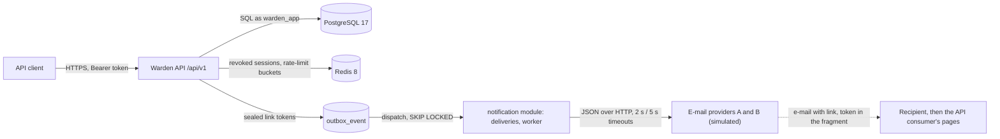

# Threat model

- Version: 3 (milestone M4, `v0.5.0`)
- Date: 2026-11-01
- Scope: authentication and sessions, the `iam` module and the `shared` security kernel (v0); workspaces, roles, invitations, notes and tenant isolation (v1); abuse protection, degraded modes, audit retention and transport security (v2); notifications: outbox dispatch, deliveries, templates, links, e-mail providers and retention purges (v3)
- Method: STRIDE per element; each threat is traced to its misuse case (MUC), requirement and test
- Next revision: milestone M5 (operability and release)

## System under analysis

| Element | Holds | Trust boundary |
|---------|-------|----------------|
| API client | Password, access token (10 min), refresh token (≤ 7 days, session ≤ 30 days) | Untrusted; every request crosses the boundary |
| Public endpoints | `register`, `email/verify`, `login`, `refresh`, `password/forgot`, `password/reset` | Reachable without a token (REQ-SEC-001) |
| `user_account`, `one_time_token`, `auth_session`, `refresh_token` | Argon2id hashes, SHA-256 token hashes, session state | Database; the runtime role owns no table |
| Workspace authorization interceptor | The caller's membership and role, resolved on every request and never cached | Every `/workspaces/{workspaceId}/**` handler; fails closed (404, 403, 503) |
| `workspace`, `workspace_member`, `note`, `invitation` | Tenant data, roles, invitation token hashes | Database; all but `workspace` under forced Row Level Security keyed by transaction-local settings (`app.workspace_id`, `app.user_id`, `app.invitation_token_hash`) |
| `outbox_event` | Event payloads with recipient data and AES-256-GCM sealed link tokens | Database; dispatched by every instance with `SKIP LOCKED`; the sealed token is removed when the event is published, and published events are purged after 7 days (ADR-008) |
| `notification_delivery` | Recipient address, template values, sealed link token until it is no longer needed, delivery state | Database; forced Row Level Security: workers in the system context, ADMINs only through their workspace's context; the runtime role cannot delete rows |
| `notification_template` | Global templates, `es` and `en`, version 1 | Database; read-only for the runtime role; rendered with a placeholder-only renderer (ADR-016) |
| E-mail providers | Rendered messages, links included | External and untrusted for availability (ACT-09); each call carries the delivery id as idempotency key; only reached by the delivery worker, never from a request |
| Link pages of the API consumer | The token, from the URL fragment | Outside Warden; the fragment is never sent to a server (REQ-INT-009) |
| `audit_log` | Security-relevant actions with `traceId` | Database; the runtime role cannot update, delete or truncate |
| Redis | Revoked session ids with a 630 s TTL; rate-limit buckets keyed by policy and HMAC of the subject | Ephemeral; PostgreSQL stays authoritative. When Redis fails, revocation checks fall back to PostgreSQL and rate limits to buckets local to the instance (ADR-007, ADR-014) |
| Management port | Health, readiness and Prometheus metrics | Plain HTTP, never published outside the deployment network |
| Key material and TLS keystore | ES256 signing key, AES-256 key ring, HMAC key, server certificate | Environment variables; never in the repository. The `prod-like` profile refuses to start without them |

## Threats

Status: **Mitigated** (control implemented and tested), **Partial** (part of the control is
implemented; the remainder is named), **Open** (planned in a later phase), **Accepted** (residual
risk recorded).

### Spoofing

| ID | Threat | Control | MUC | Requirement | Test | Status |
|----|--------|---------|-----|-------------|------|--------|
| S-01 | Forged or altered access token: `alg: none`, another algorithm, bad signature, other issuer, missing `sid` or `jti`, expired | Nimbus decoder pinned to ES256 with explicit validators and 30 s skew (ADR-012) | — | REQ-SEC-002, REQ-INT-004 | `AccessTokenAuthenticationIT.forgedOrIncompleteTokensAreRejected` | Mitigated |
| S-02 | Use of a stolen refresh token | Rotation on every use; presenting a used token revokes the whole session (ADR-006) | MUC-02 | REQ-FUNC-011, 012, BR-005 | `RefreshIT`, `RefreshReuseAndExpiryIT` | Mitigated |
| S-03 | Racing a stolen refresh token against its owner to obtain two token families | Conditional `UPDATE … RETURNING`: exactly one winner, the session ends revoked | MUC-02 | REQ-FUNC-013 | `ConcurrentRefreshIT` (50 × 4 concurrent requests) | Mitigated |
| S-04 | Replay of a verification or password reset link | Single use, conditional consumption, expiry (24 h / 30 min), a new link invalidates the previous one | MUC-06 | REQ-FUNC-006, 007, 019, 021, BR-006 | `EmailVerificationIT`, `ResendVerificationIT`, `PasswordResetIT` | Mitigated |
| S-05 | Guessing a link or refresh token | 256-bit random tokens from `SecureRandom`; only their hashes are stored | MUC-02, MUC-06 | REQ-SEC-004 | `SecureTokenGeneratorTest` | Mitigated |
| S-06 | A token from one purpose used for another (verification token on reset) | Consumption filters by purpose; refresh and link tokens have distinct prefixes | MUC-06 | REQ-FUNC-021 | `PasswordResetIT.unknownUsedWrongPurposeAndMalformedTokensGetTheSameResponseAndChangeNothing` | Mitigated |
| S-07 | Brute force and credential stuffing on login | Argon2id slows each guess; after 5 failures in 15 min an e-mail is rejected before Argon2 runs, even with the right password, and an IP gets 20 logins per minute (ADR-014); limits keep holding with local buckets when Redis fails | MUC-03 | REQ-SEC-006, 007, REQ-REL-008 | `IamRateLimitIT`, `RateLimitFallbackIT` | Mitigated |
| S-08 | Accepting an invitation sent to someone else (forwarded or intercepted link) | The caller's e-mail must be verified and equal to the invited one; otherwise 403 without consuming the token, audited as a failure | MUC-06 | REQ-FUNC-036, BR-009 | `AcceptInvitationIT.anotherOrAnUnverifiedAccountGets403AndTheTokenStaysUsable` | Mitigated |
| S-09 | Replay of an invitation link: used, revoked, replaced, expired or of a deleted workspace | Conditional update on a pending, unexpired row under the workspace lock; re-inviting replaces, deleting revokes; every case gets the same 400 | MUC-06 | REQ-FUNC-032, 035, 036, BR-006 | `AcceptInvitationIT.unknownUsedExpiredRevokedReplacedAndDeletedWorkspaceTokensGetTheSameResponse` | Mitigated |
| S-10 | Guessing refresh tokens at volume | 60 refreshes per IP per minute on top of 256-bit tokens | MUC-02 | REQ-SEC-009 | `IamRateLimitIT` | Mitigated |

### Tampering

| ID | Threat | Control | MUC | Requirement | Test | Status |
|----|--------|---------|-----|-------------|------|--------|
| T-01 | Altering a sealed link token, its key id or its expiry in the outbox | AES-256-GCM with key id and expiry as associated data (ADR-011) | MUC-06 | REQ-SEC-005 | `SecretCipherTest` (altered ciphertext, extended expiry, relabelled key) | Mitigated |
| T-02 | Altering or deleting audit records through the application, including a compromised application purging recent history | `UPDATE`, `DELETE` and `TRUNCATE` revoked from the runtime role; the only deletion path is `purge_audit_log(cutoff)`, a `SECURITY DEFINER` function executable only by `warden_app` that never deletes a record younger than 365 days by the database clock | — | REQ-SEC-016 | `AuditLogIT.theApplicationRoleCannotModifyOrDeleteAuditRecords`, `AuditRetentionIT` | Mitigated |
| T-03 | Changing the password of an account without owning its e-mail | Reset requires a single-use token sent to the e-mail; the policy is enforced again | MUC-06 | REQ-FUNC-020, 021 | `PasswordResetIT` | Mitigated |
| T-04 | An invitation holder escalating the invited role, or rewriting another invitation, through SQL | Acceptance runs in a token-holder context (`forInvitationHolder`, a refinement of the `forUser` context of SDD V14): Row Level Security exposes only the row of that token hash and lets it change only to `ACCEPTED`; the runtime role may update only `invitation.status` and cannot delete invitations | MUC-05 | REQ-SEC-012, BR-008 | `InvitationRowLevelSecurityIT`, `TenantTransactionsIT` | Mitigated |
| T-05 | Lost update when two members edit the same note | Optimistic version; a stale edit gets 409 `version-conflict` | — | REQ-FUNC-045 | `ConcurrentNoteEditIT` (50 repetitions) | Mitigated |
| T-06 | Concurrent demotions or removals leaving a workspace without OWNER | Workspace row locked with `SELECT … FOR UPDATE` and owners counted under the lock (SDD V14-A4) | MUC-05 | REQ-FUNC-039, BR-001, BR-011 | `ConcurrentLastOwnerIT` (50 repetitions), `MemberRemovalIT` | Mitigated |
| T-07 | A template, or a value inserted into one such as a workspace name, runs logic, includes other content or exposes values beyond the declared variables | Placeholder-only renderer: one regular expression, declared variables per key, any other `{{ }}` construct rejected, values inserted literally and never re-scanned (ADR-016) | — | REQ-SEC-013 | `PlaceholderRendererTest`, `TemplateResolverIT` (every seeded template validates) | Mitigated |
| T-08 | A link of a revoked, replaced or accepted invitation, or of a deleted workspace, is still delivered | The events cancel the unsent deliveries and drop their tokens; the worker records each result against the state re-read under lock and keeps `CANCELLED`; a dead invitation delivery is retried only while its invitation is pending (ADR-015) | MUC-06 | REQ-FUNC-030, 032, 035, 060, 062 | `DeliveryCancellationIT`, `NotificationCriteriaIT`, `DeliveryWorkerIT`, `WorkspaceDeliveriesIT` | Mitigated (a message already handed to a provider when the cancellation arrives may still be delivered, DRISK-04) |

### Repudiation

| ID | Threat | Control | MUC | Requirement | Test | Status |
|----|--------|---------|-----|-------------|------|--------|
| R-01 | A user or attacker denies a login, logout, session termination, refresh reuse, password reset or a workspace action (creation, role change, removal, leave, invitation, acceptance, deletion) | Audit record with actor, action, outcome and `traceId`; failures recorded even when the transaction rolls back; refused invitation acceptances recorded as failures; records kept 365 days | — | REQ-SEC-015, 016 | `AuditCompletenessIT` (exactly one complete record without secrets for each of the 14 existing actions, dead-letter retries included), `AuditLogIT`, `AuditRetentionIT` | Mitigated for every existing action; template changes have no operation in release 1.0 |

### Information disclosure

| ID | Threat | Control | MUC | Requirement | Test | Status |
|----|--------|---------|-----|-------------|------|--------|
| I-01 | Account enumeration through status codes or bodies of register, login and forgot-password | Identical responses for existing and unknown e-mails | MUC-04 | REQ-FUNC-002, 009, 019, BR-007 | `RegistrationIT`, `LoginIT`, `PasswordResetIT` (`assertIdenticalResponses`) | Mitigated |
| I-02 | Account enumeration through response time | Dummy Argon2 hash on login; 250 ms minimum response time on register and forgot-password (ADR-019) | MUC-04 | REQ-SEC-010 | `ResponseFloorTest`, `ResponseFloorIT` | Partial (statistical analysis and calibration pending) |
| I-03 | A database leak exposes usable tokens or passwords | Argon2id for passwords, SHA-256 for refresh, link and invitation tokens, sealed link tokens in events | MUC-02, MUC-06 | REQ-SEC-003, 004, 005 | `SecretsAtRestIT` (including an invitation flow), `AccountPersistenceIT`, `DeliveryWorkerIT` | Mitigated (sealed tokens are also dropped once no longer needed, I-16) |
| I-04 | Tokens leaked through URLs, proxies or logs of query strings | Access token only in the `Authorization` header, refresh and invitation tokens only in the body | — | REQ-INT-002 | `AccessTokenAuthenticationIT.aTokenInTheQueryStringIsIgnored`, `RefreshIT` | Mitigated |
| I-05 | Error responses reveal stack traces, SQL or class names | Fixed problem-type catalogue; unexpected errors render a generic 500 with `traceId` | — | REQ-SEC-017 | `ProblemDetailsContractIT.anUnexpectedExceptionRevealsNoInternals` | Mitigated |
| I-06 | Secrets written to logs, metrics or audit records | Request records redact secrets and e-mails in `toString`; audit details reject token-like values and never carry e-mails; every structured log value is masked for tokens, JWTs and e-mails; request details are never logged; metric tags take fixed values only (ADR-018) | — | REQ-SEC-014, REQ-OBS-003, REQ-OBS-005 | `AuditEntryTest.rejectsDetailsThatLookLikeTokens`, `SecretCipherTest.neverRevealsTheSecretInTextualForms`, `LogRedactorTest`, `StructuredLogsIT`, `TelemetryScanIT` (FF-09) | Mitigated |
| I-07 | The access token exposes personal or authorization data | Claims limited to `iss`, `sub`, `sid`, `jti`, `iat`, `exp`; roles stay on the server (ADR-003) | — | REQ-INT-004 | `LoginIT.validCredentialsStartASessionAndReturnExactlyTheSpecifiedTokens` | Mitigated |
| I-08 | Reading or modifying another workspace's data through its id, or through a resource id of X under the path of W | Membership resolved on every request; the effective tenant is always the one in the path and every query names it; resources of another workspace answer 404 | MUC-01 | REQ-FUNC-023, 025 | `IsolationSuiteIT`, `NoteCrossWorkspaceIT`, `MemberRoleIT`, `MemberRemovalIT`, `InvitationIT` | Mitigated |
| I-09 | A forgotten application filter or a native query returns rows of another tenant (RISK-009) | Forced Row Level Security on tenant tables keyed by transaction-local settings; with no context no row is visible (ADR-005) | MUC-01 | REQ-SEC-012 | `NoteRowLevelSecurityIT`, `InvitationRowLevelSecurityIT` | Mitigated |
| I-10 | Tenant context leaking to the next transaction on a pooled connection | `set_config(…, true)` scopes settings to the transaction; tenant transactions refuse to run nested (POC-002) | MUC-01 | REQ-SEC-012 | `TenantTransactionsIT`, POC-002 | Mitigated |
| I-11 | Workspace existence revealed to non-members, or a deleted workspace still reachable | Non-member, foreign and deleted workspaces answer exactly like a random id (ADR-004, BR-012) | MUC-01 | REQ-FUNC-023, 026 | `IsolationSuiteIT` (foreign and deleted cases on every endpoint) | Mitigated |
| I-12 | Invitation tokens exposed through the API | Only the SHA-256 is stored; creation and listing responses never contain the token or its hash; it travels only sealed in `workspace.MemberInvited` | MUC-06 | REQ-FUNC-034, REQ-SEC-004, 005 | `InvitationIT` | Mitigated |
| I-13 | A VIEWER reads the e-mail addresses of the other members (RISK-010) | Accepted by design: member listing shows e-mails to every member | — | REQ-FUNC-037 | `WorkspaceMembersIT` | Accepted |
| I-14 | A response leaks a password, a stored hash, a one-time token or a token it did not issue | Responses never carry secrets; a scan of every response of a flow that issues every kind of secret, and of every read endpoint, searches plain values and hashes in hexadecimal and Base64; a gate fails the build when a read endpoint is not scanned (FF-10) | MUC-02, MUC-06 | REQ-SEC-014 | `SecretsInResponsesIT` (the deliveries of the flow are rendered and sent before the reads; the delivery listing is scanned) | Mitigated |
| I-15 | Tokens and passwords intercepted in transit, or a downgrade to plain HTTP | The `prod-like` profile has a TLS-only connector (TLS 1.3 and 1.2), sends `Strict-Transport-Security` for one year with subdomains and does not start without its keystore; the local profile uses HTTP by design (CON-009) | MUC-02 | REQ-SEC-019 | `ProdLikeProfileIT` | Mitigated |
| I-16 | A link token exposed at rest, in the delivery listing, in a server log or in a provider's URL | Sealed with AES-256-GCM until the send; opened only by the worker; placed only in the URL fragment; dropped on `SENT`, on `CANCELLED` and once expired, whatever the state; the listing carries no subject, body, variables or link (ADR-011) | MUC-06 | REQ-SEC-005, 014, REQ-INT-009, REQ-FUNC-059 | `SecretsAtRestIT`, `DeliveryWorkerIT`, `LinkBuilderTest`, `WorkspaceDeliveriesIT` | Mitigated |
| I-17 | Personal data in events and stale credentials kept indefinitely | Published events purged after 7 days, unpublished ones never; single-use tokens purged 7 days after expiry; dead sessions with their refresh tokens after 30 days | — | REQ-FUNC-063 | `OutboxRetentionIT`, `IamRetentionIT` | Mitigated |
| I-18 | An ADMIN lists or retries the deliveries of another workspace, or system-scope deliveries | Both endpoints run in the workspace's tenant context under Row Level Security and are in the isolation registry, so they inherit the foreign and deleted workspace cases and the role matrix; system-scope deliveries have no workspace and are never listed (DEC-004) | MUC-01 | REQ-FUNC-025, 059, 060 | `IsolationSuiteIT`, `RoleMatrixIT`, `WorkspaceDeliveriesIT` | Mitigated |

### Denial of service

| ID | Threat | Control | MUC | Requirement | Test | Status |
|----|--------|---------|-----|-------------|------|--------|
| D-01 | Memory exhaustion through many concurrent Argon2 computations | Fair semaphore of 4 permits around hashing (ADR-010) | MUC-03 | REQ-SEC-003 | `BoundedPasswordHasherTest.neverRunsMoreHashesAtOnceThanAllowed` | Mitigated |
| D-02 | Oversized request bodies | 64 KiB limit before deserialization | — | REQ-SEC-018 | `ApiConventionsIT` | Mitigated |
| D-03 | Redis unavailable makes revocation fail open, or sessions revoked during the outage come back when Redis returns | The first Redis error puts the instance in degraded mode and revocation checks go to PostgreSQL; on recovery the revocations of the last 630 s are rewritten before leaving degraded mode, and healthy instances reconcile every 30 s (ADR-007) | MUC-02 | REQ-REL-007 | `RevocationDegradationIT` (Redis frozen), `RevocationReconcilerTest`, `RedisRevocationStoreTest` | Mitigated |
| D-04 | Using Warden to flood an inbox with verification or reset e-mails | 3 resends per account per hour; 3 reset requests per e-mail and 10 per IP per hour, identical for unknown e-mails (ADR-014) | MUC-07 | REQ-FUNC-007, REQ-SEC-008 | `IamRateLimitIT` | Mitigated |
| D-05 | Using invitations to send spam, including across several workspaces | 50 invitations per workspace and 100 per inviting user per day, spent only by invitations that would be sent | MUC-07 | REQ-FUNC-033 | `InvitationRateLimitIT` | Mitigated |
| D-06 | A Redis outage turns the rate limits off, or blocks the limited endpoints | Buckets local to the instance with the same policies while Redis fails; one retry of Redis every 5 s (ADR-014) | MUC-03 | REQ-REL-008 | `RateLimitFallbackIT` (Redis frozen), `FailoverBucketSourceTest`, `LocalBucketSourceTest` | Mitigated (limit multiplied by the number of instances, RISK-012) |
| D-07 | A PostgreSQL outage hangs every request, or requests are answered without the source of truth | Connections time out after 2 s; failures become 503 `service-unavailable` with `Retry-After: 5` in the controllers, the authorization interceptor and the filter chain; readiness goes DOWN only for PostgreSQL | — | REQ-REL-007, 009, REQ-AVAIL-001 | `DependencyOutageIT` (PostgreSQL and Redis frozen), `DatabaseUnavailableTest`, `ProblemDetailsContractIT` | Mitigated |
| D-08 | A slow or failing e-mail provider blocks requests or the workers | Requests only write the outbox; the worker gives each call 2 s to connect and 5 s to answer, fails over to the other provider in the same attempt and opens a breaker per provider at 50 % failures over 20 calls (ADR-009) | — | REQ-REL-003, 004, 005, REQ-FUNC-055 | `DeliveryResilienceIT` (both providers down), `ProviderFailoverTest`, `HttpEmailProviderTest` | Mitigated |
| D-09 | E-mails lost or duplicated by a crash, a restart or a second instance | Deliveries created in the dispatch transaction with a unique key per event, recipient and channel; `SKIP LOCKED` claims with a 30 s lease; all state in PostgreSQL; the delivery id sent as idempotency key (ADR-008, ADR-015) | — | REQ-REL-001, 002, REQ-AVAIL-003, REQ-FUNC-061 | `TwoInstancesIT` (1,000 events, two instances), `DeliveryResilienceIT`, `OutboxDispatcherIT`, `NotificationFanoutIT` | Mitigated (at-least-once towards the provider) |
| D-10 | A provider that keeps failing makes deliveries retry forever, or the retry endpoint is used to resend at will | 5 attempts with backoff of 1, 2, 4 and 8 s ± 50 %, then `DEAD`; a retry needs an ADMIN, a `DEAD` delivery and, for an invitation, a pending one; every retry is audited | MUC-07 | REQ-FUNC-057, 060, REQ-REL-006, REQ-SEC-015 | `DeliveryWorkerIT`, `BackoffPolicyTest`, `WorkspaceDeliveriesIT`, `AuditCompletenessIT` | Mitigated (retries are not rate limited; each one costs at most 5 attempts) |

### Elevation of privilege

| ID | Threat | Control | MUC | Requirement | Test | Status |
|----|--------|---------|-----|-------------|------|--------|
| E-01 | Calling a protected endpoint without a token | Deny by default; only six public endpoints, matched exactly | — | REQ-SEC-001 | `AuthenticationByDefaultIT` (sweep of every handler mapping) | Mitigated |
| E-02 | A revoked session keeps working until its access token expires | Revocation marked in Redis before the response; checked on every request | MUC-02 | REQ-FUNC-018 | `SessionRevocationIT`, `RefreshReuseAndExpiryIT`, `PasswordResetIT` | Mitigated |
| E-03 | Terminating or inspecting the session of another user | Ownership check; another user's session answers 404 | — | REQ-FUNC-016, 017 | `SessionManagementIT` | Mitigated |
| E-04 | Stale or forged roles in the token | Roles are never in the token; the current membership is read on every request, so a demotion or removal applies on the next request (ADR-003) | MUC-05 | REQ-FUNC-022, BR-004 | `MemberRoleIT.aDemotedAdminIsRejectedOnTheNextRequestWithTheSameToken`, `WorkspaceMembersIT` | Mitigated |
| E-05 | A role below the minimum calling a privileged workspace endpoint | Every workspace handler declares `@RequiresWorkspaceRole` (FF-05); 403 `insufficient-role` | MUC-05 | REQ-FUNC-024 | `RoleMatrixIT` (16 endpoints × 4 roles), `WorkspaceEndpointRulesIT` | Mitigated |
| E-06 | An ADMIN granting OWNER, changing or removing an OWNER, or inviting with OWNER | Authority rules re-checked under the workspace lock; OWNER is not invitable (database `CHECK` too) | MUC-05 | REQ-FUNC-031, 038, 041, BR-002, BR-008 | `MemberRoleIT`, `MemberRemovalIT`, `InvitationIT` | Mitigated |
| E-07 | A new workspace endpoint shipped without isolation coverage | R7: the build fails when a workspace handler is missing from the isolation registry; registered endpoints inherit the foreign and deleted workspace cases and the role matrix | MUC-01 | REQ-MAINT-003 | `WorkspaceEndpointRulesIT`; failing CI shown on PR #18 | Mitigated |
| E-08 | A failing membership lookup, an unknown stored role or an unresolvable workspace grants access | Fail closed: lookup errors give 503 with `Retry-After`, an unknown role or a malformed workspace id answers the same 404 as a non-member and the unknown role is logged | MUC-01 | REQ-SEC-011 | `FailClosedAuthorizationIT` (each fault on every registered endpoint, as an OWNER), `DependencyOutageIT`, `WorkspaceAuthorizationInterceptorTest` | Mitigated |
| E-09 | The notification module reads other modules' data or bypasses Row Level Security | `notification` depends only on `shared` and receives everything through events (FF-02); only its worker package may open a system-context transaction (FF-03) | — | REQ-MAINT-002 | `ArchitectureTest` | Mitigated |

## Residual and accepted risks

| ID | Risk | Decision |
|----|------|----------|
| RISK-008 | A client that retries a refresh with the same token after a timeout loses its session | Accepted and documented in ADR-006: clients must not retry a refresh with the same token |
| RISK-010 | A VIEWER can see the e-mail addresses of the other members | Accepted in the SRS (I-13) |
| RISK-012 | Without Redis, rate limits are per instance, and counts made locally are not copied back when Redis returns, so a subject can get one extra window's budget | Accepted for release 1.0 (REQ-REL-008, ADR-014) |
| DRISK-01 | A Redis write lost on one instance lets a revoked session through the other, healthy instances | Accepted: bounded to 30 s by the periodic reconciliation (ADR-007) |
| — | During a Redis outage the local buckets grow with the distinct subjects of one window; there is no hard cap | Accepted: idle buckets are dropped once a window has passed; the per-IP limits bound one source |
| — | A query on a pooled connection to a PostgreSQL that stops answering without closing the connection waits on the TCP stack | Accepted (ADR-007): Hikari validates connections idle for more than 500 ms; revisited after the load test |
| — | The management port serves health and metrics over plain HTTP | Accepted: it is never published outside the deployment network |
| — | Ephemeral keys in the local profile invalidate tokens and sealed secrets on restart | Accepted for local development only; the `prod-like` profile refuses them (REQ-INST-002) |
| — | The response floor adds at least 250 ms to registration and password reset requests | Accepted (ADR-019); these endpoints are outside the REQ-PERF-001 latency targets or account for the floor |
| — | The token-holder policy trusts the token hash: someone able to read `invitation.token_hash` could act as holder at SQL level | Accepted: that requires database access, which already exposes all tenant data; the API never returns hashes |
| DRISK-04 | A delivery cancelled while its message is being sent may still reach the recipient | Accepted (ADR-015): the result is recorded as `CANCELLED`; the link of a revoked invitation is rejected on use anyway |
| — | A send that outlives its lease, or a crash after the provider accepted, sends the message again with the same idempotency key | Accepted (ADR-015): real providers deduplicate by key; the simulators do not |
| — | Circuit breakers are per instance, so N instances call a failing provider up to N times before every breaker opens | Accepted (ADR-009): small volumes, cheap probes |
| — | Sessions are purged 30 days after they become unusable, a period the SDD marks as to be confirmed | Accepted for release 1.0; revisited with the operators' needs |

## Open items for the next revision

- I-02: REQ-SEC-010 analysis and calibration of the response floor.

- T-07, R-01: workspace template customization and its `TEMPLATE_CHANGED` audit record arrive with release 1.1 (D-01); the renderer's validation already guards them.