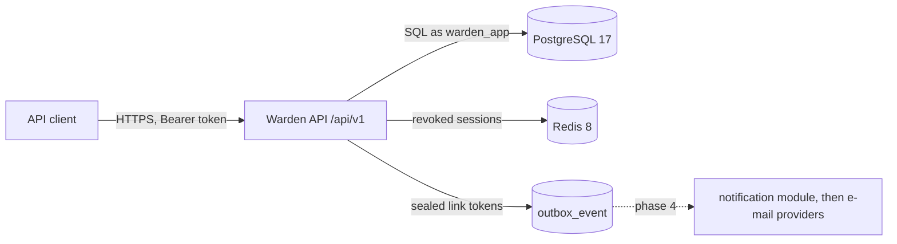

# Threat model

- Version: 0 (milestone M1, `v0.2.0`)
- Date: 2026-10-26
- Scope: authentication and sessions, the `iam` module and the `shared` security kernel
- Method: STRIDE per element; each threat is traced to its misuse case (MUC), requirement and test
- Next revision: milestone M2 (workspaces, roles and tenant isolation)

## System under analysis

| Element | Holds | Trust boundary |
|---------|-------|----------------|
| API client | Password, access token (10 min), refresh token (≤ 7 days, session ≤ 30 days) | Untrusted; every request crosses the boundary |
| Public endpoints | `register`, `email/verify`, `login`, `refresh`, `password/forgot`, `password/reset` | Reachable without a token (REQ-SEC-001) |
| `user_account`, `one_time_token`, `auth_session`, `refresh_token` | Argon2id hashes, SHA-256 token hashes, session state | Database; the runtime role owns no table |
| `outbox_event` | Event payloads with recipient data and AES-256-GCM sealed link tokens | Database; read by the notification module in phase 4 |
| `audit_log` | Security-relevant actions with `traceId` | Database; the runtime role cannot update, delete or truncate |
| Redis | Revoked session ids with a 630 s TTL | Ephemeral; PostgreSQL stays authoritative |
| Key material | ES256 signing key, AES-256 key ring, HMAC key | Environment variables; never in the repository |

## Threats

Status: **Mitigated** (control implemented and tested), **Partial** (part of the control is
implemented; the remainder is named), **Open** (planned in a later phase), **Accepted** (residual
risk recorded).

### Spoofing

| ID | Threat | Control | MUC | Requirement | Test | Status |
|----|--------|---------|-----|-------------|------|--------|
| S-01 | Forged or altered access token: `alg: none`, another algorithm, bad signature, other issuer, missing `sid` or `jti`, expired | Nimbus decoder pinned to ES256 with explicit validators and 30 s skew (ADR-012) | — | REQ-SEC-002, REQ-INT-004 | `AccessTokenAuthenticationIT.forgedOrIncompleteTokensAreRejected` | Mitigated |
| S-02 | Use of a stolen refresh token | Rotation on every use; presenting a used token revokes the whole session (ADR-006) | MUC-02 | REQ-FUNC-011, 012, BR-005 | `RefreshIT`, `RefreshReuseAndExpiryIT` | Mitigated |
| S-03 | Racing a stolen refresh token against its owner to obtain two token families | Conditional `UPDATE … RETURNING`: exactly one winner, the session ends revoked | MUC-02 | REQ-FUNC-013 | `ConcurrentRefreshIT` (50 × 4 concurrent requests) | Mitigated |
| S-04 | Replay of a verification or password reset link | Single use, conditional consumption, expiry (24 h / 30 min), a new link invalidates the previous one | MUC-06 | REQ-FUNC-006, 007, 019, 021, BR-006 | `EmailVerificationIT`, `ResendVerificationIT`, `PasswordResetIT` | Mitigated |
| S-05 | Guessing a link or refresh token | 256-bit random tokens from `SecureRandom`; only their hashes are stored | MUC-02, MUC-06 | REQ-SEC-004 | `SecureTokenGeneratorTest` | Mitigated |
| S-06 | A token from one purpose used for another (verification token on reset) | Consumption filters by purpose; refresh and link tokens have distinct prefixes | MUC-06 | REQ-FUNC-021 | `PasswordResetIT.unknownUsedWrongPurposeAndMalformedTokensGetTheSameResponseAndChangeNothing` | Mitigated |
| S-07 | Brute force and credential stuffing on login | Argon2id slows each guess; per-account and per-IP limits | MUC-03 | REQ-SEC-006, 007 | — | Open (rate limiting, phase 3) |

### Tampering

| ID | Threat | Control | MUC | Requirement | Test | Status |
|----|--------|---------|-----|-------------|------|--------|
| T-01 | Altering a sealed link token, its key id or its expiry in the outbox | AES-256-GCM with key id and expiry as associated data (ADR-011) | MUC-06 | REQ-SEC-005 | `SecretCipherTest` (altered ciphertext, extended expiry, relabelled key) | Mitigated |
| T-02 | Altering or deleting audit records through the application | `UPDATE`, `DELETE` and `TRUNCATE` revoked from the runtime role | — | REQ-SEC-016 | `AuditLogIT.theApplicationRoleCannotModifyOrDeleteAuditRecords` | Mitigated |
| T-03 | Changing the password of an account without owning its e-mail | Reset requires a single-use token sent to the e-mail; the policy is enforced again | MUC-06 | REQ-FUNC-020, 021 | `PasswordResetIT` | Mitigated |

### Repudiation

| ID | Threat | Control | MUC | Requirement | Test | Status |
|----|--------|---------|-----|-------------|------|--------|
| R-01 | A user or attacker denies a login, logout, session termination, refresh reuse or password reset | Audit record with actor, action, outcome and `traceId`; failures recorded even when the transaction rolls back | — | REQ-SEC-015 | `AuditLogIT`, `SessionManagementIT`, `RefreshReuseAndExpiryIT`, `PasswordResetIT` | Partial (workspace actions in phase 2) |

### Information disclosure

| ID | Threat | Control | MUC | Requirement | Test | Status |
|----|--------|---------|-----|-------------|------|--------|
| I-01 | Account enumeration through status codes or bodies of register, login and forgot-password | Identical responses for existing and unknown e-mails | MUC-04 | REQ-FUNC-002, 009, 019, BR-007 | `RegistrationIT`, `LoginIT`, `PasswordResetIT` (`assertIdenticalResponses`) | Mitigated |
| I-02 | Account enumeration through response time | Dummy Argon2 hash on login; 250 ms minimum response time on register and forgot-password (ADR-019) | MUC-04 | REQ-SEC-010 | `ResponseFloorTest`, `ResponseFloorIT` | Partial (statistical analysis and calibration pending) |
| I-03 | A database leak exposes usable tokens or passwords | Argon2id for passwords, SHA-256 for tokens, sealed link tokens in events | MUC-02, MUC-06 | REQ-SEC-003, 004, 005 | `SecretsAtRestIT`, `AccountPersistenceIT` | Mitigated for storage; deletion of sealed tokens after delivery in phase 4 |
| I-04 | Tokens leaked through URLs, proxies or logs of query strings | Access token only in the `Authorization` header, refresh token only in the body | — | REQ-INT-002 | `AccessTokenAuthenticationIT.aTokenInTheQueryStringIsIgnored`, `RefreshIT` | Mitigated |
| I-05 | Error responses reveal stack traces, SQL or class names | Fixed problem-type catalogue; unexpected errors render a generic 500 with `traceId` | — | REQ-SEC-017 | `ProblemDetailsContractIT.anUnexpectedExceptionRevealsNoInternals` | Mitigated |
| I-06 | Secrets written to logs or audit records | Request records redact secrets in `toString`; audit details reject token-like values | — | REQ-SEC-014, REQ-OBS-005 | `AuditEntryTest.rejectsDetailsThatLookLikeTokens`, `SecretCipherTest.neverRevealsTheSecretInTextualForms` | Partial (log scan in phase 5) |
| I-07 | The access token exposes personal or authorization data | Claims limited to `iss`, `sub`, `sid`, `jti`, `iat`, `exp`; roles stay on the server (ADR-003) | — | REQ-INT-004 | `LoginIT.validCredentialsStartASessionAndReturnExactlyTheSpecifiedTokens` | Mitigated |

### Denial of service

| ID | Threat | Control | MUC | Requirement | Test | Status |
|----|--------|---------|-----|-------------|------|--------|
| D-01 | Memory exhaustion through many concurrent Argon2 computations | Fair semaphore of 4 permits around hashing (ADR-010) | MUC-03 | REQ-SEC-003 | `BoundedPasswordHasherTest.neverRunsMoreHashesAtOnceThanAllowed` | Mitigated |
| D-02 | Oversized request bodies | 64 KiB limit before deserialization | — | REQ-SEC-018 | `ApiConventionsIT` | Mitigated |
| D-03 | Redis unavailable makes revocation fail open | The validator falls back to PostgreSQL when Redis cannot answer | — | REQ-REL-007 | `RevocationFallbackIT` | Partial (503 when both stores fail and reconciliation, phase 3) |
| D-04 | Using Warden to flood an inbox with verification or reset e-mails | Per-account and per-e-mail limits on resend and forgot-password | MUC-07 | REQ-FUNC-007, REQ-SEC-008 | — | Open (rate limiting, phase 3) |

### Elevation of privilege

| ID | Threat | Control | MUC | Requirement | Test | Status |
|----|--------|---------|-----|-------------|------|--------|
| E-01 | Calling a protected endpoint without a token | Deny by default; only six public endpoints, matched exactly | — | REQ-SEC-001 | `AuthenticationByDefaultIT` (sweep of every handler mapping) | Mitigated |
| E-02 | A revoked session keeps working until its access token expires | Revocation marked in Redis before the response; checked on every request | MUC-02 | REQ-FUNC-018 | `SessionRevocationIT`, `RefreshReuseAndExpiryIT`, `PasswordResetIT` | Mitigated |
| E-03 | Terminating or inspecting the session of another user | Ownership check; another user's session answers 404 | — | REQ-FUNC-016, 017 | `SessionManagementIT` | Mitigated |
| E-04 | Stale or forged roles in the token | Roles are never in the token; resolved per request (ADR-003) | MUC-05 | REQ-FUNC-022 | — | Open (phase 2) |

## Residual and accepted risks

| ID | Risk | Decision |
|----|------|----------|
| RISK-008 | A client that retries a refresh with the same token after a timeout loses its session | Accepted and documented in ADR-006: clients must not retry a refresh with the same token |
| RISK-012 | Without Redis, rate limits are per instance | Accepted for release 1.0 (REQ-REL-008); applies from phase 3 |
| — | Ephemeral keys in the local profile invalidate tokens and sealed secrets on restart | Accepted for local development only; the `prod-like` profile refuses them (REQ-INST-002) |
| — | The response floor adds at least 250 ms to registration and password reset requests | Accepted (ADR-019); these endpoints are outside the REQ-PERF-001 latency targets or account for the floor |

## Open items for the next revision

- S-07 and D-04: rate limiting (phase 3).
- I-02: REQ-SEC-010 analysis and calibration of the response floor.
- D-03: behaviour when both Redis and PostgreSQL are unavailable, and denylist reconciliation.
- E-04 and tenant isolation (MUC-01, MUC-05, RISK-009, RISK-010): milestone M2.